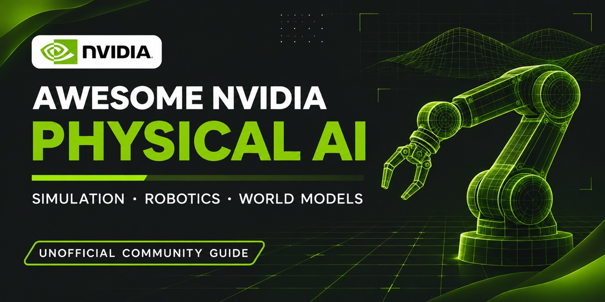
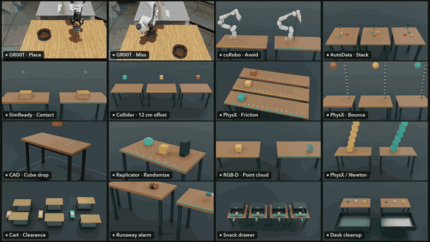
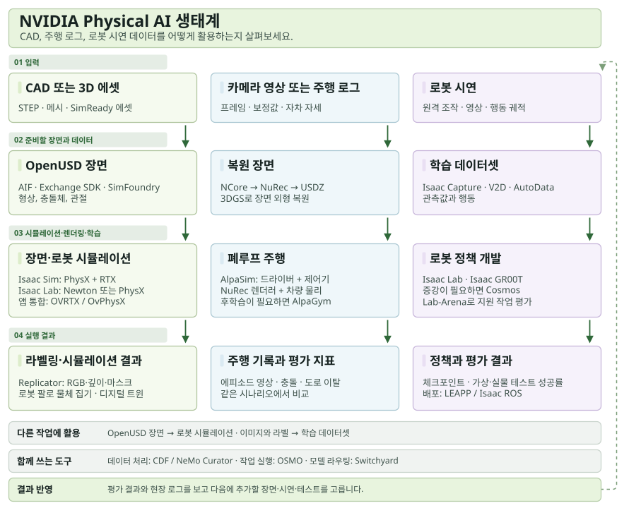

<div align="center">

# Awesome NVIDIA Physical AI

[English](README.md) · **한국어**



**개발자를 위한 무료 NVIDIA 피지컬 AI 실습.**

로봇 제어, 물리 엔진, 월드 모델, 자율주행을 실제 실험으로 배웁니다. 어떤 데이터가 오가는지 확인하고, 공개된 코드와 USD 장면으로 직접 실행해 보세요.

[로봇 학습·제어](https://james-joobs.github.io/awesome-nvidia-physical-ai/ko/topics/robotics/) · [물리 엔진](https://james-joobs.github.io/awesome-nvidia-physical-ai/ko/topics/simulation/) · [3D 세계·월드 모델](https://james-joobs.github.io/awesome-nvidia-physical-ai/ko/topics/world-models/) · [자율주행](https://james-joobs.github.io/awesome-nvidia-physical-ai/ko/topics/autonomous-driving/)

[🧪 **첫 실습**](https://james-joobs.github.io/awesome-nvidia-physical-ai/ko/labs/gr00t-placement/#first-exercise) · [📖 **학습 경로**](https://james-joobs.github.io/awesome-nvidia-physical-ai/ko/#workflows) · [**동작 원리**](https://james-joobs.github.io/awesome-nvidia-physical-ai/ko/learn/principles/) · [🎬 **분야별 갤러리**](https://james-joobs.github.io/awesome-nvidia-physical-ai/ko/topics/)

[GitHub Pages](https://james-joobs.github.io/awesome-nvidia-physical-ai/ko/) · [사이트 둘러보기 영상](https://james-joobs.github.io/awesome-nvidia-physical-ai/ko/tour/) · [실습 코드](labs/README.ko.md) · [도구 카탈로그](CATALOG.ko.md)

</div>

## Isaac Sim으로 찍은 16개 장면

[](https://james-joobs.github.io/awesome-nvidia-physical-ai/ko/showcase/)

`Isaac Sim` · `PhysX` · `GR00T` · `Replicator` · `cuRobo` · `AutoData`

[전체 영상 보기](https://james-joobs.github.io/awesome-nvidia-physical-ai/ko/showcase/) · [실습 흐름 직접 체험하기](https://james-joobs.github.io/awesome-nvidia-physical-ai/ko/#repo-tour)

## 동작 원리부터 실습까지

[동작 원리 가이드](https://james-joobs.github.io/awesome-nvidia-physical-ai/ko/learn/principles/)에서 그림과 데이터 예시를 볼 수 있습니다. 분야 이름을 누르면 전체 읽는 순서와 이어서 할 실습이 나옵니다.

- **[환경 설정](https://james-joobs.github.io/awesome-nvidia-physical-ai/ko/learn/principles/#setup)** — NVIDIA Linux → Isaac Sim GUI·CLI를 읽고 [USD 장면을 열어 재생합니다](https://james-joobs.github.io/awesome-nvidia-physical-ai/ko/workflows/isaac-sim-first-cube/#open-the-scene).
- **[물리·시뮬레이션](https://james-joobs.github.io/awesome-nvidia-physical-ai/ko/learn/principles/#simulation)** — Isaac Sim과 큐브 낙하 → PhysX·SimReady → Newton·Warp 순으로 읽고 [충돌체·마찰·반발을 비교합니다](https://james-joobs.github.io/awesome-nvidia-physical-ai/ko/labs/physics/#run).
- **[3D 에셋·합성 데이터](https://james-joobs.github.io/awesome-nvidia-physical-ai/ko/learn/principles/#synthetic-data)** — OpenUSD와 CAD → Replicator → RGB-D 복원을 읽고 [GPU 없이 저장된 카메라 데이터를 검사합니다](https://james-joobs.github.io/awesome-nvidia-physical-ai/ko/labs/workbench-capstone/#check-recording).
- **[로봇 학습·제어](https://james-joobs.github.io/awesome-nvidia-physical-ai/ko/learn/principles/#robotics)** — Isaac Lab·Arena → GR00T → 경로 계획과 시연·학습 흐름을 읽고 [GR00T 집기·놓기를 브라우저에서 판정합니다](https://james-joobs.github.io/awesome-nvidia-physical-ai/ko/labs/gr00t-placement/#first-exercise).
- **[자율주행](https://james-joobs.github.io/awesome-nvidia-physical-ai/ko/learn/principles/#autonomous-driving)** — [CARLA 운전자 카메라](https://james-joobs.github.io/awesome-nvidia-physical-ai/ko/labs/carla-ego/) → Alpamayo 출력 → AlpaSim → AlpaGym·Cosmos RL. 네 도로 환경의 실제 촬영부터 시작합니다.
- **[3D 세계·렌더링](https://james-joobs.github.io/awesome-nvidia-physical-ai/ko/learn/principles/#world-models)** — [WorldGen 글·이미지 3D 생성](https://james-joobs.github.io/awesome-nvidia-physical-ai/ko/labs/worldgen-scenes/) → [생성한 공간에서 로봇 주행](https://james-joobs.github.io/awesome-nvidia-physical-ai/ko/labs/worldgen-isaac/) → [센서로 장애물 우회](https://james-joobs.github.io/awesome-nvidia-physical-ai/ko/labs/worldgen-navigation/) → [움직이는 장애물에 대응](https://james-joobs.github.io/awesome-nvidia-physical-ai/ko/labs/worldgen-dynamic-navigation/) → [fVDB 3DGS 광장 탐색](https://james-joobs.github.io/awesome-nvidia-physical-ai/ko/labs/spatial-reconstruction/) → [가구가 있는 집 생성](https://james-joobs.github.io/awesome-nvidia-physical-ai/ko/labs/scene-generation/). [Marble·Lyra·복원 도구](https://james-joobs.github.io/awesome-nvidia-physical-ai/ko/tools/spatial-worlds/)와 비교하며 Cosmos 영상 생성은 별도 출력으로 살펴봅니다.

## 터미널에서 시작하기

Python으로 GR00T의 실행 결과를 확인할 수 있습니다. 저장된 Arena 기록을 읽어 큐브를 들어 올린 시점과 그릇에 놓았는지를 출력합니다. 기록을 확인하는 데 GPU와 Isaac Sim은 필요 없습니다.

```sh
git clone https://github.com/james-joobs/awesome-nvidia-physical-ai.git
cd awesome-nvidia-physical-ai
python3 labs/gr00t-placement/check_result.py labs/gr00t-placement/recorded-24s.jsonl
```

세 시도 모두 `placed no`가 나옵니다. 같은 코드로 [두 번째 기록](labs/gr00t-placement/recorded-70s.jsonl)을 읽어 비교해 보세요. [실습 가이드](docs/ko/labs/gr00t-placement.md)

## 만들고 싶은 것부터 시작하세요

**GPU 환경이 처음이라면** [NVIDIA Linux 환경 준비](docs/ko/onboarding/nvidia-linux.md) · [Isaac Sim GUI·CLI 시작하기](docs/ko/onboarding/isaac-sim-tools.md) · [작업대 완주 과제와 GPU 없는 결과 검사](docs/ko/labs/workbench-capstone.md)

| 목표 | 시작할 가이드 | 먼저 확인할 내용 |
| --- | --- | --- |
| **시뮬레이션 기초 익히기** | [Isaac Sim에서 큐브 떨어뜨리기](docs/ko/workflows/isaac-sim-first-cube.md) | 충돌체를 켰을 때와 껐을 때 큐브가 어떻게 움직이는지 비교합니다. |
| **CAD로 시뮬레이션 장면 만들기** | [작업대 CAD → OpenUSD → Isaac Sim](docs/ko/workflows/workbench-cad-to-isaac-sim.md) | 상판 치수가 맞는지, 큐브가 상판 위에 멈추는지 확인합니다. |
| **가상 카메라로 라벨이 붙은 데이터 만들기** | [SimReady](docs/ko/simready.md) → [Isaac Sim](docs/ko/isaac-sim.md) → [Replicator](docs/ko/replicator.md) | 같은 프레임의 RGB, 깊이값, 분할 마스크를 저장합니다. |
| **자율주행 정책 평가하기** | [AlpaSim 폐루프 평가 실습](docs/ko/workflows/alpasim-closed-loop.md) | 주행 영상과 충돌·도로 이탈 지표를 확인합니다. |
| **로봇 정책 테스트하기** | [로봇 파운데이션 모델 고르고 평가하기](docs/ko/robot-foundation-models.md) | 로봇이나 벤치마크에 맞는 체크포인트를 골라 비교 기준이 될 실행 기록을 남깁니다. |

**시뮬레이션에서 실물 로봇까지.** [Microduck 가이드](docs/ko/microduck.md)에서 Isaac Lab과 Newton으로 보행 정책을 학습시키는 과정을 볼 수 있습니다. [브라우저에서 조종해 보기](https://huggingface.co/spaces/pollen-robotics/microduck-simulator).

## 생태계 한눈에 보기

CAD로 만든 작업대 장면은 시뮬레이션과 라벨링된 카메라 데이터 생성에 쓸 수 있습니다. 주행 로그가 있다면 자율주행 정책을 평가하고, 로봇 시연이 있다면 정책을 학습하는 흐름도 지도에서 볼 수 있습니다.



## 분야별 자료 찾아보기

<a name="1-오픈소스-코드가-확인된-프로젝트"></a>
<a name="데이터와-시뮬레이션-자산"></a>
<a name="nemo와-물리-ai-도구"></a>
<a name="최근-업스트림-릴리스"></a>
<a name="2-플랫폼모델제품표준-및-제한적-공개-항목"></a>
<a name="3-대화에서-함께-언급된-외부-모델도구"></a>
<a name="4-연결-관계와-명칭-정리"></a>
<a name="로봇-파운데이션-모델과-vla"></a>

| 분야 | 대표 가이드 | 카탈로그 |
| --- | --- | --- |
| **물리·3D·시뮬레이션** | [OpenUSD](docs/ko/openusd.md) · [Isaac Sim](docs/ko/isaac-sim.md) · [Newton](docs/ko/newton.md) | [시뮬레이션 도구](CATALOG.ko.md#물리-3d-및-시뮬레이션) |
| **로봇 학습·제어** | [Isaac Capture](docs/ko/isaac-capture.md) · [Isaac Lab](docs/ko/isaac-lab.md) | [로봇 도구](CATALOG.ko.md#로봇-학습-수집-및-제어) |
| **데이터·시뮬레이션 에셋** | [SimReady](docs/ko/simready.md) · [Video to Data](docs/ko/video-to-data.md) · [AutoData](docs/ko/autodata.md) | [데이터셋과 에셋](CATALOG.ko.md#데이터와-시뮬레이션-자산) |
| **로봇 파운데이션 모델** | [GR00T](docs/ko/groot-model.md) · [Physical Intelligence π](docs/ko/physical-intelligence-pi.md) | [로봇 모델과 VLA](CATALOG.ko.md#로봇-파운데이션-모델과-vla) |
| **자율주행** | [NuRec](docs/ko/nurec.md) · [Alpamayo](docs/ko/alpamayo.md) · [AlpaSim](docs/ko/alpasim.md) | [자율주행 도구](CATALOG.ko.md#자율주행) |
| **월드 모델·NeMo** | [Cosmos](docs/ko/cosmos.md) · [NeMo Curator](docs/ko/nemo-curator.md) · [NeMo Switchyard](docs/ko/nemo-switchyard.md) | [NeMo와 피지컬 AI 도구](CATALOG.ko.md#nemo와-물리-ai-도구) |

카탈로그에서 공식 자료, 라이선스, 공개 범위를 확인할 수 있습니다. 오픈소스 목록에는 각 저장소의 최근 커밋 날짜도 표시합니다.

[📚 전체 Markdown 카탈로그](CATALOG.ko.md) · [🔎 Pages에서 검색·필터](https://james-joobs.github.io/awesome-nvidia-physical-ai/ko/catalog/) · [📰 주요 도구 업데이트](CATALOG.ko.md#최근-업스트림-릴리스)

[🤝 기여 방법](CONTRIBUTING.md#기여-방법) · [📄 MIT 라이선스](LICENSE) · [🖼️ 외부 자료 출처](NOTICE.md) · [🏷️ 저장소 최신 릴리스](https://github.com/james-joobs/awesome-nvidia-physical-ai/releases/latest)
