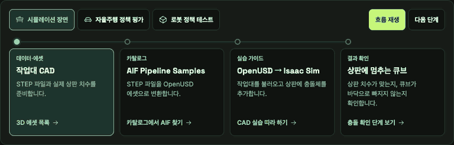

# Awesome NVIDIA Physical AI

[English](README.md) · **한국어**

NVIDIA 피지컬 AI 도구가 너무 많아 어디서 시작할지 막막할 때 참고할 수 있는 가이드입니다. 로봇 시뮬레이션, 데이터 제작, 자율주행 등 목표별로 도구를 고르고 첫 실습을 따라 해 보세요.

**[🌐 사이트 열기](https://james-joobs.github.io/awesome-nvidia-physical-ai/ko/)**

**[🔎 카탈로그 검색](https://james-joobs.github.io/awesome-nvidia-physical-ai/ko/catalog/)** · [🗺️ 생태계 지도](https://james-joobs.github.io/awesome-nvidia-physical-ai/ko/#ecosystem) · [🤖 로봇 파운데이션 모델](https://james-joobs.github.io/awesome-nvidia-physical-ai/ko/#models)

## 만들고 싶은 것부터 시작하세요

| 실습 | 실습에서 확인할 내용 |
| --- | --- |
| **[🧊 Isaac Sim에서 큐브 떨어뜨리기](https://james-joobs.github.io/awesome-nvidia-physical-ai/ko/workflows/isaac-sim-first-cube/)** | 충돌체를 켰을 때와 껐을 때 큐브가 어떻게 움직이는지 비교합니다. |
| **[📐 작업대 CAD를 Isaac Sim으로 가져오기](https://james-joobs.github.io/awesome-nvidia-physical-ai/ko/workflows/workbench-cad-to-isaac-sim/)** | STEP 파일을 OpenUSD로 변환한 뒤, 작업대 치수가 맞는지, 큐브가 상판을 통과하지 않는지 확인합니다. |
| **[🚗 AlpaSim으로 자율주행 정책 평가하기](https://james-joobs.github.io/awesome-nvidia-physical-ai/ko/workflows/alpasim-closed-loop/)** | 폐루프 시뮬레이션에서 충돌과 도로 이탈 여부를 확인합니다. |

## 분야별 자료 찾아보기

| 자료 | 주요 내용 |
| --- | --- |
| [🧰 물리·3D·시뮬레이션 도구](https://james-joobs.github.io/awesome-nvidia-physical-ai/ko/catalog/?field=simulation) | 물리 엔진, 3D 장면 제작, 센서 시뮬레이션 도구를 분야·라이선스별로 찾을 수 있습니다. |
| [📦 데이터와 시뮬레이션 자산](CATALOG.ko.md#데이터와-시뮬레이션-자산) | SimReady 에셋, 라벨링된 영상, 주행 로그, 로봇 시연 데이터 |
| [🧠 NeMo 도구](https://james-joobs.github.io/awesome-nvidia-physical-ai/ko/catalog/?field=nemo) | 데이터 처리, 모델 학습과 평가, 추론 서비스에 쓰는 도구 |
| [📰 주요 도구 업데이트](CATALOG.ko.md#최근-업스트림-릴리스) | Isaac Sim, Isaac Lab, Alpamayo 등의 버전별 변경 사항 |

[📚 전체 Markdown 카탈로그](CATALOG.ko.md) · [🏷️ 저장소 최신 릴리스](https://github.com/james-joobs/awesome-nvidia-physical-ai/releases/latest)

[🤝 기여 방법](CONTRIBUTING.md#기여-방법) · [📄 MIT 라이선스](LICENSE) · [🖼️ 외부 자료 출처](NOTICE.md)
