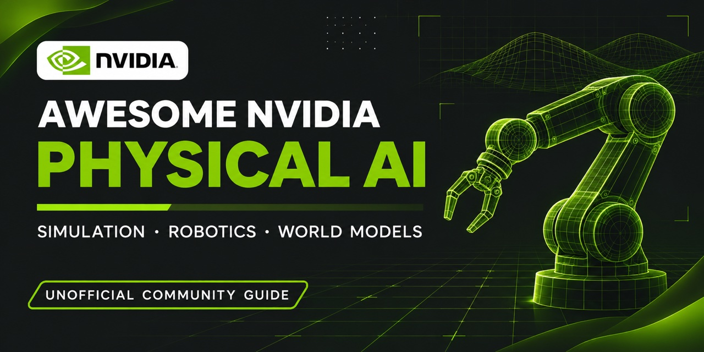
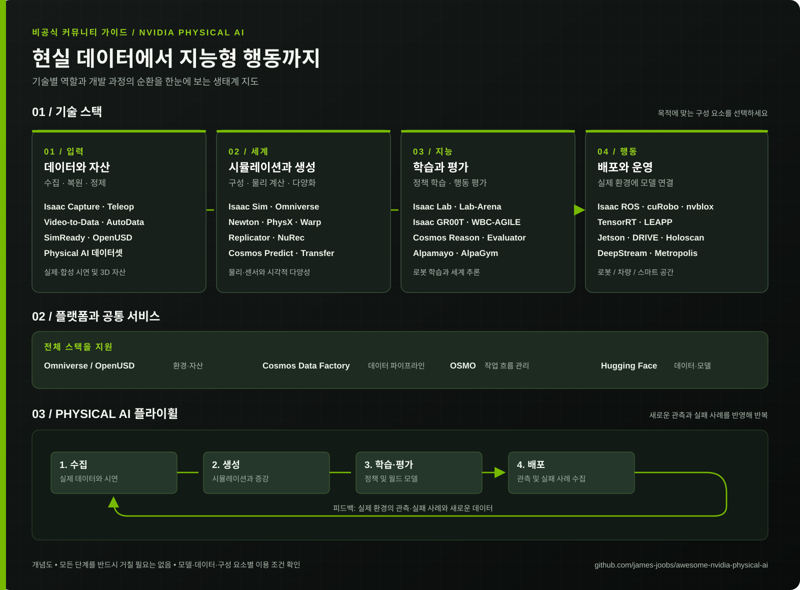

# Awesome NVIDIA Physical AI

### [🇺🇸 Read in English](README.md) · 🇰🇷 한국어

**물리 AI를 위한 시뮬레이션, 데이터, 로봇 학습 생태계 안내서**

[생태계 지도](#생태계-한눈에-보기) · [오픈소스 프로젝트](#1-오픈소스-코드가-확인된-프로젝트) · [데이터와 자산](#데이터와-시뮬레이션-자산) · [플랫폼과 모델](#2-플랫폼모델제품표준-및-제한적-공개-항목) · [외부 도구](#3-대화에서-함께-언급된-외부-모델도구) · [연결 관계](#4-연결-관계와-명칭-정리)

---

확인일: 2026-11-09. 연결된 대화에서 언급된 프로젝트와 추가 조사한 시뮬레이션 자산·데이터셋을 정리했다. NVIDIA 외부 프로젝트도 관련된 경우 포함했다. 공식 저장소와 문서를 기준으로 했으며, 링크에 접속할 수 있다는 사실은 모든 코드·모델·데이터가 같은 조건으로 이용 가능하다는 의미가 아니다.

**분류 기준:** 아래 첫 표는 공개 코드에 대해 오픈소스 라이선스가 확인된 프로젝트다. 코드의 라이선스는 모델 가중치, 데이터, 바이너리, 클라우드 서비스 및 의존성에 자동으로 적용되지 않는다. 표의 라이선스는 지정한 저장소의 기본적인 코드 조건이며, 개별 파일과 버전은 직접 확인해야 한다. 두 번째 표는 플랫폼·모델·제품·표준, 제한적 공개 코드, 또는 라이선스가 불명확한 항목이다. NVIDIA 고유 모델도 소스가 공개되었다는 이유만으로 오픈소스로 분류하지 않았다.

> 이미지는 공식 프로젝트 저장소와 데이터셋 카드에서 가져왔습니다. 움직이는 예시는 로딩에 시간이 걸릴 수 있으며, 일부 미리보기는 실행 화면이 아닌 구성도입니다. 썸네일을 누르면 공식 프로젝트로 이동합니다.

## 생태계 한눈에 보기

데이터 수집과 자산 구성부터 시뮬레이션, 학습·평가, 실제 배포까지의 개념적 관계를 보여줍니다. 배포 후 관측과 실패 사례는 다시 데이터 수집으로 이어집니다. 모든 도구나 단계가 필수인 것은 아닙니다.

[다이어그램 원본 보기](assets/physical-ai-landscape.ko.svg) · [English diagram](assets/physical-ai-landscape.svg)

## 1. 오픈소스 코드가 확인된 프로젝트

### 물리, 3D 및 시뮬레이션

| 이름 | 미리보기 | 역할 | 공개 코드 라이선스 및 유의점 | 공식 소스 |
|---|---|---|---|---|
| **Newton** |  | Warp 기반 GPU 물리 엔진과 로봇 시뮬레이션 솔버 | Apache-2.0 | [저장소](https://github.com/newton-physics/newton) |
| **NVIDIA Warp** |  | GPU 가속 물리·기하 계산용 Python 프레임워크 | Apache-2.0 | [저장소](https://github.com/NVIDIA/warp) |
| **NVIDIA PhysX** | — | 강체·충돌 등 물리 시뮬레이션 엔진 | BSD-3-Clause; 일부 추가 구성 요소는 별도 조건 확인 | [저장소](https://github.com/NVIDIA-Omniverse/PhysX) |
| **MuJoCo Warp (MJWarp)** |  | MuJoCo 물리 계산의 Warp 기반 가속 구현 | Apache-2.0; Google DeepMind 프로젝트 | [저장소](https://github.com/google-deepmind/mujoco_warp) |
| **OpenUSD** | — | 3D 장면과 자산 교환·구성을 위한 프레임워크 | 수정 BSD 계열; 표준 및 상표와 구현은 구분 | [저장소](https://github.com/PixarAnimationStudios/OpenUSD) |
| **Isaac Sim** |  | 로봇·센서·환경 시뮬레이션 참조 애플리케이션 | 저장소 코드 Apache-2.0; 전체 배포물·의존성은 별도 NVIDIA 약관이 적용될 수 있음 | [저장소](https://github.com/isaac-sim/IsaacSim) |
| **PhysicsNeMo** |  | 물리 기반 AI 및 대리 모델 학습 프레임워크 | Apache-2.0 | [저장소](https://github.com/NVIDIA/physicsnemo) |

### 로봇 학습, 수집 및 제어

| 이름 | 미리보기 | 역할 | 공개 코드 라이선스 및 유의점 | 공식 소스 |
|---|---|---|---|---|
| **Isaac Lab** |  | 강화·모방학습 및 로봇 학습 환경 | BSD-3-Clause; 선택한 백엔드와 의존성은 별도 조건 | [저장소](https://github.com/isaac-sim/IsaacLab) |
| **Isaac Lab-Arena** |  | 조합 가능한 로봇 작업 환경과 정책 평가 | Apache-2.0; Isaac Sim 등 의존성 별도 | [저장소](https://github.com/isaac-sim/IsaacLab-Arena) |
| **Isaac Capture (이전 Isaac Teleop 포함)** |  | 원격 조작 및 1인칭 데이터 수집·기록·리타기팅 | 기본 Apache-2.0; EgoPost는 OpenMDW-1.1, CloudXR과 일부 선택 패키지는 별도 독점 조건 | [저장소](https://github.com/NVIDIA/IsaacCapture) |
| **AutoData** |  | 소수의 시연을 다양한 작업 조건의 궤적으로 확장 | Apache-2.0; Isaac Sim 및 특정 cuRobo 구성 요소 별도 조건 | [저장소](https://github.com/isaac-sim/AutoData) |
| **Video-to-Data (V2D)** |  | 영상의 장면·동작을 복원하고 로봇 학습에 연결하는 파이프라인 | 소스 Apache-2.0, 문서·스킬 CC-BY-4.0; 의존 모델 별도 | [저장소](https://github.com/nvidia-isaac/video_to_data) |
| **Isaac GR00T 코드** |  | GR00T 로봇 정책의 학습·추론·배포 코드 | 코드 Apache-2.0; 모델과 가중치는 별도 조건 | [저장소](https://github.com/NVIDIA/Isaac-GR00T) |
| **cuRobo** |  | GPU 기반 로봇 역기구학·동작계획 | 저장소 Apache-2.0; AutoData 배포의 특정 구성 요소는 별도 약관 확인 | [저장소](https://github.com/NVlabs/curobo) |
| **LeRobot** |  | 로봇 데이터셋과 모델 학습 도구; Capture와 연동 가능 | Apache-2.0; Hugging Face 프로젝트 | [저장소](https://github.com/huggingface/lerobot) |
| **Isaac ROS** | — | ROS 2 기반 GPU 가속 로봇 패키지 모음 | 패키지별 조건 상이; 공통 저장소와 배포물의 개별 라이선스 확인 | [공식 문서](https://nvidia-isaac-ros.github.io/) · [공통 코드](https://github.com/NVIDIA-ISAAC-ROS/isaac_ros_common) |
| **Isaac ROS Visual SLAM** |  | ROS 2 기반 시각 주행거리 추정·SLAM 연동 | Apache-2.0; cuVSLAM은 별도 약관 | [저장소](https://github.com/NVIDIA-ISAAC-ROS/isaac_ros_visual_slam) |
| **Isaac ROS Nvblox** | — | ROS 2 3D 지도 및 Nav2 장애물 비용 지도 | Apache-2.0; 의존성 별도 | [저장소](https://github.com/NVIDIA-ISAAC-ROS/isaac_ros_nvblox) |
| **Isaac ROS Pose Estimation** |  | GPU 가속 물체 자세 추정 패키지 | 코드 Apache-2.0; 모델 별도 | [저장소](https://github.com/NVIDIA-ISAAC-ROS/isaac_ros_pose_estimation) |
| **Isaac ROS Manipulation** | — | ROS 2 기반 로봇팔 조작 워크플로 | 코드 Apache-2.0; 모델·의존성 별도 | [저장소](https://github.com/NVIDIA-ISAAC-ROS/isaac_ros_manipulation) |
| **Isaac ROS DNN Stereo Depth** |  | ROS 2 신경망 스테레오 깊이 추정 | 코드 Apache-2.0; 모델 별도 | [저장소](https://github.com/NVIDIA-ISAAC-ROS/isaac_ros_dnn_stereo_depth) |
| **Isaac ROS DNN Inference** |  | ROS 2용 TensorRT·Triton 추론 연동 | 코드 Apache-2.0; 런타임·모델 별도 | [저장소](https://github.com/NVIDIA-ISAAC-ROS/isaac_ros_dnn_inference) |
| **LEAPP** | — | 로봇 정책의 전체 추론 파이프라인 내보내기·배포 | Apache-2.0; 모델·런타임 의존성 별도 | [저장소](https://github.com/nvidia-isaac/leapp) |
| **WBC-AGILE** | — | Isaac Lab 기반 휴머노이드 전신 이동·조작 학습 | 대부분 Apache-2.0, RSL-RL 패치는 BSD-3-Clause | [저장소](https://github.com/nvidia-isaac/WBC-AGILE) |
| **FoundationPose Inference Library** | — | 배포용 물체 자세 추정 라이브러리 | 코드 Apache-2.0; 모델 가중치 별도 | [저장소](https://github.com/nvidia-isaac/foundation-pose-inference-library) |
| **Isaac Automator** | — | Isaac 시뮬레이션 워크플로 설치·배포 자동화 | Apache-2.0; 설치되는 구성 요소는 별도 약관 | [저장소](https://github.com/isaac-sim/IsaacAutomator) |
| **Isaac ROS Object Detection** |  | ROS 2 물체 탐지 패키지 | Apache-2.0; 모델 별도 | [저장소](https://github.com/NVIDIA-ISAAC-ROS/isaac_ros_object_detection) |
| **Isaac ROS Image Segmentation** |  | ROS 2 이미지 의미 분할 | Apache-2.0; 모델 별도 | [저장소](https://github.com/NVIDIA-ISAAC-ROS/isaac_ros_image_segmentation) |
| **Isaac ROS Deploy** | — | 학습된 로봇 정책을 시뮬레이션 및 실제 하드웨어에 배포 | Apache-2.0; 런타임·모델 별도 | [저장소](https://github.com/NVIDIA-ISAAC-ROS/isaac_ros_deploy) |
| **Isaac ROS Teleop** |  | ROS 2 기반 XR 로봇 원격 조작 | Apache-2.0; 장치 소프트웨어 별도 | [저장소](https://github.com/NVIDIA-ISAAC-ROS/isaac_ros_teleop) |
| **GR00T-VisualSim2Real** | — | 휴머노이드 시각 기반 이동·조작의 시뮬레이션-현실 전이 | Apache-2.0; 모델·로봇 자산 별도 | [저장소](https://github.com/NVlabs/GR00T-VisualSim2Real) |
| **GR00T-H 코드** |  | 의료·수술 로봇 정책 학습 및 추론 코드 | 코드 Apache-2.0; 의료 모델 가중치·데이터 별도 약관 | [저장소](https://github.com/NVIDIA-Medtech/GR00T-H) |
| **Cosmos Reason2 코드** | — | 월드 추론 모델의 추론·학습 코드 | 코드 Apache-2.0; 모델 가중치 별도 약관 | [저장소](https://github.com/nvidia-cosmos/cosmos-reason2) |
| **Cosmos Predict2 코드** | — | 월드·영상 생성 모델 코드 | 코드 Apache-2.0; 모델 가중치 별도 약관 | [저장소](https://github.com/nvidia-cosmos/cosmos-predict2) |

### 데이터 생성·처리 및 실행

| 이름 | 미리보기 | 역할 | 공개 코드 라이선스 및 유의점 | 공식 소스 |
|---|---|---|---|---|
| **Cosmos Data Factory (CDF; 이전 Physical AI Data Factory)** | — | 영상·이미지 생성 및 처리 워크플로와 스킬 모음 | 코드 Apache-2.0, 문서·스킬 CC-BY-4.0; 사용 모델·서비스 별도 | [저장소](https://github.com/NVIDIA/cosmos-data-factory) |
| **CDF Auto Labeling (이전 paidf-auto-labeling)** |  | 영상·이미지 자동 주석 워크플로 | Apache-2.0; 모델·서비스 별도 | [저장소](https://github.com/NVIDIA/cdf-auto-labeling) |
| **CDF Augmentation (이전 paidf-augmentation)** |  | 영상·이미지·텍스트 증강 워크플로 | Apache-2.0; 모델 별도 | [저장소](https://github.com/NVIDIA/cdf-augmentation) |
| **CDF Simulation (이전 paidf-simulation)** |  | Isaac Sim·Replicator 기반 합성 데이터 생성 | Apache-2.0; 시뮬레이터 및 자산 별도 | [저장소](https://github.com/NVIDIA/cdf-simulation) |
| **Cosmos Curator** |  | 영상·이미지 분할, 필터링, 주석, 중복 제거 | Apache-2.0; 모델은 별도 | [저장소](https://github.com/NVIDIA/cosmos-curator) |
| **Cosmos Evaluator** |  | 생성 영상의 객체 일관성·물리적 개연성 등 평가 | Apache-2.0; 체커별 모델 조건 별도 | [저장소](https://github.com/NVIDIA/cosmos-evaluator) |
| **OSMO** |  | GPU 자원을 사용하는 시뮬레이션·학습 워크플로 실행 관리 | Apache-2.0 | [저장소](https://github.com/NVIDIA/OSMO) |
| **TensorRT 공개 코드** | — | 추론 최적화 관련 샘플·플러그인·도구 | 저장소 Apache-2.0; TensorRT 바이너리 SDK 전체가 같은 라이선스라는 뜻은 아님 | [저장소](https://github.com/NVIDIA/TensorRT) |
| **Holoscan SDK** | — | 저지연 스트리밍·센서 AI 파이프라인 | Apache-2.0; 외부 구성 요소 별도 | [저장소](https://github.com/nvidia-holoscan/holoscan-sdk) |

### 자율주행

| 이름 | 미리보기 | 역할 | 공개 코드 라이선스 및 유의점 | 공식 소스 |
|---|---|---|---|---|
| **AlpaSim** |  | 자율주행 정책의 폐루프 시뮬레이션 | Apache-2.0 코드; 모델·데이터 별도 | [저장소](https://github.com/NVlabs/alpasim) |
| **AlpaGym** | — | 자율주행 정책 강화학습 | Apache-2.0 코드; 의존성·모델 별도 | [저장소](https://github.com/NVlabs/alpagym) |

## 데이터와 시뮬레이션 자산

### 검색 플랫폼과 도구

| 항목 | 미리보기 | 역할 | 공개 및 이용 조건 | 공식 출처 |
|---|---|---|---|---|
| **SimReady Foundation** |  | OpenUSD 자산 프로파일·규격·검증 도구 및 예제 | NVIDIA 작성 콘텐츠 Apache-2.0; 제3자 자산은 별도 라이선스 | [GitHub](https://github.com/NVIDIA/simready-foundation) |
| **SimReady Central Library** | — | NVIDIA와 다른 소유자의 시뮬레이션 자산 검색·탐색 | 공개 탐색 가능; 자산별 라이선스가 다르며 비상업용 자산도 포함 | [Hugging Face Space](https://huggingface.co/spaces/nvidia/simready-central) · [공식 문서](https://docs.omniverse.nvidia.com/simready/latest/simready-central.html) |
| **SimReady Central** | — | 소유자가 Hugging Face에 보관한 자산의 제출·검토 인덱스 | 저장소 공개; 제출을 위한 온보딩과 자산 이용 조건은 별도 | [GitHub](https://github.com/NVIDIA-Omniverse/simready-central) |
| **NVIDIA Physical AI 데이터셋 컬렉션** | — | 로봇·자율주행 등 NVIDIA 데이터셋의 통합 탐색 출발점 | 데이터셋별 접근 및 이용 조건 상이 | [컬렉션](https://huggingface.co/collections/nvidia/physical-ai) · [NVIDIA 전체 데이터셋](https://huggingface.co/nvidia/datasets) |
| **Human-1M Explorer** | — | 사람의 1인칭 촬영 및 복원 사례 탐색 | Space 공개; 데이터셋 접근과 약관은 별도 | [Hugging Face Space](https://huggingface.co/spaces/nvidia/PhysicalAI-Human-1M-Explorer) |

아래 라이선스는 **2026년 11월 9일**에 확인한 Hugging Face 라이선스 태그이며 데이터 카드와 실제 약관을 대신하지 않는다. ‘공개’는 접근 제한이 표시되지 않았다는 뜻으로, 오픈소스 또는 무제한 이용을 의미하지 않는다. CC BY는 출처 표시가 필요하며 CC BY-NC는 상업적 사용을 제한한다. `기타` 또는 태그가 없는 경우 개별 확인이 필요하다. 자산에 포함된 제3자 자료에도 별도 조건이 적용될 수 있다.

### 3D 자산과 환경

| 데이터셋 | 미리보기 | 역할 | 라이선스 태그 · 접근 |
|---|---|---|---|
| **[simready-assets](https://huggingface.co/datasets/nvidia/simready-assets)** | — | SimReady 3D 소품·물체 자산 | CC BY 4.0; 공개 |
| **[simready-dsx](https://huggingface.co/datasets/nvidia/simready-dsx)** | — | AI 팩토리 디지털 트윈용 SimReady 자산 | CC BY 4.0; 공개 |
| **[isaacsim-assets](https://huggingface.co/datasets/nvidia/isaacsim-assets)** | — | Isaac Sim 자산 및 예제 콘텐츠 | 라이선스 미확인 |
| **[PhysicalAI-SimReady-Warehouse-01](https://huggingface.co/datasets/nvidia/PhysicalAI-SimReady-Warehouse-01)** |  | OpenUSD 기반 창고 시뮬레이션 장면 | CC-BY-4.0; 공개 |
| **[PhysicalAI-DigitalCousin-Assets](https://huggingface.co/datasets/nvidia/PhysicalAI-DigitalCousin-Assets)** | — | GR1 탁상 작업 환경용 시뮬레이션 자산 | CC-BY-NC-4.0; 공개 |
| **[PhysicalAI-Robotics-Manipulation-Objects-Kitchen-MJCF](https://huggingface.co/datasets/nvidia/PhysicalAI-Robotics-Manipulation-Objects-Kitchen-MJCF)** |  | MJCF 형식의 주방 물체 자산 | CC-BY-4.0; 공개 |
| **[PhysicalAI-Robotics-PhysicalAssets-VoMP](https://huggingface.co/datasets/nvidia/PhysicalAI-Robotics-PhysicalAssets-VoMP)** | — | 시각 기반 로봇 동작계획 연구용 자산 | 라이선스 미확인; 공개 |
| **[PhysicalAI-Robotics-PhysicalAssets-VoMP-Eval](https://huggingface.co/datasets/nvidia/PhysicalAI-Robotics-PhysicalAssets-VoMP-Eval)** | — | 시각 기반 동작계획 평가용 자산 | 라이선스 미확인; 공개 |

### 로봇 시연과 동작

| 데이터셋 | 미리보기 | 역할 | 라이선스 태그 · 접근 |
|---|---|---|---|
| **[PhysicalAI-Robotics-GR00T-X-Embodiment-Sim](https://huggingface.co/datasets/nvidia/PhysicalAI-Robotics-GR00T-X-Embodiment-Sim)** | — | 여러 로봇 형태의 GR00T 후학습용 시뮬레이션 궤적 | CC-BY-4.0; 공개 |
| **[PhysicalAI-GR00T-Tuned-Tasks](https://huggingface.co/datasets/nvidia/PhysicalAI-GR00T-Tuned-Tasks)** | — | GR1 탁상 조작을 위한 멀티모달 궤적 | CC-BY-4.0; 공개 |
| **[PhysicalAI-Robotics-GR00T-GR1](https://huggingface.co/datasets/nvidia/PhysicalAI-Robotics-GR00T-GR1)** | — | GR1 로봇 작업을 촬영한 제3자 시점 영상 | CC-BY-4.0; 공개 |
| **[PhysicalAI-Robotics-GR00T-Teleop-G1](https://huggingface.co/datasets/nvidia/PhysicalAI-Robotics-GR00T-Teleop-G1)** |  | 원격 조작으로 수집한 Unitree G1 시연 | CC-BY-4.0; 공개 |
| **[GR00T-N1.7-AppleToPlate](https://huggingface.co/datasets/nvidia/GR00T-N1.7-AppleToPlate)** | — | G1 사과 옮기기 원격 조작 시연 | CC-BY-4.0; 공개 |
| **[PhysicalAI-Robotics-GR00T-Teleop-Sim](https://huggingface.co/datasets/nvidia/PhysicalAI-Robotics-GR00T-Teleop-Sim)** | — | 시뮬레이션 원격 조작 시연 | CC-BY-NC-4.0; 공개 |
| **[PhysicalAI-Robotics-GR00T-Teleop-GR1](https://huggingface.co/datasets/nvidia/PhysicalAI-Robotics-GR00T-Teleop-GR1)** | — | GR1 원격 조작 데이터 | CC-BY-NC-4.0; 공개 |
| **[PhysicalAI-Robotics-GR00T-Eval](https://huggingface.co/datasets/nvidia/PhysicalAI-Robotics-GR00T-Eval)** |  | GR00T 로봇 평가 데이터 | CC-BY-4.0; 공개 |
| **[PhysicalAI-Robotics-Manipulation-Kitchen](https://huggingface.co/datasets/nvidia/PhysicalAI-Robotics-Manipulation-Kitchen)** |  | LeRobot 형식의 주방 조작 시뮬레이션 궤적 | CC-BY-4.0; 공개 |
| **[PhysicalAI-Robotics-Manipulation-SingleArm](https://huggingface.co/datasets/nvidia/PhysicalAI-Robotics-Manipulation-SingleArm)** | — | 단일 로봇팔 조작 시뮬레이션 데이터 | CC-BY-4.0; 공개 |
| **[PhysicalAI-Robotics-Manipulation-Objects](https://huggingface.co/datasets/nvidia/PhysicalAI-Robotics-Manipulation-Objects)** |  | 물체 집기·놓기 시뮬레이션 궤적 | 라이선스 미확인; 공개 |
| **[PhysicalAI-Robotics-Manipulation-Augmented](https://huggingface.co/datasets/nvidia/PhysicalAI-Robotics-Manipulation-Augmented)** | — | 합성·주석 처리된 큐브 쌓기 시연 | 라이선스 미확인; 공개 |
| **[PhysicalAI-Robotics-Manipulation-Kitchen-Demos](https://huggingface.co/datasets/nvidia/PhysicalAI-Robotics-Manipulation-Kitchen-Demos)** | — | 사람의 원격 조작으로 수집한 주방 작업 시연 | CC-BY-4.0; 공개 |
| **[PhysicalAI-Robotics-GraspGen](https://huggingface.co/datasets/nvidia/PhysicalAI-Robotics-GraspGen)** |  | 여러 그리퍼와 물체에 대한 파지 후보 | CC-BY-4.0; 공개 |
| **[PhysicalAI-Robotics-Locomanipulation-GRAIL](https://huggingface.co/datasets/nvidia/PhysicalAI-Robotics-Locomanipulation-GRAIL)** |  | 로봇 이동·조작 동작 데이터 | CC-BY-NC-4.0; 공개 |
| **[PhysicalAI-Robotics-Open-H-Embodiment](https://huggingface.co/datasets/nvidia/PhysicalAI-Robotics-Open-H-Embodiment)** | — | 수술 로봇·초음파 자율화 데이터 이니셔티브 | CC-BY-4.0; 공개 |
| **[PhysicalAI-Robotics-mindmap-GR1-Drill-in-Box](https://huggingface.co/datasets/nvidia/PhysicalAI-Robotics-mindmap-GR1-Drill-in-Box)** | — | GR1 드릴을 상자에 넣는 작업 궤적 | CC-BY-NC-4.0; 공개 |
| **[PhysicalAI-Robotics-mindmap-GR1-Stick-in-Bin](https://huggingface.co/datasets/nvidia/PhysicalAI-Robotics-mindmap-GR1-Stick-in-Bin)** | — | GR1 막대를 통에 넣는 작업 궤적 | CC-BY-NC-4.0; 공개 |
| **[PhysicalAI-Robotics-mindmap-Franka-Mug-in-Drawer](https://huggingface.co/datasets/nvidia/PhysicalAI-Robotics-mindmap-Franka-Mug-in-Drawer)** | — | Franka 머그잔을 서랍에 넣는 작업 궤적 | CC-BY-NC-4.0; 공개 |
| **[PhysicalAI-Robotics-mindmap-Franka-Cube-Stacking](https://huggingface.co/datasets/nvidia/PhysicalAI-Robotics-mindmap-Franka-Cube-Stacking)** | — | Franka 큐브 쌓기 작업 궤적 | CC-BY-NC-4.0; 공개 |

### 자율주행·영상·월드 모델 데이터

| 데이터셋 | 미리보기 | 역할 | 라이선스 태그 · 접근 |
|---|---|---|---|
| **[PhysicalAI-Autonomous-Vehicles](https://huggingface.co/datasets/nvidia/PhysicalAI-Autonomous-Vehicles)** | — | 실제 자율주행 다중 센서 데이터 | 별도 약관 확인; 로그인·접근 동의 필요 |
| **[PhysicalAI-Autonomous-Vehicles-NuRec](https://huggingface.co/datasets/nvidia/PhysicalAI-Autonomous-Vehicles-NuRec)** | — | NuRec으로 재구성한 주행 장면 | 별도 약관 확인; 로그인·접근 동의 필요 |
| **[NuRec-AV-Object-Benchmark](https://huggingface.co/datasets/nvidia/NuRec-AV-Object-Benchmark)** | — | 자율주행 물체 중심 3D 재구성 벤치마크 | CC-BY-4.0; 공개 |
| **[PhysicalAI-Autonomous-Vehicles-NCore](https://huggingface.co/datasets/nvidia/PhysicalAI-Autonomous-Vehicles-NCore)** | — | NCore 기반 자율주행 센서 데이터 | 별도 약관 확인; 로그인·접근 동의 필요 |
| **[PhysicalAI-Autonomous-Vehicles-Foundation4D](https://huggingface.co/datasets/nvidia/PhysicalAI-Autonomous-Vehicles-Foundation4D)** | — | 4D 재구성을 위한 자율주행 데이터 | 별도 약관 확인; 로그인·접근 동의 필요 |
| **[PhysicalAI-Autonomous-Vehicle-Cosmos-Drive-Dreams](https://huggingface.co/datasets/nvidia/PhysicalAI-Autonomous-Vehicle-Cosmos-Drive-Dreams)** |  | Cosmos 기반 합성 주행 데이터 | CC-BY-4.0; 공개 |
| **[PhysicalAI-Autonomous-Vehicle-Cosmos-Synthetic](https://huggingface.co/datasets/nvidia/PhysicalAI-Autonomous-Vehicle-Cosmos-Synthetic)** | — | 합성 주행 데이터; 데이터 카드에서 Cosmos Drive Dreams 참조 | CC-BY-4.0; 공개 |
| **[PhysicalAI-SmartSpaces](https://huggingface.co/datasets/nvidia/PhysicalAI-SmartSpaces)** |  | 사람과 이동 장비 추적을 위한 다중 카메라 영상 | CC-BY-4.0; 공개 |
| **[PhysicalAI-Traffic-Anomaly-Reasoning](https://huggingface.co/datasets/nvidia/PhysicalAI-Traffic-Anomaly-Reasoning)** | — | 교통 이상 상황 추론·평가 데이터 | CC-BY-4.0; 공개 |
| **[PhysicalAI-Human-1M-100K](https://huggingface.co/datasets/nvidia/PhysicalAI-Human-1M-100K)** |  | 동작·언어 주석이 포함된 사람의 1인칭 영상 | CC-BY-4.0; 공개 |
| **[PhysicalAI-Spatial-Intelligence-Warehouse](https://huggingface.co/datasets/nvidia/PhysicalAI-Spatial-Intelligence-Warehouse)** | — | 창고 장면의 공간 지능 데이터 | CC-BY-4.0; 로그인·접근 동의 필요 |
| **[PhysicalAI-Robotics-NuRec](https://huggingface.co/datasets/nvidia/PhysicalAI-Robotics-NuRec)** | — | 로봇용 신경 재구성 데이터 | CC-BY-4.0; 로그인·접근 동의 필요 |
| **[PhysicalAI-NuRec-PPISP](https://huggingface.co/datasets/nvidia/PhysicalAI-NuRec-PPISP)** | — | 재구성·이미지 처리를 위한 장면 촬영 데이터 | CC-BY-4.0; 공개 |
| **[PhysicalAI-SpatialIntelligence-Lyra-SDG](https://huggingface.co/datasets/nvidia/PhysicalAI-SpatialIntelligence-Lyra-SDG)** | — | 공간 지능 연구용 합성 데이터 | CC-BY-4.0; 공개 |
| **[PhysicalAI-WorldModel-Synthetic-Autonomous-Driving-Scenarios](https://huggingface.co/datasets/nvidia/PhysicalAI-WorldModel-Synthetic-Autonomous-Driving-Scenarios)** | — | 월드 모델용 합성 자율주행 장면 | 별도 약관 확인; 공개 |
| **[PhysicalAI-WorldModel-Synthetic-Embodied-Robot-Scenes](https://huggingface.co/datasets/nvidia/PhysicalAI-WorldModel-Synthetic-Embodied-Robot-Scenes)** |  | 월드 모델용 합성 로봇 장면 | 별도 약관 확인; 공개 |
| **[PhysicalAI-WorldModel-Synthetic-Digital-Human-Scenes](https://huggingface.co/datasets/nvidia/PhysicalAI-WorldModel-Synthetic-Digital-Human-Scenes)** | — | 합성 디지털 휴먼 영상 장면 | 별도 약관 확인; 공개 |
| **[PhysicalAI-WorldModel-Synthetic-Physical-Interaction-Scenes](https://huggingface.co/datasets/nvidia/PhysicalAI-WorldModel-Synthetic-Physical-Interaction-Scenes)** |  | 물리 시뮬레이션 기반 다중 물체 상호작용 | 별도 약관 확인; 공개 |
| **[PhysicalAI-WorldModel-Synthetic-Warehouse-Operations-Scenes](https://huggingface.co/datasets/nvidia/PhysicalAI-WorldModel-Synthetic-Warehouse-Operations-Scenes)** |  | 합성 창고 운영 및 안전 이벤트 영상 | 별도 약관 확인; 공개 |
| **[PhysicalAI-Event-Videos](https://huggingface.co/datasets/nvidia/PhysicalAI-Event-Videos)** |  | 영상 이상 상황·안전 이벤트 및 주석 | 별도 약관 확인; 공개 |
| **[PhysicalAI-VANTAGE-Bench](https://huggingface.co/datasets/nvidia/PhysicalAI-VANTAGE-Bench)** |  | 고정 카메라 영상 이해 벤치마크 | 별도 약관 확인; 공개 |
| **[PhysicalAI-VANTAGE-Bench-Subset](https://huggingface.co/datasets/nvidia/PhysicalAI-VANTAGE-Bench-Subset)** |  | 고정 카메라 영상 벤치마크의 부분집합 | 별도 약관 확인; 공개 |

### V2D 및 Cosmos 데이터셋

| 데이터셋 | 역할 | 라이선스 태그 · 접근 |
|---|---|---|
| **[video-to-data-robot-dexterity-task-library-and-dataset](https://huggingface.co/datasets/nvidia/video-to-data-robot-dexterity-task-library-and-dataset)** | V2D 사람 손 시연을 로봇 손으로 리타기팅한 데이터 | CC BY 4.0; 공개 |
| **[Cosmos-Reason1-RL-Dataset](https://huggingface.co/datasets/nvidia/Cosmos-Reason1-RL-Dataset)** | 추론 강화학습용 영상·텍스트 주석 | 라이선스 미확인; 공개 |
| **[Cosmos-Reason1-Benchmark](https://huggingface.co/datasets/nvidia/Cosmos-Reason1-Benchmark)** | 영상 추론 평가 주석 | 라이선스 미확인; 공개 |
| **[Cosmos-Reason1-SFT-Dataset](https://huggingface.co/datasets/nvidia/Cosmos-Reason1-SFT-Dataset)** | 지도 추론 학습용 영상·텍스트 주석 | CC BY 4.0; 공개 |
| **[Cosmos-Transfer-LidarGen-Example](https://huggingface.co/datasets/nvidia/Cosmos-Transfer-LidarGen-Example)** | LiDAR 생성 예제 데이터 | 별도 약관; 접근 제한 |
| **[Cosmos-Transfer1-7B-Sample-AV-Data-Example](https://huggingface.co/datasets/nvidia/Cosmos-Transfer1-7B-Sample-AV-Data-Example)** | Cosmos Transfer용 자율주행 입력 예제 | CC BY 4.0; 접근 제한 |
| **[ALOHA-Cosmos-Policy](https://huggingface.co/datasets/nvidia/ALOHA-Cosmos-Policy)** | Cosmos Policy 학습용 실제 양손 조작 데이터 | CC 태그; 상세 약관 확인 필요 |
| **[LIBERO-Cosmos-Policy](https://huggingface.co/datasets/nvidia/LIBERO-Cosmos-Policy)** | Cosmos Policy용 LIBERO 시뮬레이션 데이터 | CC 태그; 상세 약관 확인 필요 |
| **[RoboCasa-Cosmos-Policy](https://huggingface.co/datasets/nvidia/RoboCasa-Cosmos-Policy)** | Cosmos Policy용 RoboCasa 시뮬레이션 데이터 | CC 태그; 상세 약관 확인 필요 |
| **[Cosmos-HumanEval-v1](https://huggingface.co/datasets/nvidia/Cosmos-HumanEval-v1)** | Cosmos 출력의 사람 평가 데이터 | 별도 약관 확인 |
| **[Cosmos-AnomalyGen-PCB-Dataset](https://huggingface.co/datasets/nvidia/Cosmos-AnomalyGen-PCB-Dataset)** | PCB 결함 생성 데이터 | 별도 약관 확인 |
| **[Cosmos-AnomalyGen-Glass-Masks](https://huggingface.co/datasets/nvidia/Cosmos-AnomalyGen-Glass-Masks)** | 유리 결함 생성용 마스크 | 라이선스 미확인; 공개 |
| **[Cosmos3-DROID](https://huggingface.co/datasets/nvidia/Cosmos3-DROID)** | Cosmos 3용 로봇 조작 시연 | OpenMDW-1.1; 공개 |
| **[Cosmos3-Driving-Simulation-Evaluation](https://huggingface.co/datasets/nvidia/Cosmos3-Driving-Simulation-Evaluation)** | 자율주행 시뮬레이션 평가용 제어 영상·설명 | OpenMDW-1.1; 공개 |

**연계 예:** SimReady 자산으로 Isaac Sim·Isaac Lab 장면을 구성하고, Capture·GR00T 시연이나 기존 데이터셋으로 정책을 학습한 뒤 평가할 수 있다. 각 데이터셋의 로봇 형태·좌표계·센서와 라이선스가 호환되는지 따로 확인해야 한다.

## 2. 플랫폼·모델·제품·표준 및 제한적 공개 항목

이 표의 ‘공개’는 접근 가능성만 뜻하며, 오픈소스 라이선스 또는 상업적 이용 허가를 뜻하지 않는다. 확인하지 못한 조건은 미확인으로 표시한다.

| 이름 | 미리보기 | 역할·분류 | 공개·라이선스 상태 | 공식 출처 |
|---|---|---|---|---|
| **cuVSLAM** |  | CUDA 가속 시각 위치 추정·SLAM 라이브러리 | NVIDIA Community License; NVIDIA 플랫폼 제한이 있는 공개 코드, ROS 래퍼와 별도 | [저장소](https://github.com/nvidia-isaac/cuVSLAM) |
| **NVIDIA Omniverse** | — | OpenUSD 기반 3D 개발 플랫폼 | 제품·SDK와 공개 구성 요소의 조건이 각각 다름 | [공식 페이지](https://developer.nvidia.com/omniverse) |
| **SimReady** | — | 시뮬레이션에 필요한 속성을 갖춘 3D 자산의 규격·지침 | 자산별 라이선스 별도; 단일 소프트웨어 프로젝트 아님 | [공식 문서](https://docs.omniverse.nvidia.com/simready/latest/index.html) |
| **NuRec** | — | 실제 환경의 신경 재구성·렌더링 기술 | 제품·기술; 전체 소스 및 라이선스 범위 미확인 | [공식 안내](https://developer.nvidia.com/omniverse/nurec) |
| **Cosmos 및 Cosmos 3** |  | 월드 모델·도구 플랫폼 및 모델 계열 | [Cosmos 저장소](https://github.com/NVIDIA/cosmos)는 코드와 모델에 OpenMDW-1.1을 명시; OSI 승인 오픈소스라고 단정하지 않음. 개별 저장소는 별도 조건 | [공식 저장소](https://github.com/NVIDIA/cosmos) |
| **Cosmos Predict / Transfer / Reason** | — | 각각 세계·영상 생성, 시각 조건 변환, 장면 추론 모델 계열 | 모델 버전과 가중치별 약관 확인; 전체를 일괄 오픈소스로 취급하지 않음 | [Cosmos 공식 저장소](https://github.com/NVIDIA/cosmos) |
| **Cosmos Embed / Dataset Search** | — | 멀티모달 임베딩 모델·서비스 및 영상 검색 마이크로서비스 | 서비스·모델의 전체 소스 및 라이선스 미확인 | [공식 문서](https://docs.nvidia.com/cosmos/cds/latest/introduction.html) |
| **Isaac GR00T / GR00T N1.7** | — | 로봇 행동 기반 모델·플랫폼 | 코드와 가중치의 라이선스 별도; 모델 이용 조건은 버전별 확인 | [공식 저장소](https://github.com/NVIDIA/Isaac-GR00T) |
| **GR00T-Mimic / GR00T-Dreams** | — | 로봇 시연·합성 데이터 생성 기술·워크플로 | 독립 프로젝트 여부와 각 구현·모델의 조건은 개별 확인 필요 | [GR00T 공식 저장소](https://github.com/NVIDIA/Isaac-GR00T) |
| **Isaac Manipulator** | — | 로봇팔 인식·파지·계획용 참조 워크플로 | Isaac ROS 패키지·모델 및 구성 요소마다 조건 상이 | [Isaac ROS 문서](https://nvidia-isaac-ros.github.io/) |
| **Isaac RLPT** | — | 사전학습 정책을 강화학습으로 개선하는 워크플로 | 독립 저장소와 라이선스 미확인 | [Isaac Lab](https://github.com/isaac-sim/IsaacLab) |
| **Replicator** | — | Omniverse/Isaac Sim의 합성 데이터 생성 도구 | 제품 구성 요소; 전체 코드 공개 및 독립 라이선스 미확인 | [Isaac Sim 문서](https://docs.isaacsim.omniverse.nvidia.com/latest/replicator_tutorials/index.html) |
| **EgoHand / EgoPost** | — | Capture의 1인칭 손·카메라 동작 관련 구성 요소 | EgoPost는 OpenMDW-1.1; EgoHand의 독립 라이선스 미확인. 상위 패키지 기본 라이선스를 일괄 적용하지 않음 | [Isaac Capture](https://github.com/NVIDIA/IsaacCapture) |
| **MimicGen** |  | 시연으로 다양한 로봇 행동 데이터 생성 | 소스 공개; NVIDIA Source Code License 조건을 확인해야 하며 오픈소스로 단정하지 않음 | [저장소](https://github.com/NVlabs/mimicgen) |
| **DexMimicGen** | — | 양손·다중 조작 시연 데이터 생성 연구 | 코드 NVIDIA Source Code License; 데이터 CC-BY-4.0, 코드 이용 제한 확인 | [저장소](https://github.com/NVlabs/dexmimicgen) |
| **SkillGen / SkillMimicGen** | — | 동작계획으로 시연 구간을 연결·생성하는 방법 | Isaac Lab 구현과 cuRobo 등 의존성의 조건을 각각 확인; 논문명과 구현명은 구분 | [Isaac Lab 구현 문서](https://github.com/isaac-sim/IsaacLab/blob/main/docs/source/features/imitation-learning/skillgen.rst) |
| **Isaac Lab Eureka** | — | 언어 모델을 이용한 보상 함수 생성 연구 코드 | 공개 저장소; 적용 라이선스 미확인 | [저장소](https://github.com/NVlabs/IsaacLabEureka) |
| **FoundationPose** |  | 물체 6D 자세 추정·추적 연구 코드·모델 | 연구 저장소 코드는 비상업적 사용 제한; 별도 배포 모델은 별도 조건 | [코드](https://github.com/NVlabs/FoundationPose) · [모델 카드](https://huggingface.co/nvidia/foundationpose) |
| **FoundationStereo** |  | 스테레오 깊이 추정 연구 코드·모델 | 연구 코드 비상업적 제한; 별도 상업용 모델 제공 여부와 조건은 해당 배포물 확인 | [저장소](https://github.com/NVlabs/FoundationStereo) |
| **nvblox** |  | 3D 공간 매핑·장애물 표현 라이브러리 | 코드 공개; 저장소의 혼합 라이선스 범위 미확인 | [저장소](https://github.com/nvidia-isaac/nvblox) |
| **AnomalyGen** |  | 소수 예시를 이용한 결함 이미지 생성 워크플로 | 공개 저장소; 코드·모델·어댑터 각각의 조건 미확인 | [저장소](https://github.com/NVIDIA/cdf-anomalygen) |
| **CDF Orchestration** |  | 데이터 팩토리 작업 실행·관리 구성 요소 | 공개 저장소; 라이선스 및 실행 서비스별 조건 미확인 | [저장소](https://github.com/NVIDIA/cdf-orchestration) |
| **Alpamayo** | — | 자율주행 추론·행동 모델 계열 | 공개 가중치의 조건과 접근 절차는 모델 버전별 상이 | [AlpaSim 모델 안내](https://github.com/NVlabs/alpasim/blob/main/docs/TUTORIAL.md) |
| **Metropolis / VSS** | — | 영상 AI 플랫폼 / 영상 검색·요약 워크플로 | 플랫폼·서비스; 개별 SDK·모델의 조건 별도 | [Metropolis](https://developer.nvidia.com/metropolis) |
| **DeepStream** | — | 실시간 영상 분석 SDK | 제품 SDK; 공개 샘플과 바이너리의 조건 별도 | [공식 페이지](https://developer.nvidia.com/deepstream-sdk) |
| **TAO Toolkit** | — | 비전 AI 모델 학습·파인튜닝 도구 | 제품·SDK; 모델과 구성 요소별 조건 확인 | [공식 페이지](https://developer.nvidia.com/tao-toolkit) |
| **Jetson / JetPack** | — | 엣지 AI 하드웨어 / 소프트웨어 개발 키트 | 제품·배포판; 개별 구성 요소의 조건 상이 | [Jetson](https://developer.nvidia.com/embedded/jetson-modules) · [JetPack](https://developer.nvidia.com/embedded/jetpack) |
| **NVIDIA DRIVE** | — | 자율주행 하드웨어·소프트웨어 플랫폼 | 제품·플랫폼; 구성 요소별 이용 조건 확인 | [공식 페이지](https://developer.nvidia.com/drive) |
| **RTX / DGX Spark** | — | GPU 기술·제품군 / AI 컴퓨터 | 하드웨어·제품; 오픈소스 프로젝트 아님 | [RTX](https://www.nvidia.com/en-us/geforce/graphics-cards/) · [DGX Spark](https://www.nvidia.com/en-us/products/workstations/dgx-spark/) |

## 3. 대화에서 함께 언급된 외부 모델·도구

이들은 V2D 등의 구성이나 의존 기술로 언급되었으며 NVIDIA 프로젝트라는 뜻은 아니다. 공개 코드와 체크포인트의 조건은 각각 다르다.

| 이름 | 역할 | 상태 및 공식 출처 |
|---|---|---|
| **LangGraph** | 에이전트 워크플로 구성 | [공식 저장소](https://github.com/langchain-ai/langgraph); 라이선스·버전 확인 |
| **SigLIP 2** | 영상·텍스트 표현 모델 | [공식 모델 카드](https://huggingface.co/google/siglip2-base-patch16-224); 모델별 조건 확인 |
| **Grounding DINO** | 텍스트 조건 객체 탐지 | [공식 저장소](https://github.com/IDEA-Research/GroundingDINO); 가중치 별도 |
| **SAM 2 / SAM 3D** | 영상·이미지 분할 / 3D 복원 계열 | [SAM 2](https://github.com/facebookresearch/sam2) · [SAM 3D Objects](https://github.com/facebookresearch/sam-3d-objects); 모델별 약관 확인 |
| **MoGe** | 단일 이미지 기반 3D 기하 추정 | [공식 저장소](https://github.com/microsoft/MoGe); 코드·가중치 조건 확인 |
| **SMPL** | 인체 형상·자세 파라미터 모델 계열 | [공식 프로젝트](https://smpl.is.tue.mpg.de/); 모델 데이터 별도 이용 조건 |
| **PyTorch** | 기계학습 프레임워크 | [공식 저장소](https://github.com/pytorch/pytorch); BSD 계열, 의존성 별도 |
| **ROS 2** | 로봇 소프트웨어 미들웨어 | [공식 문서](https://docs.ros.org/en/rolling/); 패키지별 라이선스 별도 |
| **CUDA / TensorRT / ONNX** | GPU 컴퓨팅 플랫폼 / 추론 SDK / 모델 교환 형식 | CUDA와 TensorRT 배포물은 별도 제품 약관, [ONNX](https://github.com/onnx/onnx)는 공개 구현·표준. TensorRT 공개 코드는 위 표 참조 |
| **MCAP / HDF5 / URDF / CAD** | 기록 포맷 / 데이터 포맷 / 로봇 기술 형식 / 설계 일반 개념 | 형식·개념과 이를 구현하는 코드의 라이선스는 별개. [MCAP](https://mcap.dev/) · [HDF5](https://www.hdfgroup.org/solutions/hdf5/) · [URDF](https://docs.ros.org/en/rolling/Tutorials/Intermediate/URDF/URDF-Main.html) |

## 4. 연결 관계와 명칭 정리

- **수집:** Isaac Capture의 원격 조작과 1인칭 데이터, 또는 V2D의 영상 복원 결과를 로봇 학습 데이터로 가공할 수 있다. 실제 데이터 형식과 리타기팅 호환성은 작업별로 확인한다.
- **합성·증강:** AutoData는 주로 로봇 행동 궤적을 확장한다. CDF, Cosmos 및 Replicator는 영상·이미지 등 시각 데이터 생산과 처리에 활용된다. 서로 자동으로 연결된 단일 파이프라인은 아니다.
- **시뮬레이션·학습:** Warp 위의 Newton 또는 다른 물리 백엔드를 Isaac Lab에서 선택할 수 있다. Isaac Sim은 센서·렌더링·로봇 환경을 제공하며, 일부 Lab 워크플로는 Isaac Sim 없이도 실행된다. [Lab 릴리스 설명](https://github.com/isaac-sim/IsaacLab/releases).
- **모델·평가·배포:** GR00T 등의 정책을 데이터로 학습하고 Lab-Arena나 시뮬레이터에서 평가한 뒤, Isaac ROS·TensorRT·Jetson 등과 결합할 수 있다. OSMO와 CDF Orchestration은 해당 작업의 실행 관리를 맡는다.
- **통합한 이름:** 질문의 `issac`, `lssac`은 **Isaac**으로 정정했다. Isaac Teleop은 현재 Isaac Capture에 포함된 이전 명칭으로 통합했다. Physical AI Data Factory 저장소는 Cosmos Data Factory로 연결되며, `paidf-*`의 위 세 저장소도 현재 `cdf-*`로 연결된다. GR00T의 숫자는 영문 O가 아니라 숫자 0이다.
- **별도 워크플로 이름:** Video Data Augmentation, Event Video Generation, Defect Image Generation, Image Attribute Augmentation, Autonomous Vehicle Dataset Generation은 CDF의 워크플로이며 독립 저장소로 임의 분류하지 않았다. Ego Pipeline, Video Ingestion Agent, Reconstruction, Robotic Grounding 및 recording/replay 등은 기능·단계다.

## 검증 방법과 한계

대화 원문을 다시 읽어 이름을 수집하고 중복 표기를 통합했다. 공식 GitHub 저장소는 GitHub의 저장소 응답과 README·LICENSE 정보를 확인했으며, 저장소가 리디렉션되는 경우 현재 주소를 사용했다. 공식 문서·제품 링크도 접근 여부를 확인했다. 접속 상태는 변할 수 있고 일부 사이트는 지역·로그인·자동 접근 제한으로 확인이 어려울 수 있다. 저장소의 공개 여부, 특정 버전의 라이선스, 가중치 이용 조건 및 제3자 의존성은 각각 별개이므로 도입 전에 대상 버전의 LICENSE와 모델 카드를 재확인해야 한다. 이전 대화에 있던 구체적인 GPU 호환성이나 모델 버전 주장은 이 목록의 라이선스 검증으로 보증되지 않는다.
