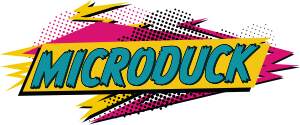
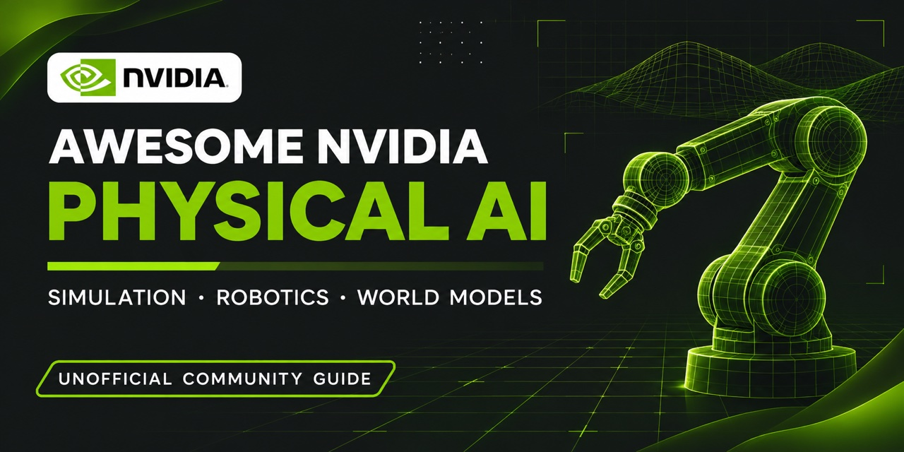
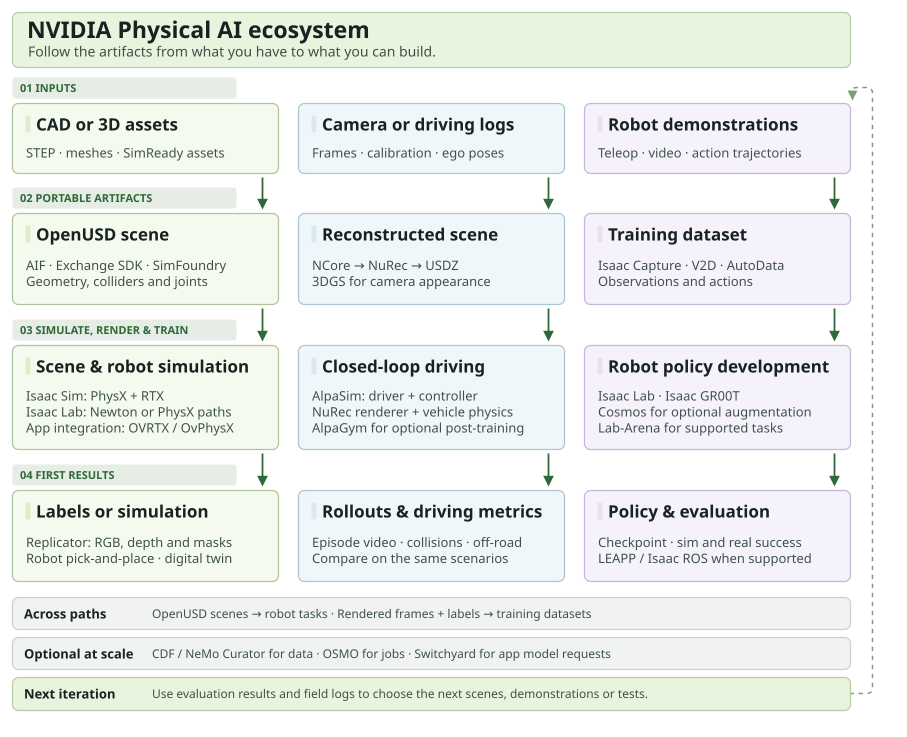
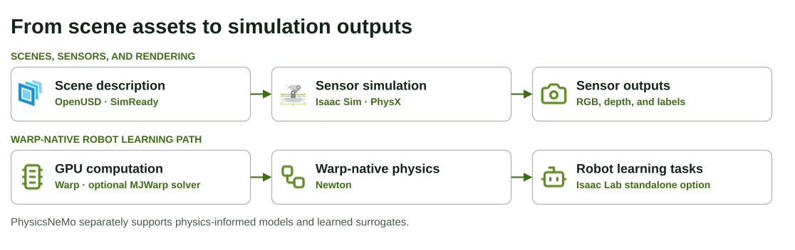
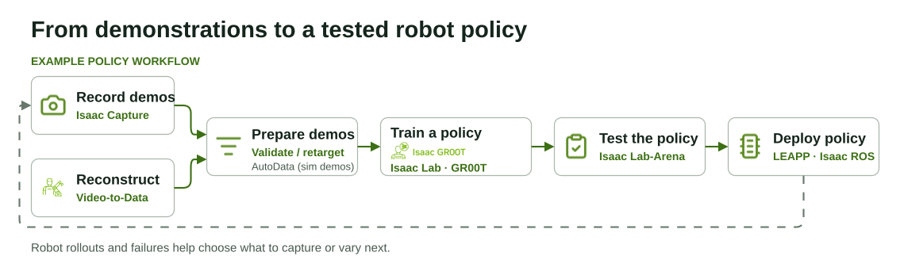
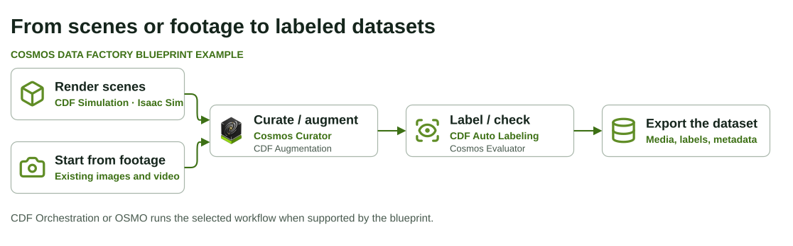
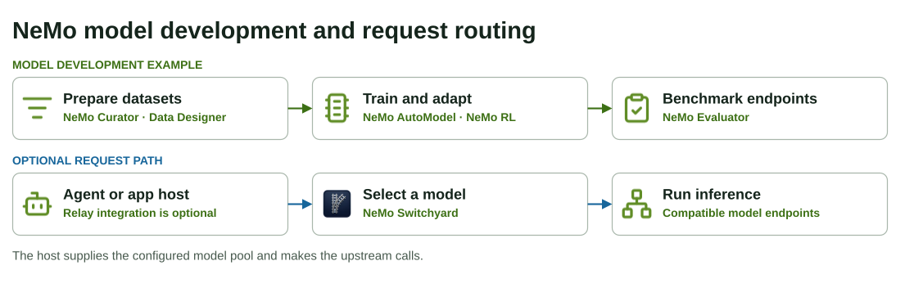
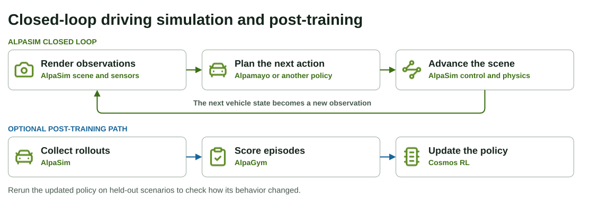
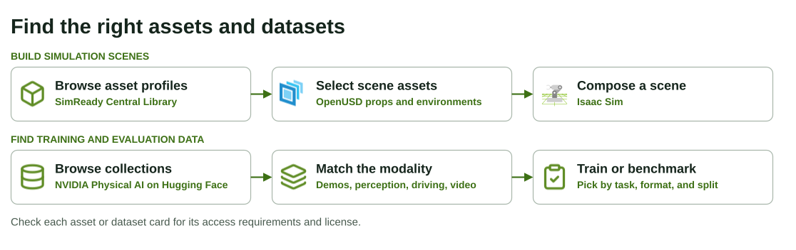

# Awesome NVIDIA Physical AI

  
  &nbsp;
  

**Find the right tools for your Physical AI project and see how they fit together.**

180 catalog entries · 115 guides per language · Official sources and license notes

[Start here](#start-with-what-you-want-to-build) · [Ecosystem map](#ecosystem-at-a-glance) · [Data and assets](#data-and-simulation-assets) · [NeMo](#nemo-and-physical-ai-tooling) · [Full catalog](#1-projects-with-confirmed-open-source-code) · [Latest release](https://github.com/james-joobs/awesome-nvidia-physical-ai/releases/latest)

## Start with what you want to build

| Goal | Tool path | Result |
|---|---|---|
| **Train a robot policy** | [Isaac Sim](docs/en/isaac-sim.md) → [Isaac Lab](docs/en/isaac-lab.md) → [Lab-Arena](docs/en/isaac-lab-arena.md) | Compare policy performance across scenes. |
| **Generate labeled camera data** | [SimReady](docs/en/simready.md) → [Isaac Sim](docs/en/isaac-sim.md) → [Replicator](docs/en/replicator.md) | Export labeled images. |
| **Build a video analysis agent** | [Metropolis VSS](docs/en/metropolis-vss.md) → [Switchyard](docs/en/nemo-switchyard.md) (optional) | Find video evidence and route follow-up requests. |
| **Test a driving policy** | [AlpaSim](docs/en/alpasim.md) → [AlpaGym](docs/en/alpagym.md) | Compare driving policies on the same route. |

  <strong>Sim-to-real in action</strong> 
   
  <a href="https://huggingface.co/spaces/pollen-robotics/microduck-simulator">Browser simulator</a>

  

## Ecosystem at a glance

Captured and simulated data feed two example development paths. Green arrows follow data and model artifacts, blue arrows show optional inference routing, and dashed arrows carry feedback into the next iteration.

Visual sources

- **Data and simulation** · [V2D](https://nvidia-isaac.github.io/video_to_data/) · [Isaac Sim](https://github.com/isaac-sim/IsaacSim/blob/7c206f75bdadd9e05fc457f19863ca4c3f0cb693/source/deprecated/isaacsim.replicator.domain_randomization/python/nodes/icons/isaac-sim.svg)
- **Model development** · [Isaac GR00T](https://github.com/NVIDIA/Isaac-GR00T/blob/7aa0bca50f1097f8b17f5c274c98264b72a1419f/media/header_compress.png) · [Cosmos Framework](https://github.com/NVIDIA/cosmos-framework/blob/5950e7b4ea3677b99a2de279a7ed7058b5446e42/tools/docs/images/cosmos-logo.png)
- **Deployment and serving** · [NeMo Switchyard](https://github.com/NVIDIA-NeMo/Switchyard/blob/88fe33e323d48bedc82b4c55920b6764548411fd/experimental/switchyard-desktop/icons/icon.png)
- **Stage icons** · [Lucide](https://lucide.dev/icons/) ([ISC license](assets/icons/LICENSE))

This guide catalogs NVIDIA Physical AI projects, simulation assets, and datasets, including related projects outside NVIDIA. It links to official repositories and documentation and distinguishes open-source code from models, products, and source-available code with restrictions.

**Checked:** November 9, 2026. A public repository does not imply that its model weights, datasets, binaries, cloud services, or dependencies share the same license. License notes below describe the linked code where confirmed; check the exact version and individual components before use. “Unverified” means the relevant scope or license could not be established, not that it is closed source.

> Open a detail guide for architecture, workflow examples, and image credits. Dataset names link directly to their official cards.

## 1. Projects with confirmed open-source code

### Physics, 3D, and simulation

| Project | Role | Code license and notes | Official source | Details |
|---|---|---|---|---|
| **Newton** | Warp-based GPU physics engine and robotics simulation solvers | Apache-2.0 | [Repository](https://github.com/newton-physics/newton) | [Guide](docs/en/newton.md) |
| **NVIDIA Warp** | Python framework for GPU-accelerated physics and geometry | Apache-2.0 | [Repository](https://github.com/NVIDIA/warp) | [Guide](docs/en/nvidia-warp.md) |
| **NVIDIA PhysX** | Physics engine for rigid bodies, collisions, and more | BSD-3-Clause; check terms for additional components | [Repository](https://github.com/NVIDIA-Omniverse/PhysX) | [Guide](docs/en/nvidia-physx.md) |
| **MuJoCo Warp (MJWarp)** | Warp-based acceleration of MuJoCo physics | Apache-2.0; a Google DeepMind project | [Repository](https://github.com/google-deepmind/mujoco_warp) | [Guide](docs/en/mujoco-warp.md) |
| **OpenUSD** | Framework for composing and exchanging 3D scenes and assets | Modified BSD-style license; distinguish the implementation from the standard and trademarks | [Repository](https://github.com/PixarAnimationStudios/OpenUSD) | [Guide](docs/en/openusd.md) |
| **Isaac Sim** | Reference application for simulating robots, sensors, and environments | Repository code: Apache-2.0; distribution and dependencies may have separate NVIDIA terms | [Repository](https://github.com/isaac-sim/IsaacSim) | [Guide](docs/en/isaac-sim.md) |
| **PhysicsNeMo** | Framework for physics-informed AI and surrogate models | Apache-2.0 | [Repository](https://github.com/NVIDIA/physicsnemo) | [Guide](docs/en/physicsnemo.md) |

### Robot learning, capture, and control

| Project | Role | Code license and notes | Official source | Details |
|---|---|---|---|---|
| **Isaac Lab** | Robot-learning environments for reinforcement and imitation learning | BSD-3-Clause; backends and dependencies have separate terms | [Repository](https://github.com/isaac-sim/IsaacLab) | [Guide](docs/en/isaac-lab.md) |
| **Isaac Lab-Arena** | Composable robot task environments and policy evaluation | Apache-2.0; Isaac Sim and other dependencies have separate terms | [Repository](https://github.com/isaac-sim/IsaacLab-Arena) | [Guide](docs/en/isaac-lab-arena.md) |
| **Microduck robot software** | Onboard Rust runtime for ONNX policies, servo control, and device services | Apache-2.0 code | [Repository](https://github.com/pollen-robotics/microduck) | [Guide](docs/en/microduck.md) |
| **Microduck RL** | Pollen Robotics’ mjlab and PPO training environments for Microduck | Apache-2.0 code; listed STL meshes are CC BY-NC-SA 4.0 | [Repository](https://github.com/pollen-robotics/microduck_rl) | [Guide](docs/en/microduck.md) |
| **Isaac Capture (formerly Isaac Teleop)** | Teleoperation and egocentric capture, recording, and retargeting | Apache-2.0 by default; EgoPost uses OpenMDW-1.1, while CloudXR and some optional packages have separate proprietary terms | [Repository](https://github.com/NVIDIA/IsaacCapture) | [Guide](docs/en/isaac-capture.md) |
| **AutoData** | Expands a small set of demonstrations into trajectories across varied task conditions | Apache-2.0; Isaac Sim and specific cuRobo components have separate terms | [Repository](https://github.com/isaac-sim/AutoData) | [Guide](docs/en/autodata.md) |
| **Video-to-Data (V2D)** | Reconstructs scenes and motion from video for robot-learning workflows | Code: Apache-2.0; documentation and skills: CC-BY-4.0; dependent models have separate terms | [Repository](https://github.com/nvidia-isaac/video_to_data) | [Guide](docs/en/video-to-data.md) |
| **Isaac GR00T code** | Training, inference, and deployment code for GR00T robot policies | Code: Apache-2.0; models and weights have separate terms | [Repository](https://github.com/NVIDIA/Isaac-GR00T) | [Guide](docs/en/isaac-gr00t.md) |
| **cuRobo** | GPU-accelerated inverse kinematics and robot motion planning | Repository: Apache-2.0; check terms for specific components distributed with AutoData | [Repository](https://github.com/NVlabs/curobo) | [Guide](docs/en/curobo.md) |
| **LeRobot** | Robot datasets and model-training tools; integrates with Capture | Apache-2.0; a Hugging Face project | [Repository](https://github.com/huggingface/lerobot) | [Guide](docs/en/lerobot.md) |
| **Isaac ROS** | Collection of GPU-accelerated ROS 2 robotics packages | Package terms vary; check licenses for each repository and distribution | [Documentation](https://nvidia-isaac-ros.github.io/) · [Common code](https://github.com/NVIDIA-ISAAC-ROS/isaac_ros_common) | [Guide](docs/en/isaac-ros.md) |
| **Isaac ROS Visual SLAM** | Visual odometry and SLAM integration for ROS 2 | Apache-2.0; cuVSLAM has separate terms | [Repository](https://github.com/NVIDIA-ISAAC-ROS/isaac_ros_visual_slam) | [Guide](docs/en/isaac-ros-visual-slam.md) |
| **Isaac ROS Nvblox** | ROS 2 3D mapping and Nav2 obstacle costmaps | Apache-2.0; dependencies separate | [Repository](https://github.com/NVIDIA-ISAAC-ROS/isaac_ros_nvblox) | [Guide](docs/en/isaac-ros-nvblox.md) |
| **Isaac ROS Pose Estimation** | GPU-accelerated object pose estimation packages | Apache-2.0 code; models separate | [Repository](https://github.com/NVIDIA-ISAAC-ROS/isaac_ros_pose_estimation) | [Guide](docs/en/isaac-ros-pose-estimation.md) |
| **Isaac ROS Manipulation** | ROS 2 workflows for robotic-arm manipulation | Apache-2.0 code; models and dependencies separate | [Repository](https://github.com/NVIDIA-ISAAC-ROS/isaac_ros_manipulation) | [Guide](docs/en/isaac-ros-manipulation.md) |
| **Isaac ROS DNN Stereo Depth** | Neural stereo depth estimation in ROS 2 | Apache-2.0 code; models separate | [Repository](https://github.com/NVIDIA-ISAAC-ROS/isaac_ros_dnn_stereo_depth) | [Guide](docs/en/isaac-ros-dnn-stereo-depth.md) |
| **Isaac ROS DNN Inference** | TensorRT and Triton inference integrations for ROS 2 | Apache-2.0 code; runtime and models separate | [Repository](https://github.com/NVIDIA-ISAAC-ROS/isaac_ros_dnn_inference) | [Guide](docs/en/isaac-ros-dnn-inference.md) |
| **LEAPP** | Export and deploy complete robot policy inference pipelines | Apache-2.0; models and runtime dependencies separate | [Repository](https://github.com/nvidia-isaac/leapp) | [Guide](docs/en/leapp.md) |
| **WBC-AGILE** | Isaac Lab-based humanoid whole-body locomotion and manipulation learning | Apache-2.0, with BSD-3-Clause RSL-RL patches | [Repository](https://github.com/nvidia-isaac/WBC-AGILE) | [Guide](docs/en/wbc-agile.md) |
| **FoundationPose Inference Library** | Deployment-oriented object pose inference library | Apache-2.0 code; model weights separate | [Repository](https://github.com/nvidia-isaac/foundation-pose-inference-library) | [Guide](docs/en/foundationpose-inference-library.md) |
| **Isaac Automator** | Automates setup and deployment of Isaac simulation workflows | Apache-2.0; installed components have separate terms | [Repository](https://github.com/isaac-sim/IsaacAutomator) | [Guide](docs/en/isaac-automator.md) |
| **Isaac ROS Object Detection** | ROS 2 object-detection packages | Apache-2.0; models separate | [Repository](https://github.com/NVIDIA-ISAAC-ROS/isaac_ros_object_detection) | [Guide](docs/en/isaac-ros-object-detection.md) |
| **Isaac ROS Image Segmentation** | ROS 2 semantic image segmentation | Apache-2.0; models separate | [Repository](https://github.com/NVIDIA-ISAAC-ROS/isaac_ros_image_segmentation) | [Guide](docs/en/isaac-ros-image-segmentation.md) |
| **Isaac ROS Deploy** | Deploy trained robot policies in simulation or on hardware | Apache-2.0; runtimes and models separate | [Repository](https://github.com/NVIDIA-ISAAC-ROS/isaac_ros_deploy) | [Guide](docs/en/isaac-ros-deploy.md) |
| **Isaac ROS Teleop** | XR-based robot teleoperation through ROS 2 | Apache-2.0; device software separate | [Repository](https://github.com/NVIDIA-ISAAC-ROS/isaac_ros_teleop) | [Guide](docs/en/isaac-ros-teleop.md) |
| **GR00T-VisualSim2Real** | Sim-to-real framework for humanoid visual locomotion and manipulation | Apache-2.0; models and robot assets separate | [Repository](https://github.com/NVlabs/GR00T-VisualSim2Real) | [Guide](docs/en/gr00t-visualsim2real.md) |
| **GR00T-H code** | Healthcare and surgical robotics policy training and inference | Apache-2.0 code; healthcare model weights and data have separate terms | [Repository](https://github.com/NVIDIA-Medtech/GR00T-H) | [Guide](docs/en/gr00t-h.md) |
| **Cosmos Reason2 code** | World-reasoning model inference and training code | Apache-2.0 code; model weights separately licensed | [Repository](https://github.com/nvidia-cosmos/cosmos-reason2) | [Guide](docs/en/cosmos-reason2.md) |
| **Cosmos Predict2 code** | World and video generation model code | Apache-2.0 code; model weights separately licensed | [Repository](https://github.com/nvidia-cosmos/cosmos-predict2) | [Guide](docs/en/cosmos-predict2.md) |

### Data generation, processing, and orchestration

| Project | Role | Code license and notes | Official source | Details |
|---|---|---|---|---|
| **Cosmos Data Factory (CDF; formerly Physical AI Data Factory)** | Workflows and skills for generating and processing video and images | Code: Apache-2.0; documentation and skills: CC-BY-4.0; models and services have separate terms | [Repository](https://github.com/NVIDIA/cosmos-data-factory) | [Guide](docs/en/cosmos-data-factory.md) |
| **CDF Auto Labeling (formerly paidf-auto-labeling)** | Automated video and image annotation workflows | Apache-2.0; models and services have separate terms | [Repository](https://github.com/NVIDIA/cdf-auto-labeling) | [Guide](docs/en/cdf-auto-labeling.md) |
| **CDF Augmentation (formerly paidf-augmentation)** | Video, image, and text augmentation workflows | Apache-2.0; models have separate terms | [Repository](https://github.com/NVIDIA/cdf-augmentation) | [Guide](docs/en/cdf-augmentation.md) |
| **CDF Simulation (formerly paidf-simulation)** | Synthetic data generation with Isaac Sim and Replicator | Apache-2.0; simulator and assets have separate terms | [Repository](https://github.com/NVIDIA/cdf-simulation) | [Guide](docs/en/cdf-simulation.md) |
| **Cosmos Curator** | Splits, filters, annotates, and deduplicates video and images | Apache-2.0; models have separate terms | [Repository](https://github.com/NVIDIA/cosmos-curator) | [Guide](docs/en/cosmos-curator.md) |
| **Cosmos Evaluator** | Evaluates generated video for object consistency, physical plausibility, and other qualities | Apache-2.0; model terms vary by checker | [Repository](https://github.com/NVIDIA/cosmos-evaluator) | [Guide](docs/en/cosmos-evaluator.md) |
| **CDF Orchestration** | Runs and manages data factory workflows | Code: Apache-2.0; execution services and dependencies have separate terms | [Repository](https://github.com/NVIDIA/cdf-orchestration) | [Guide](docs/en/cdf-orchestration.md) |
| **OSMO** | Manages GPU-backed simulation and training workflows | Apache-2.0 | [Repository](https://github.com/NVIDIA/OSMO) | [Guide](docs/en/osmo.md) |
| **TensorRT public code** | Samples, plugins, and tools for inference optimization | Repository: Apache-2.0; this does not cover the entire TensorRT binary SDK | [Repository](https://github.com/NVIDIA/TensorRT) | [Guide](docs/en/tensorrt.md) |
| **Holoscan SDK** | Low-latency streaming and sensor AI pipelines | Apache-2.0; external components have separate terms | [Repository](https://github.com/nvidia-holoscan/holoscan-sdk) | [Guide](docs/en/holoscan-sdk.md) |

### NeMo and Physical AI tooling

NeMo tools cover dataset preparation, model post-training and agent operations. Cosmos RL and Xenna are listed here because they connect to AlpaGym and Curator. The detail guides distinguish documented integrations from example workflows.

| Project | Role | Code license and notes | Official source | Details |
|---|---|---|---|---|
| **NeMo Switchyard** | Model routing for LLM agents and applications | Apache-2.0 | [Repository](https://github.com/NVIDIA-NeMo/Switchyard) | [Guide](docs/en/nemo-switchyard.md) |
| **NeMo Curator** | Distributed preparation of text, image, video and audio datasets | Apache-2.0 | [Repository](https://github.com/NVIDIA-NeMo/Curator) | [Guide](docs/en/nemo-curator.md) |
| **NeMo Data Designer** | Schema-driven generation of synthetic datasets from models and seed data | Apache-2.0 | [Repository](https://github.com/NVIDIA-NeMo/DataDesigner) | [Guide](docs/en/nemo-data-designer.md) |
| **NeMo AutoModel** | PyTorch-native distributed training of supported language and multimodal models | Apache-2.0 | [Repository](https://github.com/NVIDIA-NeMo/Automodel) | [Guide](docs/en/nemo-automodel.md) |
| **NeMo Megatron Bridge** | Megatron Core training recipes and bidirectional Hugging Face checkpoint conversion | Apache-2.0 | [Repository](https://github.com/NVIDIA-NeMo/Megatron-Bridge) | [Guide](docs/en/nemo-megatron-bridge.md) |
| **NeMo RL** | Distributed SFT and reinforcement learning for supported LLMs and VLMs | Apache-2.0 | [Repository](https://github.com/NVIDIA-NeMo/RL) | [Guide](docs/en/nemo-rl.md) |
| **NeMo Gym** | Tool-using agent rollout environments and verifiers | Apache-2.0 | [Repository](https://github.com/NVIDIA-NeMo/Gym) | [Guide](docs/en/nemo-gym.md) |
| **NeMo Evaluator** | Reproducible model and agent benchmarks against configured endpoints | Apache-2.0 | [Repository](https://github.com/NVIDIA-NeMo/Evaluator) | [Guide](docs/en/nemo-evaluator.md) |
| **NeMo Guardrails** | Programmable checks for model requests, retrieval, actions and responses | Apache-2.0 | [Repository](https://github.com/NVIDIA-NeMo/Guardrails) | [Guide](docs/en/nemo-guardrails.md) |
| **NeMo Retriever Library** | Multimodal extraction, indexing and retrieval of document evidence | Apache-2.0 | [Repository](https://github.com/NVIDIA/NeMo-Retriever) | [Guide](docs/en/nemo-retriever.md) |
| **NeMo Agent Toolkit** | Agent workflow integration and profiling, with a published robotics example | Apache-2.0 (Deprecated, EOL planned for end of 2026) | [Repository](https://github.com/NVIDIA/NeMo-Agent-Toolkit) | [Guide](docs/en/nemo-agent-toolkit.md) |
| **NeMo Relay** | Agent call tracing, middleware and governance | Apache-2.0 | [Repository](https://github.com/NVIDIA/NeMo-Relay) | [Guide](docs/en/nemo-relay.md) |
| **NeMo Fabric** | Adapter-based execution of supported agent harnesses | Apache-2.0 | [Repository](https://github.com/NVIDIA/NeMo-Fabric) | [Guide](docs/en/nemo-fabric.md) |
| **NeMo Helix** | Control plane for agent evaluation, optimization and security testing | Apache-2.0 | [Repository](https://github.com/NVIDIA-NeMo/nemo-helix) | [Guide](docs/en/nemo-helix.md) |
| **NemoClaw** | OpenShell-based reference stack for running supported agents | Apache-2.0 | [Repository](https://github.com/NVIDIA/NemoClaw) | [Guide](docs/en/nemoclaw.md) |
| **NeMo Speech** | Speech model training and inference, including ASR and TTS | Apache-2.0 | [Repository](https://github.com/NVIDIA/NeMo) | [Guide](docs/en/nemo-speech.md) |
| **Cosmos RL** | Distributed reinforcement learning infrastructure used by AlpaGym | Apache-2.0 (Limited maintenance) | [Repository](https://github.com/nvidia-cosmos/cosmos-rl) | [Guide](docs/en/cosmos-rl.md) |
| **Cosmos Xenna** | Ray-based distributed stage execution used by curation pipelines | Apache-2.0 (Limited maintenance) | [Repository](https://github.com/nvidia-cosmos/cosmos-xenna) | [Guide](docs/en/cosmos-xenna.md) |

### Autonomous driving

| Project | Role | Code license and notes | Official source | Details |
|---|---|---|---|---|
| **AlpaSim** | Closed-loop simulation for autonomous-driving policies | Code: Apache-2.0; models and data have separate terms | [Repository](https://github.com/NVlabs/alpasim) | [Guide](docs/en/alpasim.md) |
| **AlpaGym** | Reinforcement learning for autonomous-driving policies | Code: Apache-2.0; dependencies and models have separate terms | [Repository](https://github.com/NVlabs/alpagym) | [Guide](docs/en/alpagym.md) |

## Data and simulation assets

### Discovery platforms and tools

| Resource | Role | Access and license | Official source | Details |
|---|---|---|---|---|
| **SimReady Foundation** | OpenUSD asset profiles, specifications, validation tools, and sample content | NVIDIA-authored content Apache-2.0; third-party assets have their own licenses | [GitHub](https://github.com/NVIDIA/simready-foundation) | [Guide](docs/en/simready-foundation.md) |
| **SimReady Central Library** | Search and discover registered simulation-ready assets from NVIDIA and other owners | Public browsing; each asset has its own license. Accepted assets can include non-commercial terms | [Hugging Face Space](https://huggingface.co/spaces/nvidia/simready-central) · [Documentation](https://docs.omniverse.nvidia.com/simready/latest/simready-central.html) | [Guide](docs/en/simready-central-library.md) |
| **SimReady Central** | Submission and review index for owner-hosted Hugging Face asset packages | Public repository; submission onboarding and asset terms apply separately | [GitHub](https://github.com/NVIDIA-Omniverse/simready-central) | [Guide](docs/en/simready-central.md) |
| **NVIDIA Physical AI dataset collection** | Entry point to curated NVIDIA datasets for robotics, driving, and other physical AI applications | Dataset terms and access vary by entry | [Collection](https://huggingface.co/collections/nvidia/physical-ai) · [All NVIDIA datasets](https://huggingface.co/nvidia/datasets) | [Guide](docs/en/physical-ai-dataset-collection.md) |
| **Human-1M Explorer** | Browser for human egocentric capture and reconstruction examples | Public Space; check dataset access and terms separately | [Hugging Face Space](https://huggingface.co/spaces/nvidia/PhysicalAI-Human-1M-Explorer) | [Guide](docs/en/human-1m-explorer.md) |

Dataset licenses below are the Hugging Face license tags observed on **November 9, 2026**, not a substitute for the dataset card or terms. “Public” means no access gate was reported, not that the dataset is open source or unrestricted. CC BY requires attribution; CC BY-NC restricts commercial use. `Other` and missing tags require individual review. Some asset packages include third-party materials with separate conditions.

### 3D assets and environments

| Dataset | Role | License tag · access | Details |
|---|---|---|---|
| **[simready-assets](https://huggingface.co/datasets/nvidia/simready-assets)** | SimReady 3D props and objects | CC BY 4.0; public | [Guide](docs/en/datasets-3d-assets.md#simready-assets) |
| **[simready-dsx](https://huggingface.co/datasets/nvidia/simready-dsx)** | SimReady assets for AI factory digital twins | CC BY 4.0; public | [Guide](docs/en/datasets-3d-assets.md#simready-dsx) |
| **[isaacsim-assets](https://huggingface.co/datasets/nvidia/isaacsim-assets)** | Isaac Sim assets and sample content | License unverified | [Guide](docs/en/datasets-3d-assets.md#isaacsim-assets) |
| **[PhysicalAI-SimReady-Warehouse-01](https://huggingface.co/datasets/nvidia/PhysicalAI-SimReady-Warehouse-01)** | OpenUSD warehouse scene for simulation | CC-BY-4.0; public | [Guide](docs/en/datasets-3d-assets.md#physicalai-simready-warehouse-01) |
| **[PhysicalAI-DigitalCousin-Assets](https://huggingface.co/datasets/nvidia/PhysicalAI-DigitalCousin-Assets)** | Assets for simulated GR1 tabletop environments | CC-BY-NC-4.0; public | [Guide](docs/en/datasets-3d-assets.md#physicalai-digitalcousin-assets) |
| **[PhysicalAI-Robotics-Manipulation-Objects-Kitchen-MJCF](https://huggingface.co/datasets/nvidia/PhysicalAI-Robotics-Manipulation-Objects-Kitchen-MJCF)** | MJCF kitchen object assets | CC-BY-4.0; public | [Guide](docs/en/datasets-3d-assets.md#physicalai-robotics-manipulation-objects-kitchen-mjcf) |
| **[PhysicalAI-Robotics-PhysicalAssets-VoMP](https://huggingface.co/datasets/nvidia/PhysicalAI-Robotics-PhysicalAssets-VoMP)** | Assets for vision-based robot motion planning research | License unverified; public | [Guide](docs/en/datasets-3d-assets.md#physicalai-robotics-physicalassets-vomp) |
| **[PhysicalAI-Robotics-PhysicalAssets-VoMP-Eval](https://huggingface.co/datasets/nvidia/PhysicalAI-Robotics-PhysicalAssets-VoMP-Eval)** | Evaluation assets for vision-based motion planning | License unverified; public | [Guide](docs/en/datasets-3d-assets.md#physicalai-robotics-physicalassets-vomp-eval) |

### Robot demonstrations and motion

| Dataset | Role | License tag · access | Details |
|---|---|---|---|
| **[PhysicalAI-Robotics-GR00T-X-Embodiment-Sim](https://huggingface.co/datasets/nvidia/PhysicalAI-Robotics-GR00T-X-Embodiment-Sim)** | Simulated trajectories across robot embodiments for GR00T post-training | CC-BY-4.0; public | [Guide](docs/en/datasets-robot-demonstrations.md#physicalai-robotics-gr00t-x-embodiment-sim) |
| **[PhysicalAI-GR00T-Tuned-Tasks](https://huggingface.co/datasets/nvidia/PhysicalAI-GR00T-Tuned-Tasks)** | Multimodal GR1 tabletop manipulation trajectories | CC-BY-4.0; public | [Guide](docs/en/datasets-robot-demonstrations.md#physicalai-gr00t-tuned-tasks) |
| **[PhysicalAI-Robotics-GR00T-GR1](https://huggingface.co/datasets/nvidia/PhysicalAI-Robotics-GR00T-GR1)** | Third-person video of GR1 robot tasks | CC-BY-4.0; public | [Guide](docs/en/datasets-robot-demonstrations.md#physicalai-robotics-gr00t-gr1) |
| **[PhysicalAI-Robotics-GR00T-Teleop-G1](https://huggingface.co/datasets/nvidia/PhysicalAI-Robotics-GR00T-Teleop-G1)** | Teleoperated Unitree G1 demonstrations | CC-BY-4.0; public | [Guide](docs/en/datasets-robot-demonstrations.md#physicalai-robotics-gr00t-teleop-g1) |
| **[GR00T-N1.7-AppleToPlate](https://huggingface.co/datasets/nvidia/GR00T-N1.7-AppleToPlate)** | G1 apple pick-and-place teleoperation demonstrations | CC-BY-4.0; public | [Guide](docs/en/datasets-robot-demonstrations.md#gr00t-n1-7-appletoplate) |
| **[PhysicalAI-Robotics-GR00T-Teleop-Sim](https://huggingface.co/datasets/nvidia/PhysicalAI-Robotics-GR00T-Teleop-Sim)** | Simulated teleoperation demonstrations | CC-BY-NC-4.0; public | [Guide](docs/en/datasets-robot-demonstrations.md#physicalai-robotics-gr00t-teleop-sim) |
| **[PhysicalAI-Robotics-GR00T-Teleop-GR1](https://huggingface.co/datasets/nvidia/PhysicalAI-Robotics-GR00T-Teleop-GR1)** | GR1 teleoperation data | CC-BY-NC-4.0; public | [Guide](docs/en/datasets-robot-demonstrations.md#physicalai-robotics-gr00t-teleop-gr1) |
| **[PhysicalAI-Robotics-GR00T-Eval](https://huggingface.co/datasets/nvidia/PhysicalAI-Robotics-GR00T-Eval)** | GR00T robot evaluation data | CC-BY-4.0; public | [Guide](docs/en/datasets-robot-demonstrations.md#physicalai-robotics-gr00t-eval) |
| **[PhysicalAI-Robotics-Manipulation-Kitchen](https://huggingface.co/datasets/nvidia/PhysicalAI-Robotics-Manipulation-Kitchen)** | Simulated kitchen manipulation trajectories in LeRobot format | CC-BY-4.0; public | [Guide](docs/en/datasets-robot-demonstrations.md#physicalai-robotics-manipulation-kitchen) |
| **[PhysicalAI-Robotics-Manipulation-SingleArm](https://huggingface.co/datasets/nvidia/PhysicalAI-Robotics-Manipulation-SingleArm)** | Simulated single-arm robot manipulation | CC-BY-4.0; public | [Guide](docs/en/datasets-robot-demonstrations.md#physicalai-robotics-manipulation-singlearm) |
| **[PhysicalAI-Robotics-Manipulation-Objects](https://huggingface.co/datasets/nvidia/PhysicalAI-Robotics-Manipulation-Objects)** | Simulated object pick-and-place trajectories | License unverified; public | [Guide](docs/en/datasets-robot-demonstrations.md#physicalai-robotics-manipulation-objects) |
| **[PhysicalAI-Robotics-Manipulation-Augmented](https://huggingface.co/datasets/nvidia/PhysicalAI-Robotics-Manipulation-Augmented)** | Synthetic annotated cube-stacking demonstrations | License unverified; public | [Guide](docs/en/datasets-robot-demonstrations.md#physicalai-robotics-manipulation-augmented) |
| **[PhysicalAI-Robotics-Manipulation-Kitchen-Demos](https://huggingface.co/datasets/nvidia/PhysicalAI-Robotics-Manipulation-Kitchen-Demos)** | Human-teleoperated kitchen task demonstrations | CC-BY-4.0; public | [Guide](docs/en/datasets-robot-demonstrations.md#physicalai-robotics-manipulation-kitchen-demos) |
| **[PhysicalAI-Robotics-GraspGen](https://huggingface.co/datasets/nvidia/PhysicalAI-Robotics-GraspGen)** | Candidate grasps for multiple grippers and objects | CC-BY-4.0; public | [Guide](docs/en/datasets-robot-demonstrations.md#physicalai-robotics-graspgen) |
| **[PhysicalAI-Robotics-Locomanipulation-GRAIL](https://huggingface.co/datasets/nvidia/PhysicalAI-Robotics-Locomanipulation-GRAIL)** | Robot locomotion and manipulation motion data | CC-BY-NC-4.0; public | [Guide](docs/en/datasets-robot-demonstrations.md#physicalai-robotics-locomanipulation-grail) |
| **[PhysicalAI-Robotics-Open-H-Embodiment](https://huggingface.co/datasets/nvidia/PhysicalAI-Robotics-Open-H-Embodiment)** | Surgical robotics and ultrasound autonomy data initiative | CC-BY-4.0; public | [Guide](docs/en/datasets-robot-demonstrations.md#physicalai-robotics-open-h-embodiment) |
| **[PhysicalAI-Robotics-mindmap-GR1-Drill-in-Box](https://huggingface.co/datasets/nvidia/PhysicalAI-Robotics-mindmap-GR1-Drill-in-Box)** | GR1 drill-in-box task trajectories | CC-BY-NC-4.0; public | [Guide](docs/en/datasets-robot-demonstrations.md#physicalai-robotics-mindmap-gr1-drill-in-box) |
| **[PhysicalAI-Robotics-mindmap-GR1-Stick-in-Bin](https://huggingface.co/datasets/nvidia/PhysicalAI-Robotics-mindmap-GR1-Stick-in-Bin)** | GR1 stick-in-bin task trajectories | CC-BY-NC-4.0; public | [Guide](docs/en/datasets-robot-demonstrations.md#physicalai-robotics-mindmap-gr1-stick-in-bin) |
| **[PhysicalAI-Robotics-mindmap-Franka-Mug-in-Drawer](https://huggingface.co/datasets/nvidia/PhysicalAI-Robotics-mindmap-Franka-Mug-in-Drawer)** | Franka mug-in-drawer task trajectories | CC-BY-NC-4.0; public | [Guide](docs/en/datasets-robot-demonstrations.md#physicalai-robotics-mindmap-franka-mug-in-drawer) |
| **[PhysicalAI-Robotics-mindmap-Franka-Cube-Stacking](https://huggingface.co/datasets/nvidia/PhysicalAI-Robotics-mindmap-Franka-Cube-Stacking)** | Franka cube-stacking task trajectories | CC-BY-NC-4.0; public | [Guide](docs/en/datasets-robot-demonstrations.md#physicalai-robotics-mindmap-franka-cube-stacking) |

### Robot perception

| Dataset | Role | License tag · access | Details |
|---|---|---|---|
| **[Microduck Duck Detector Dataset](https://huggingface.co/datasets/pollen-robotics/microduck-duck-detector-dataset)** | Onboard camera images and bounding boxes for detecting other Microducks | Apache-2.0; public | [Guide](docs/en/microduck.md#hugging-face-resources) |

### Driving, video, and world-model data

| Dataset | Role | License tag · access | Details |
|---|---|---|---|
| **[PhysicalAI-Autonomous-Vehicles](https://huggingface.co/datasets/nvidia/PhysicalAI-Autonomous-Vehicles)** | Real-world autonomous-driving multisensor data | Other terms; check card; Login and access acceptance required | [Guide](docs/en/datasets-driving-world-model.md#physicalai-autonomous-vehicles) |
| **[PhysicalAI-Autonomous-Vehicles-NuRec](https://huggingface.co/datasets/nvidia/PhysicalAI-Autonomous-Vehicles-NuRec)** | Driving scenes reconstructed with NuRec | Other terms; check card; Login and access acceptance required | [Guide](docs/en/datasets-driving-world-model.md#physicalai-autonomous-vehicles-nurec) |
| **[NuRec-AV-Object-Benchmark](https://huggingface.co/datasets/nvidia/NuRec-AV-Object-Benchmark)** | Object-centric 3D reconstruction benchmark for driving | CC-BY-4.0; public | [Guide](docs/en/datasets-driving-world-model.md#nurec-av-object-benchmark) |
| **[PhysicalAI-Autonomous-Vehicles-NCore](https://huggingface.co/datasets/nvidia/PhysicalAI-Autonomous-Vehicles-NCore)** | Autonomous-driving sensor data in the NCore ecosystem | Other terms; check card; Login and access acceptance required | [Guide](docs/en/datasets-driving-world-model.md#physicalai-autonomous-vehicles-ncore) |
| **[PhysicalAI-Autonomous-Vehicles-Foundation4D](https://huggingface.co/datasets/nvidia/PhysicalAI-Autonomous-Vehicles-Foundation4D)** | Autonomous-driving data for 4D reconstruction | Other terms; check card; Login and access acceptance required | [Guide](docs/en/datasets-driving-world-model.md#physicalai-autonomous-vehicles-foundation4d) |
| **[PhysicalAI-Autonomous-Vehicle-Cosmos-Drive-Dreams](https://huggingface.co/datasets/nvidia/PhysicalAI-Autonomous-Vehicle-Cosmos-Drive-Dreams)** | Cosmos-based synthetic driving data | CC-BY-4.0; public | [Guide](docs/en/datasets-driving-world-model.md#physicalai-autonomous-vehicle-cosmos-drive-dreams) |
| **[PhysicalAI-Autonomous-Vehicle-Cosmos-Synthetic](https://huggingface.co/datasets/nvidia/PhysicalAI-Autonomous-Vehicle-Cosmos-Synthetic)** | Synthetic driving data; card refers to Cosmos Drive Dreams | CC-BY-4.0; public | [Guide](docs/en/datasets-driving-world-model.md#physicalai-autonomous-vehicle-cosmos-synthetic) |
| **[PhysicalAI-SmartSpaces](https://huggingface.co/datasets/nvidia/PhysicalAI-SmartSpaces)** | Multi-camera video for tracking people and mobile equipment | CC-BY-4.0; public | [Guide](docs/en/datasets-driving-world-model.md#physicalai-smartspaces) |
| **[PhysicalAI-Traffic-Anomaly-Reasoning](https://huggingface.co/datasets/nvidia/PhysicalAI-Traffic-Anomaly-Reasoning)** | Traffic anomaly reasoning and evaluation data | CC-BY-4.0; public | [Guide](docs/en/datasets-driving-world-model.md#physicalai-traffic-anomaly-reasoning) |
| **[PhysicalAI-Human-1M-100K](https://huggingface.co/datasets/nvidia/PhysicalAI-Human-1M-100K)** | Egocentric human video with motion and language annotations | CC-BY-4.0; public | [Guide](docs/en/datasets-driving-world-model.md#physicalai-human-1m-100k) |
| **[PhysicalAI-Spatial-Intelligence-Warehouse](https://huggingface.co/datasets/nvidia/PhysicalAI-Spatial-Intelligence-Warehouse)** | Spatial intelligence data for warehouse scenes | CC-BY-4.0; Login and access acceptance required | [Guide](docs/en/datasets-driving-world-model.md#physicalai-spatial-intelligence-warehouse) |
| **[PhysicalAI-Robotics-NuRec](https://huggingface.co/datasets/nvidia/PhysicalAI-Robotics-NuRec)** | Neural reconstruction data for robotics | CC-BY-4.0; Login and access acceptance required | [Guide](docs/en/datasets-driving-world-model.md#physicalai-robotics-nurec) |
| **[PhysicalAI-NuRec-PPISP](https://huggingface.co/datasets/nvidia/PhysicalAI-NuRec-PPISP)** | Scene captures for reconstruction and image processing | CC-BY-4.0; public | [Guide](docs/en/datasets-driving-world-model.md#physicalai-nurec-ppisp) |
| **[PhysicalAI-SpatialIntelligence-Lyra-SDG](https://huggingface.co/datasets/nvidia/PhysicalAI-SpatialIntelligence-Lyra-SDG)** | Synthetic spatial-intelligence research data | CC-BY-4.0; public | [Guide](docs/en/datasets-driving-world-model.md#physicalai-spatialintelligence-lyra-sdg) |
| **[PhysicalAI-WorldModel-Synthetic-Autonomous-Driving-Scenarios](https://huggingface.co/datasets/nvidia/PhysicalAI-WorldModel-Synthetic-Autonomous-Driving-Scenarios)** | Synthetic autonomous-driving scenes for world models | Other terms; check card; public | [Guide](docs/en/datasets-driving-world-model.md#physicalai-worldmodel-synthetic-autonomous-driving-scenarios) |
| **[PhysicalAI-WorldModel-Synthetic-Embodied-Robot-Scenes](https://huggingface.co/datasets/nvidia/PhysicalAI-WorldModel-Synthetic-Embodied-Robot-Scenes)** | Synthetic embodied-robot scenes for world models | Other terms; check card; public | [Guide](docs/en/datasets-driving-world-model.md#physicalai-worldmodel-synthetic-embodied-robot-scenes) |
| **[PhysicalAI-WorldModel-Synthetic-Digital-Human-Scenes](https://huggingface.co/datasets/nvidia/PhysicalAI-WorldModel-Synthetic-Digital-Human-Scenes)** | Synthetic digital-human video scenes | Other terms; check card; public | [Guide](docs/en/datasets-driving-world-model.md#physicalai-worldmodel-synthetic-digital-human-scenes) |
| **[PhysicalAI-WorldModel-Synthetic-Physical-Interaction-Scenes](https://huggingface.co/datasets/nvidia/PhysicalAI-WorldModel-Synthetic-Physical-Interaction-Scenes)** | Simulated multi-object physical interactions | Other terms; check card; public | [Guide](docs/en/datasets-driving-world-model.md#physicalai-worldmodel-synthetic-physical-interaction-scenes) |
| **[PhysicalAI-WorldModel-Synthetic-Warehouse-Operations-Scenes](https://huggingface.co/datasets/nvidia/PhysicalAI-WorldModel-Synthetic-Warehouse-Operations-Scenes)** | Synthetic warehouse operations and safety events | Other terms; check card; public | [Guide](docs/en/datasets-driving-world-model.md#physicalai-worldmodel-synthetic-warehouse-operations-scenes) |
| **[PhysicalAI-Event-Videos](https://huggingface.co/datasets/nvidia/PhysicalAI-Event-Videos)** | Video anomalies, safety events, and annotations | Other terms; check card; public | [Guide](docs/en/datasets-driving-world-model.md#physicalai-event-videos) |
| **[PhysicalAI-VANTAGE-Bench](https://huggingface.co/datasets/nvidia/PhysicalAI-VANTAGE-Bench)** | Fixed-camera video understanding benchmark | Other terms; check card; public | [Guide](docs/en/datasets-driving-world-model.md#physicalai-vantage-bench) |
| **[PhysicalAI-VANTAGE-Bench-Subset](https://huggingface.co/datasets/nvidia/PhysicalAI-VANTAGE-Bench-Subset)** | Subset of the fixed-camera video benchmark | Other terms; check card; public | [Guide](docs/en/datasets-driving-world-model.md#physicalai-vantage-bench-subset) |

### V2D and Cosmos datasets

| Dataset | Role | License tag · access | Details |
|---|---|---|---|
| **[video-to-data-robot-dexterity-task-library-and-dataset](https://huggingface.co/datasets/nvidia/video-to-data-robot-dexterity-task-library-and-dataset)** | V2D human hand demonstrations retargeted to robot hands | CC BY 4.0; public | [Guide](docs/en/datasets-v2d-cosmos.md#video-to-data-robot-dexterity-task-library-and-dataset) |
| **[Cosmos-Reason1-RL-Dataset](https://huggingface.co/datasets/nvidia/Cosmos-Reason1-RL-Dataset)** | Video and text annotations for reasoning reinforcement learning | License unverified; public | [Guide](docs/en/datasets-v2d-cosmos.md#cosmos-reason1-rl-dataset) |
| **[Cosmos-Reason1-Benchmark](https://huggingface.co/datasets/nvidia/Cosmos-Reason1-Benchmark)** | Video reasoning evaluation annotations | License unverified; public | [Guide](docs/en/datasets-v2d-cosmos.md#cosmos-reason1-benchmark) |
| **[Cosmos-Reason1-SFT-Dataset](https://huggingface.co/datasets/nvidia/Cosmos-Reason1-SFT-Dataset)** | Video and text annotations for supervised reasoning | CC BY 4.0; public | [Guide](docs/en/datasets-v2d-cosmos.md#cosmos-reason1-sft-dataset) |
| **[Cosmos-Transfer-LidarGen-Example](https://huggingface.co/datasets/nvidia/Cosmos-Transfer-LidarGen-Example)** | LiDAR generation example data | Other terms; access gated | [Guide](docs/en/datasets-v2d-cosmos.md#cosmos-transfer-lidargen-example) |
| **[Cosmos-Transfer1-7B-Sample-AV-Data-Example](https://huggingface.co/datasets/nvidia/Cosmos-Transfer1-7B-Sample-AV-Data-Example)** | Sample autonomous-driving input for Cosmos Transfer | CC BY 4.0; access gated | [Guide](docs/en/datasets-v2d-cosmos.md#cosmos-transfer1-7b-sample-av-data-example) |
| **[ALOHA-Cosmos-Policy](https://huggingface.co/datasets/nvidia/ALOHA-Cosmos-Policy)** | Real bimanual manipulation dataset for Cosmos Policy | CC tag; exact terms require review | [Guide](docs/en/datasets-v2d-cosmos.md#aloha-cosmos-policy) |
| **[LIBERO-Cosmos-Policy](https://huggingface.co/datasets/nvidia/LIBERO-Cosmos-Policy)** | LIBERO simulation benchmark data adapted for Cosmos Policy | CC tag; exact terms require review | [Guide](docs/en/datasets-v2d-cosmos.md#libero-cosmos-policy) |
| **[RoboCasa-Cosmos-Policy](https://huggingface.co/datasets/nvidia/RoboCasa-Cosmos-Policy)** | RoboCasa simulation benchmark data adapted for Cosmos Policy | CC tag; exact terms require review | [Guide](docs/en/datasets-v2d-cosmos.md#robocasa-cosmos-policy) |
| **[Cosmos-HumanEval-v1](https://huggingface.co/datasets/nvidia/Cosmos-HumanEval-v1)** | Human evaluation data for Cosmos outputs | Other terms; check card | [Guide](docs/en/datasets-v2d-cosmos.md#cosmos-humaneval-v1) |
| **[Cosmos-AnomalyGen-PCB-Dataset](https://huggingface.co/datasets/nvidia/Cosmos-AnomalyGen-PCB-Dataset)** | PCB defect generation data | Other terms; check card | [Guide](docs/en/datasets-v2d-cosmos.md#cosmos-anomalygen-pcb-dataset) |
| **[Cosmos-AnomalyGen-Glass-Masks](https://huggingface.co/datasets/nvidia/Cosmos-AnomalyGen-Glass-Masks)** | Masks for glass defect generation | License unverified; public | [Guide](docs/en/datasets-v2d-cosmos.md#cosmos-anomalygen-glass-masks) |
| **[Cosmos3-DROID](https://huggingface.co/datasets/nvidia/Cosmos3-DROID)** | Robot manipulation demonstrations for Cosmos 3 | OpenMDW-1.1; public | [Guide](docs/en/datasets-v2d-cosmos.md#cosmos3-droid) |
| **[Cosmos3-Driving-Simulation-Evaluation](https://huggingface.co/datasets/nvidia/Cosmos3-Driving-Simulation-Evaluation)** | Driving simulation evaluation controls and captions | OpenMDW-1.1; public | [Guide](docs/en/datasets-v2d-cosmos.md#cosmos3-driving-simulation-evaluation) |

**Example workflow:** Build an Isaac Sim/Isaac Lab scene with SimReady assets, then train and evaluate a policy using Capture/GR00T demonstrations or existing datasets. Check robot embodiment, coordinate frames, sensors, and license compatibility for each dataset.

## 2. Platforms, models, products, standards, and restricted code

Public access alone does not establish an open-source license or permission for commercial use. Unverified terms are identified explicitly.

| Name | Role or category | Availability and license status | Official source | Details |
|---|---|---|---|---|
| **cuVSLAM** | CUDA-accelerated visual odometry and SLAM library | NVIDIA Community License restricts use to NVIDIA platforms; distinct from its ROS wrapper | [Repository](https://github.com/nvidia-isaac/cuVSLAM) | [Guide](docs/en/cuvslam.md) |
| **Microduck** | Pollen Robotics and Hugging Face’s compact biped for sim-to-real robot learning | Hardware product; mechanical and electronic designs outside the open-source scope | [Product](https://pollen-robotics.com/microduck/) · [NVIDIA walkthrough](https://huggingface.co/blog/nvidia/microduck-isaac-lab-sim-to-real) | [Guide](docs/en/microduck.md) |
| **Microduck Sandbox and Arena** | Browser simulation demo and hosted policy benchmark | Public Spaces; Sandbox app code Apache-2.0, Arena project-wide source license unverified | [Sandbox](https://huggingface.co/spaces/pollen-robotics/microduck-simulator) · [Arena](https://huggingface.co/spaces/pollen-robotics/microduck-arena) | [Guide](docs/en/microduck.md#hugging-face-resources) |
| **Microduck policies and checkpoints** | Deployable ONNX policies and separate mjlab training checkpoints | Public model repositories; ONNX pack tagged Apache-2.0, checkpoint license unverified | [ONNX policies](https://huggingface.co/pollen-robotics/microduck-policies) · [Training checkpoints](https://huggingface.co/pollen-robotics/microduck-training) | [Guide](docs/en/microduck.md#hugging-face-resources) |
| **NVIDIA Omniverse** | OpenUSD-based 3D development platform | Product, SDK, and publicly available components have different terms | [Official page](https://developer.nvidia.com/omniverse) | [Guide](docs/en/omniverse.md) |
| **SimReady** | Guidelines and specifications for simulation-ready 3D assets | Asset licenses vary; not a single software project | [Documentation](https://docs.omniverse.nvidia.com/simready/latest/index.html) | [Guide](docs/en/simready.md) |
| **NuRec** | Neural reconstruction and rendering of real environments | Product/technology; complete source and license scope unverified | [Official page](https://developer.nvidia.com/omniverse/nurec) | [Guide](docs/en/nurec.md) |
| **Cosmos and Cosmos 3** | World-model and tooling platform and model family | The [Cosmos repository](https://github.com/NVIDIA/cosmos) specifies OpenMDW-1.1 for its code and models; it is not assumed to be OSI-approved. Other repositories have their own terms | [Repository](https://github.com/NVIDIA/cosmos) | [Guide](docs/en/cosmos.md) |
| **Cosmos Predict / Transfer / Reason** | Model families for world/video generation, visual transformation, and scene reasoning | Check the terms for each model version and its weights | [Cosmos](https://github.com/NVIDIA/cosmos) | [Guide](docs/en/cosmos-models.md) |
| **Cosmos Embed / Dataset Search** | Multimodal embedding model/service and video-search microservices | Complete source availability and license scope unverified | [Documentation](https://docs.nvidia.com/cosmos/cds/latest/introduction.html) | [Guide](docs/en/cosmos-embed-search.md) |
| **Isaac GR00T / GR00T N1.7** | Robot action foundation model and platform | Code and weights have separate licenses; check the model version | [Repository](https://github.com/NVIDIA/Isaac-GR00T) | [Guide](docs/en/groot-model.md) |
| **GR00T-Mimic / GR00T-Dreams** | Robot demonstration and synthetic-data generation techniques/workflows | Independent project status and terms for implementations and models require individual verification | [GR00T](https://github.com/NVIDIA/Isaac-GR00T) | [Guide](docs/en/groot-mimic-dreams.md) |
| **Isaac Manipulator** | Reference workflows for robotic-arm perception, grasping, and planning | Isaac ROS packages, models, and components have different terms | [Isaac ROS documentation](https://nvidia-isaac-ros.github.io/) | [Guide](docs/en/isaac-manipulator.md) |
| **Isaac RLPT** | Workflow for improving pretrained policies with reinforcement learning | Independent repository and license unverified | [Isaac Lab](https://github.com/isaac-sim/IsaacLab) | [Guide](docs/en/isaac-rlpt.md) |
| **Replicator** | Synthetic data generation tool within Omniverse/Isaac Sim | Product component; complete source availability and independent license unverified | [Isaac Sim documentation](https://docs.isaacsim.omniverse.nvidia.com/latest/replicator_tutorials/index.html) | [Guide](docs/en/replicator.md) |
| **EgoHand / EgoPost** | Capture components for egocentric hand and camera motion | EgoPost uses OpenMDW-1.1; EgoHand's independent license is unverified | [Isaac Capture](https://github.com/NVIDIA/IsaacCapture) | [Guide](docs/en/egohand-egopost.md) |
| **MimicGen** | Generates varied robot demonstrations from existing demonstrations | Source available under NVIDIA Source Code License; do not assume unrestricted open-source use | [Repository](https://github.com/NVlabs/mimicgen) | [Guide](docs/en/mimicgen.md) |
| **DexMimicGen** | Research on generating bimanual and multi-manipulator demonstrations | Code uses NVIDIA Source Code License; data uses CC-BY-4.0. Check code restrictions | [Repository](https://github.com/NVlabs/dexmimicgen) | [Guide](docs/en/dexmimicgen.md) |
| **SkillGen / SkillMimicGen** | Connects demonstration segments with motion planning | Check terms for the Isaac Lab implementation and dependencies such as cuRobo separately; paper and implementation names differ | [Isaac Lab documentation](https://github.com/isaac-sim/IsaacLab/blob/main/docs/source/features/imitation-learning/skillgen.rst) | [Guide](docs/en/skillgen.md) |
| **Isaac Lab Eureka** | Research code for generating reward functions with language models | Public repository; applicable license unverified | [Repository](https://github.com/NVlabs/IsaacLabEureka) | [Guide](docs/en/isaac-lab-eureka.md) |
| **FoundationPose** | Research code and models for 6D object pose estimation and tracking | Research repository code restricts commercial use; separately distributed models have separate terms | [Code](https://github.com/NVlabs/FoundationPose) · [Model card](https://huggingface.co/nvidia/foundationpose) | [Guide](docs/en/foundationpose.md) |
| **FoundationStereo** | Research code and models for stereo depth estimation | Research code has non-commercial restrictions; check separately distributed commercial models | [Repository](https://github.com/NVlabs/FoundationStereo) | [Guide](docs/en/foundationstereo.md) |
| **nvblox** | 3D mapping and obstacle representation | Source is public; scope of mixed repository licenses unverified | [Repository](https://github.com/nvidia-isaac/nvblox) | [Guide](docs/en/nvblox.md) |
| **AnomalyGen** | Generates defect images from a small number of examples | Public repository; terms for code, models, and adapters unverified | [Repository](https://github.com/NVIDIA/cdf-anomalygen) | [Guide](docs/en/anomalygen.md) |
| **Alpamayo** | Autonomous-driving reasoning and action model family | Access and license terms for weights vary by model version | [AlpaSim model guide](https://github.com/NVlabs/alpasim/blob/main/docs/TUTORIAL.md) | [Guide](docs/en/alpamayo.md) |
| **Metropolis / VSS** | Video AI platform / video search and summarization workflow | Platform and services; individual SDKs and models have separate terms | [Metropolis](https://developer.nvidia.com/metropolis) | [Guide](docs/en/metropolis-vss.md) |
| **DeepStream** | Real-time video analytics SDK | Product SDK; samples and binaries have separate terms | [Official page](https://developer.nvidia.com/deepstream-sdk) | [Guide](docs/en/deepstream.md) |
| **TAO Toolkit** | Vision AI model training and fine-tuning | Product/SDK; check model and component terms | [Official page](https://developer.nvidia.com/tao-toolkit) | [Guide](docs/en/tao-toolkit.md) |
| **Jetson / JetPack** | Edge AI hardware / software development kit | Product and distribution; component terms vary | [Jetson](https://developer.nvidia.com/embedded/jetson-modules) · [JetPack](https://developer.nvidia.com/embedded/jetpack) | [Guide](docs/en/jetson-jetpack.md) |
| **NVIDIA DRIVE** | Autonomous-driving hardware and software platform | Product/platform; check component terms | [Official page](https://developer.nvidia.com/drive) | [Guide](docs/en/nvidia-drive.md) |
| **RTX / DGX Spark** | GPU product family / AI computer | Hardware products, not open-source projects | [RTX](https://www.nvidia.com/en-us/geforce/graphics-cards/) · [DGX Spark](https://www.nvidia.com/en-us/products/workstations/dgx-spark/) | [Guide](docs/en/rtx-dgx-spark.md) |
| **Cosmos Framework** | Training, post-training, evaluation and serving recipes for Cosmos 3 | OpenMDW-1.1 repository code | [Repository](https://github.com/NVIDIA/cosmos-framework) | [Guide](docs/en/cosmos-framework.md) |
| **NVIDIA NeMo Platform** | Infrastructure for model customization, evaluation, guardrails and inference | Platform or service terms vary by component | [Documentation](https://docs.nvidia.com/nemo/microservices/latest/about/core-concepts/platform.html) | [Guide](docs/en/nemo-platform.md) |
| **NVIDIA NIM** | Model-specific inference services for use by agents and pipelines | Platform or service terms vary by component | [Documentation](https://docs.nvidia.com/nim/) | [Guide](docs/en/nvidia-nim.md) |

## 3. External models and tools

These were mentioned as components or dependencies in workflows such as V2D. They are not necessarily NVIDIA projects. Code and checkpoint terms may differ.

| Name | Role | Status and official source | Details |
|---|---|---|---|
| **LangGraph** | Agent workflow orchestration | [Repository](https://github.com/langchain-ai/langgraph); check version and license | [Guide](docs/en/langgraph.md) |
| **SigLIP 2** | Video/image and text representation model | [Model card](https://huggingface.co/google/siglip2-base-patch16-224); model terms vary | [Guide](docs/en/siglip-2.md) |
| **Grounding DINO** | Text-conditioned object detection | [Repository](https://github.com/IDEA-Research/GroundingDINO); weights have separate terms | [Guide](docs/en/grounding-dino.md) |
| **SAM 2 / SAM 3D** | Video/image segmentation / 3D reconstruction | [SAM 2](https://github.com/facebookresearch/sam2) · [SAM 3D Objects](https://github.com/facebookresearch/sam-3d-objects); check model terms | [Guide](docs/en/sam-2-sam-3d.md) |
| **MoGe** | Single-image 3D geometry estimation | [Repository](https://github.com/microsoft/MoGe); check code and weight terms | [Guide](docs/en/moge.md) |
| **SMPL** | Parametric human body shape and pose model family | [Project](https://smpl.is.tue.mpg.de/); model data has separate terms | [Guide](docs/en/smpl.md) |
| **PyTorch** | Machine-learning framework | [Repository](https://github.com/pytorch/pytorch); BSD-style license, dependencies separate | [Guide](docs/en/pytorch.md) |
| **ROS 2** | Robotics middleware | [Documentation](https://docs.ros.org/en/rolling/); package licenses vary | [Guide](docs/en/ros-2.md) |
| **CUDA / TensorRT / ONNX** | GPU computing platform / inference SDK / model interchange format | CUDA and TensorRT distributions have separate product terms; [ONNX](https://github.com/onnx/onnx) has a public implementation and standard. TensorRT public code is listed above | [Guide](docs/en/cuda-tensorrt-onnx.md) |
| **MCAP / HDF5 / URDF / CAD** | Recording format / data format / robot description format / design concept | A format or concept and its implementations have distinct licenses. [MCAP](https://mcap.dev/) · [HDF5](https://www.hdfgroup.org/solutions/hdf5/) · [URDF](https://github.com/ros/urdfdom) | [Guide](docs/en/mcap-hdf5-urdf-cad.md) |

## 4. How the pieces fit together

1. **Capture:** Isaac Capture records teleoperation or egocentric data; V2D reconstructs information from video. Data formats and retargeting compatibility depend on the task.
2. **Generate and augment:** AutoData primarily expands robot trajectories. CDF, Cosmos, and Replicator support the production and processing of visual data. These are composable workflows, not a single automatically connected pipeline.
3. **Simulate and train:** Isaac Lab can use Newton on Warp or other physics backends. Isaac Sim provides sensors, rendering, and robot environments; some Lab workflows run without Isaac Sim. See [Isaac Lab releases](https://github.com/isaac-sim/IsaacLab/releases).
4. **Evaluate and deploy:** Policies such as GR00T can be trained on the data, evaluated in Lab-Arena or a simulator, and integrated with Isaac ROS, TensorRT, and Jetson. OSMO and CDF Orchestration manage workflow execution.

**Names and scope:** Isaac Teleop is an earlier name incorporated into Isaac Capture. The Physical AI Data Factory repository redirects to Cosmos Data Factory, and the three `paidf-*` repositories listed above redirect to `cdf-*` names. GR00T uses zeros. Video Data Augmentation, Event Video Generation, Defect Image Generation, Image Attribute Augmentation, and Autonomous Vehicle Dataset Generation are CDF workflows, not assumed to be independent repositories. Ego Pipeline, Video Ingestion Agent, Reconstruction, Robotic Grounding, and recording/replay are components or workflow stages.

## Verification and limitations

Names were collected from the source conversation and duplicate names were consolidated. Official GitHub repositories were checked against repository responses and README/license information; redirects use the current destination. Official documentation and product links were also checked. Access can change and some sites may restrict automated access, regions, or require login. Repository visibility, a specific version's license, model-weight terms, and third-party dependencies are separate questions: review the applicable LICENSE and model card before adoption. GPU compatibility and model-version claims in the earlier conversation were not established by this license review.
