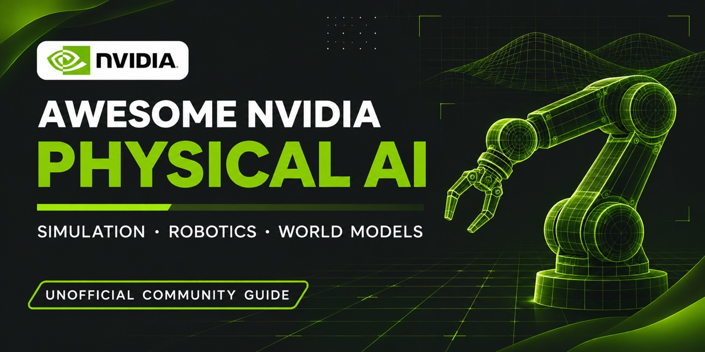
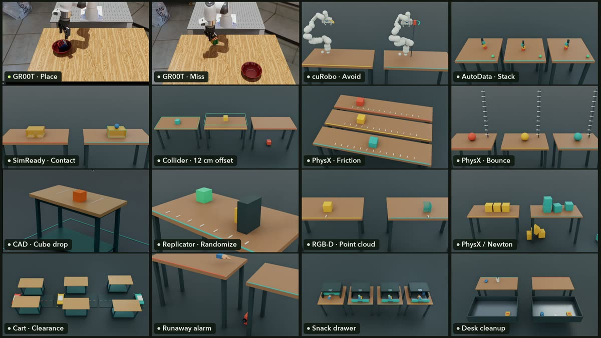
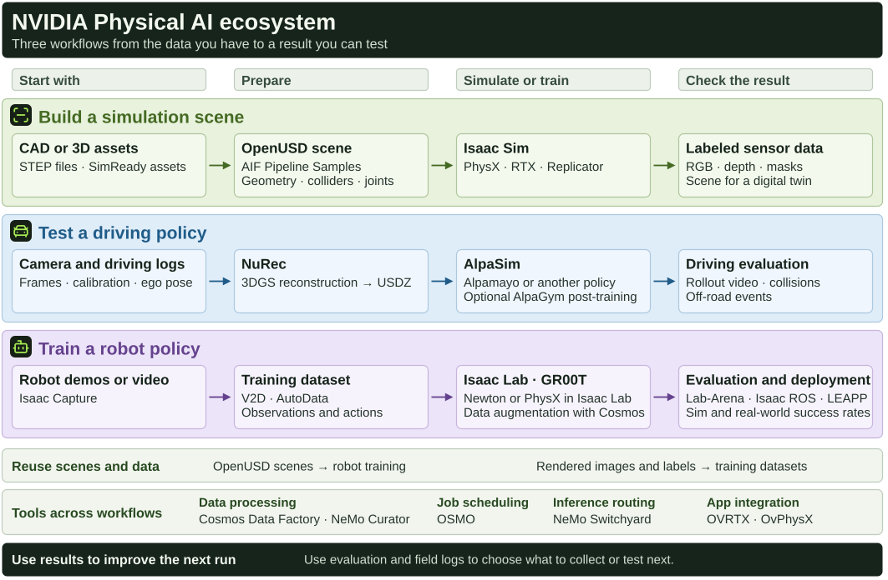

# Awesome NVIDIA Physical AI

**English** · [한국어](README.ko.md)

**Find the NVIDIA Physical AI tools for your project and see how they work together.**

An independent community guide to simulation, robot learning, autonomous driving, and the data they share.

[🧪 Start with a workflow](#start-with-what-you-want-to-build) · [🗺️ Ecosystem map](#ecosystem-at-a-glance) · [📚 Tool catalog](CATALOG.md) · [🌐 GitHub Pages](https://james-joobs.github.io/awesome-nvidia-physical-ai/)

[▶ Watch 16 Isaac Sim scenes](https://james-joobs.github.io/awesome-nvidia-physical-ai/showcase/) · [Try the interactive walkthrough](https://james-joobs.github.io/awesome-nvidia-physical-ai/#repo-tour)

## Start with what you want to build

| Your goal | Where to start | What to check first |
| --- | --- | --- |
| **Learn simulation basics** | [Drop a cube in Isaac Sim](docs/en/workflows/isaac-sim-first-cube.md) | Compare what happens with and without a collider. |
| **Build a scene from CAD** | [Workbench CAD → OpenUSD → Isaac Sim](docs/en/workflows/workbench-cad-to-isaac-sim.md) | Check tabletop dimensions and see whether the cube rests on it. |
| **Render labeled camera data** | [SimReady](docs/en/simready.md) → [Isaac Sim](docs/en/isaac-sim.md) → [Replicator](docs/en/replicator.md) | Export RGB, depth, and a segmentation mask for the same frame. |
| **Evaluate a driving policy** | [AlpaSim closed-loop walkthrough](docs/en/workflows/alpasim-closed-loop.md) | Review driving video, collision metrics, and off-road events. |
| **Test a robot policy** | [Choose and evaluate a robot foundation model](docs/en/robot-foundation-models.md) | Match a checkpoint to a robot or benchmark and record a baseline run. |

**From simulation to a real robot.** Follow the [Microduck guide](docs/en/microduck.md) to see how Isaac Lab and Newton are used to train a walking policy. [Try the browser simulator](https://huggingface.co/spaces/pollen-robotics/microduck-simulator).

## Ecosystem at a glance

A workbench from CAD can become a reusable simulation scene and a source of labeled camera data. The map traces that path alongside driving evaluation from recorded logs and robot learning from demonstrations.

## Explore the ecosystem

| Area | Guides to start with | Catalog section |
| --- | --- | --- |
| **Physics, 3D, and simulation** | [OpenUSD](docs/en/openusd.md) · [Isaac Sim](docs/en/isaac-sim.md) · [Newton](docs/en/newton.md) | [Simulation tools](CATALOG.md#physics-3d-and-simulation) |
| **Robot learning and control** | [Isaac Capture](docs/en/isaac-capture.md) · [Isaac Lab](docs/en/isaac-lab.md) | [Robotics tools](CATALOG.md#robot-learning-capture-and-control) |
| **Data and simulation assets** | [SimReady](docs/en/simready.md) · [Video to Data](docs/en/video-to-data.md) · [AutoData](docs/en/autodata.md) | [Datasets and assets](CATALOG.md#data-and-simulation-assets) |
| **Robot foundation models** | [GR00T](docs/en/groot-model.md) · [Physical Intelligence π](docs/en/physical-intelligence-pi.md) | [Robot models and VLAs](CATALOG.md#robot-foundation-models-and-vlas) |
| **Autonomous driving** | [NuRec](docs/en/nurec.md) · [Alpamayo](docs/en/alpamayo.md) · [AlpaSim](docs/en/alpasim.md) | [Driving tools](CATALOG.md#autonomous-driving) |
| **World models and NeMo** | [Cosmos](docs/en/cosmos.md) · [NeMo Curator](docs/en/nemo-curator.md) · [NeMo Switchyard](docs/en/nemo-switchyard.md) | [NeMo and Physical AI tooling](CATALOG.md#nemo-and-physical-ai-tooling) |

The catalog links to official sources and records license terms and availability. Open-source rows also show recent commits for the linked repositories.

[📚 Full Markdown catalog](CATALOG.md) · [🔎 Search and filter on Pages](https://james-joobs.github.io/awesome-nvidia-physical-ai/catalog/) · [📰 Upstream releases](CATALOG.md#recent-upstream-releases)

[🤝 Contributing](CONTRIBUTING.md) · [📄 MIT License](LICENSE) · [🖼️ Third-party credits](NOTICE.md) · [🏷️ Latest repository release](https://github.com/james-joobs/awesome-nvidia-physical-ai/releases/latest)
