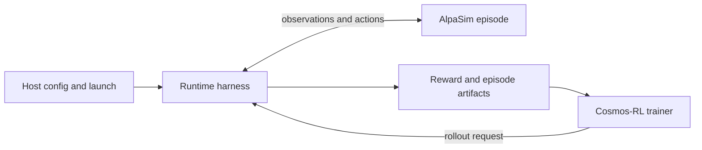

# AlpaGym

[← Catalog](../../README.md) · [한국어](../ko/alpagym.md)

AlpaGym links an autonomous-driving policy to AlpaSim for closed-loop experience and to Cosmos-RL for distributed policy updates.

## How does a closed-loop drive become a training score?

### Read an actual smoke-test configuration

The published two-GPU smoke test selects `clipgt-a309e228-26e1-423e-a44c-cb00aa7378cb`. Its `control_timestep_us=200000` is a 0.2-second control interval, and `n_sim_steps=30` configures thirty steps. With `force_gt_duration_us=1600000`, the first 1.6 seconds use recorded ego motion. The configuration sets `expected_valid_steps=22`. During a run, inspect completion and the actual number of valid steps together. [Official smoke-test YAML](https://github.com/NVlabs/alpagym/blob/972d160eed0e23d388497851504a3a233fec5879/packages/policies/alpamayo_r1/src/alpagym_alpamayo_r1/configs/experiment/alpamayo_1_5_local_2gpu_smoke.yaml)

### Work through the repository’s reward test

These values are the inputs and expected output of an upstream **reward unit test**. Measured driving scores come from a separate episode run.

| Metric | Test value | Weight | Contribution |
|---|---:|---:|---:|
| XY RMSE against the reference path | 1.0 m | −1.0 | −1.0 |
| Route `progress` | 0.5 | +1.0 | +0.5 |
| `collision_any` | 1.0 | −5.0 | −5.0 |
| Total | | | **−5.5** |

The configured reward profile sets the weights for a training run. AlpaGym sends the rollout and its score to Cosmos RL, then collects another round of driving experience with the updated policy. Keep the individual metrics so you can explain changes in the total. [Official reward test](https://github.com/NVlabs/alpagym/blob/972d160eed0e23d388497851504a3a233fec5879/packages/runtime/src/alpagym_runtime/rewards/tests/test_compute.py) · [Cosmos RL trainer and rollouts](cosmos-rl.md) · [AlpaSim evaluation lab](workflows/alpasim-closed-loop.md)

## How it works

The host resolves Hydra configuration, starts services, and manages local or Slurm launch artifacts. The runtime runs in a GPU container. Cosmos-RL requests rollouts, the episode runner calls AlpaSim over gRPC, and policy adapters batch inference. Reward terms score completed drives and episode transport returns artifacts for optimization.

### Component interfaces

| Component | Input | Output |
|---|---|---|
| Host | Resolved experiment configuration and scene list | Simulator launch and run artifacts |
| Runtime | Rollout request, policy and AlpaSim observations | Scored episode and observations for training |
| Cosmos-RL | Rollout artifacts and training settings | Updated policy weights |

## A practical workflow

Bring up the documented AlpaSim tutorial first. Train from a supported checkpoint on a small fixed scene set. Compare the starting and trained checkpoint on held-out routes and inspect cases where reward improved but the drive looks worse.

## What to verify

Save the resolved configuration, scene split, reward weights and policy checkpoints. Check which model adapters the checkout supports. Measure collision, route progress and rollout throughput independently so policy quality is distinguishable from system throughput.

## License and availability

Code: Apache-2.0; dependencies and models have separate terms. Models, data, dependencies and hosted services may have separate terms; check each source before use.

## Official references

- [Architecture and workflow documentation](https://github.com/NVlabs/alpagym#architecture)
- [Onboarding and prerequisites](https://github.com/NVlabs/alpagym/blob/main/docs/ONBOARDING.md)
- [Related official resource · github.com](https://github.com/NVlabs/alpagym)

## Related tools

See [Cosmos RL](cosmos-rl.md) for the rollout and trainer boundary and its upstream maintenance status.
