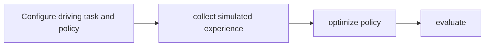

# AlpaGym

[Catalog](../../README.md) · [한국어](../ko/alpagym.md)

A reinforcement-learning toolkit for autonomous-driving policy development.

**Official sources:** [Repository](https://github.com/NVlabs/alpagym)

**License and access:** Code: Apache-2.0; dependencies and models have separate terms. Models, data, dependencies and hosted services may have separate terms; check each source before use.

**Architecture.** The host prepares configuration and launches the run. A runtime drives AlpaSim episodes and scores them; Cosmos-RL consumes rollout artifacts to train the policy. [Official architecture](https://github.com/NVlabs/alpagym#architecture).

## Workflow

The following conceptual diagram is an explanatory overview, not an official architecture diagram.

## Use case

Improve a driving policy through reinforcement learning in simulation.

## Related technologies

AlpaSim, autonomous-driving models. Confirm compatibility and runtime requirements in the documentation for each version.
