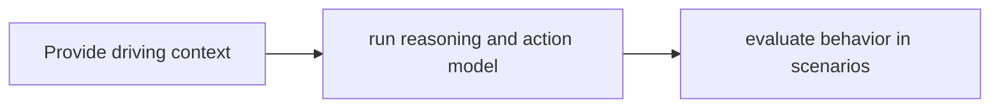

# Alpamayo

[← All projects](../../README.md) · [한국어](../ko/alpamayo.md)

## Overview

Autonomous-driving reasoning and action model family.

## Conceptual workflow

## Workflow and use

Provide driving context → run reasoning and action model → evaluate behavior in scenarios. This is a conceptual workflow; check the official source for version-specific prerequisites and supported configurations.

**Example use case:** evaluating driving decisions in simulation. Check applicability, supported inputs and model versions in the official source.

**Related technologies:** AlpaSim, AlpaGym.

## Architecture and example

Alpamayo is a family of driving reasoning and action models. AlpaSim supplies a closed-loop simulation environment and AlpaGym connects simulation rollouts to reinforcement-learning training.

Evaluate candidate driving trajectories in a simulated scenario and compare model behavior against defined metrics.

[Official technical source](https://github.com/NVlabs/alpamayo-recipes)

## Availability and terms

Access and license terms for weights vary by model version. Verify the exact version and the terms of any models, datasets, binaries and dependencies before use.

## Official sources

[AlpaSim model guide](https://github.com/NVlabs/alpasim/blob/main/docs/TUTORIAL.md)
