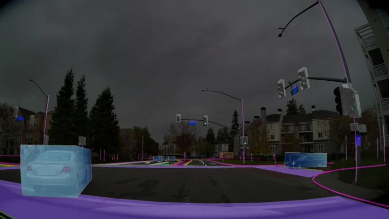

# AlpaSim

[← Catalog](../../README.md) · [한국어](../ko/alpasim.md)

   
  <a href="https://github.com/NVlabs/alpasim/blob/affc2eab209fa43bdfa2f26c0f8d437922d78a68/docs/VIDEO_MODEL.md#how-it-works">Representative camera frame from the official AlpaSim video renderer guide</a>

AlpaSim evaluates autonomous driving policies in a closed loop. As the policy moves the ego vehicle, the next sensor observations are rendered from the new state.

*The runtime orchestrates the components and writes logs for a separate evaluator. Follow the rendered observations back to the driver to see where the loop closes.* [Official figure source](https://github.com/NVlabs/alpasim/blob/main/docs/DESIGN.md)

*The driving example shows the output you can inspect alongside episode metrics.* [Official figure source](https://github.com/NVlabs/alpasim)

## How it works

The runtime advances simulation time and calls Python services through gRPC. The renderer produces observations from a scene and pose. The driver converts observations into a plan, and the controller and physics advance the ego state under vehicle and ground constraints. The evaluator runs over recorded output outside the main loop. Rendering backends can share a service interface, including the documented neural reconstruction and video-model backends.

### Component interfaces

| Component | Input | Output |
|---|---|---|
| Renderer | Scene, camera configuration and simulation state | Frames for the driver |
| Driver and controller | Rendered observations, route and ego state | Policy trajectory, then vehicle commands |
| Runtime and evaluator | Service outputs and simulation clock | Episode logs and derived metrics |

## A practical workflow

Start with a tutorial scene and reference driver. Keep the scene, route and initial pose fixed while changing one policy checkpoint. Inspect trajectory, collisions and route progress in the logs, then inspect the rendered video around failures. Repeat across scenes to avoid drawing conclusions from one reconstruction.

## What to verify

Check scene and renderer compatibility, service health and route or camera configuration before comparing policies. The design prioritizes sensor fidelity and scale, so use a separate vehicle validation setup when precise dynamics or real-time operation is required.

## License and availability

Code: Apache-2.0; models and data have separate terms. Models, data, dependencies and hosted services may have separate terms; check each source before use.

## Official references

- [Architecture and workflow documentation](https://github.com/NVlabs/alpasim/blob/main/docs/DESIGN.md)
