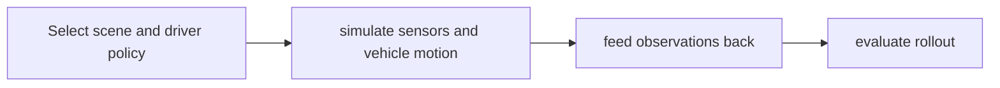

# AlpaSim

[Catalog](../../README.md) · [한국어](../ko/alpasim.md)

A modular autonomous-driving simulator for testing policies in a closed feedback loop.

**Official sources:** [Repository](https://github.com/NVlabs/alpasim)

**License and access:** Code: Apache-2.0; models and data have separate terms. Models, data, dependencies and hosted services may have separate terms; check each source before use.

Image source: [AlpaSim](https://github.com/NVlabs/alpasim)

**Architecture.** A driver policy receives simulated observations and returns trajectories; the simulator advances the vehicle and supplies the next observation. The modular services and their interfaces are described in the [official design](https://github.com/NVlabs/alpasim/blob/main/docs/DESIGN.md).

## Workflow

The following conceptual diagram is an explanatory overview, not an official architecture diagram.

## Use case

Compare autonomous-driving policies and test challenging scenarios.

## Related technologies

Alpamayo, AlpaGym, NuRec. Confirm compatibility and runtime requirements in the documentation for each version.
