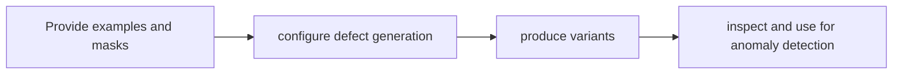

# AnomalyGen

[← All projects](../../README.md) · [한국어](../ko/anomalygen.md)

Image: official project source linked below.

## Overview

Generates defect images from a small number of examples.

## Conceptual workflow

## Workflow and use

Provide examples and masks → configure defect generation → produce variants → inspect and use for anomaly detection. This is a conceptual workflow; check the official source for version-specific prerequisites and supported configurations.

**Example use case:** creating examples of manufacturing defects. Check applicability, supported inputs and model versions in the official source.

**Related technologies:** Cosmos Data Factory.

## Architecture and example

The documented pipeline prepares real anomaly examples and masks, generates placement masks, fine-tunes a generator, synthesizes candidates and evaluates or refines them before pseudo-labeling.

Use a few labeled PCB defect examples to create mask-aligned synthetic defects for an inspection model.

[Official technical source](https://github.com/NVIDIA/cdf-anomalygen)

## Availability and terms

Public repository; terms for code, models, and adapters unverified. Verify the exact version and the terms of any models, datasets, binaries and dependencies before use.

## Official sources

[Repository](https://github.com/NVIDIA/cdf-anomalygen)
