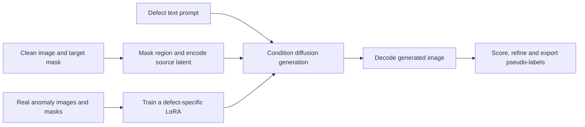

# AnomalyGen

[← All projects](../../README.md) · [한국어](../ko/anomalygen.md)

AnomalyGen generates defect images with target masks for visual inspection. Its texture workflow takes real defect examples and clean images and trains a small adaptation for the chosen defect type.

## How defect placement and rendering connect

This image illustrates the Auto Mask Placement route. It places available defect submasks according to routing rules. The documented default Agentic Mask Generation route uses a propose, judge and refine loop with a vision-language model. Both produce placement metadata for generation. [Official workflow](https://github.com/NVIDIA/cdf-anomalygen#overview) · [Agentic mask generation](https://github.com/NVIDIA/cdf-anomalygen/blob/main/docs/tutorial/texture/3-agentic-mask-generation.md)

This guide diagram separates training references from generation inputs. The generated batch is scored against real references. Refinement can select among repeated candidate generations and pseudo-labeling can export instance or classification layouts. [Official evaluation and refinement](https://github.com/NVIDIA/cdf-anomalygen/blob/main/docs/tutorial/texture/6-evaluation-and-refinement.md)

## Worked example — simulate scratches on glass

Reserve real scratched samples for evaluation. For a few clean images, check that masks follow allowable regions, then inspect whether generated changes remain inside the intended area and resemble the real scratch under comparable lighting. Compare a classifier trained with and without the generated variants on the held-out real set. [Glass dataset](https://huggingface.co/datasets/nvidia/Cosmos-AnomalyGen-Glass-Masks)

Check code, base weights, adapters and source data separately for applicable terms. [Official repository](https://github.com/NVIDIA/cdf-anomalygen)
