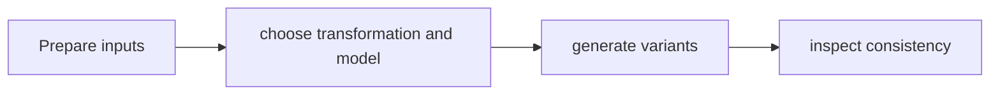

# CDF Augmentation (formerly paidf-augmentation)

[Catalog](../../README.md) · [한국어](../ko/cdf-augmentation.md)

Tools for generating visual and text variations from existing data using model-backed workflows.

**Official sources:** [Repository](https://github.com/NVIDIA/cdf-augmentation)

**License and access:** Apache-2.0; models have separate terms. Models, data, dependencies and hosted services may have separate terms; check each source before use.

Image source: [CDF Augmentation (formerly paidf-augmentation)](https://github.com/NVIDIA/cdf-augmentation)

## Workflow

The following conceptual diagram is an explanatory overview, not an official architecture diagram.

## Use case

Expand weather, lighting or appearance coverage where capturing new examples is costly.

## Related technologies

Cosmos Data Factory, Cosmos models, Cosmos Evaluator. Confirm compatibility and runtime requirements in the documentation for each version.
