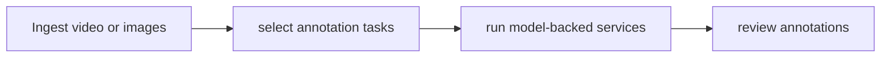

# CDF Auto Labeling (formerly paidf-auto-labeling)

[Catalog](../../README.md) · [한국어](../ko/cdf-auto-labeling.md)

A framework for constructing automated annotation services from reusable tasks.

**Official sources:** [Repository](https://github.com/NVIDIA/cdf-auto-labeling)

**License and access:** Apache-2.0; models and services have separate terms. Models, data, dependencies and hosted services may have separate terms; check each source before use.

Image source: [CDF Auto Labeling (formerly paidf-auto-labeling)](https://github.com/NVIDIA/cdf-auto-labeling)

**Architecture.** The workspace separates shared core abstractions, individual annotation task packages and services that compose those tasks. [Architecture source](https://github.com/NVIDIA/cdf-auto-labeling/blob/main/AGENTS.md).

## Workflow

The following conceptual diagram is an explanatory overview, not an official architecture diagram.

## Use case

Produce candidate detections, tracks, captions or other labels to accelerate dataset preparation.

## Related technologies

Cosmos Data Factory, Cosmos Curator. Confirm compatibility and runtime requirements in the documentation for each version.
