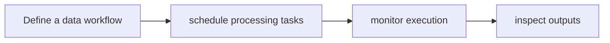

# CDF Orchestration

[← All projects](../../README.md) · [한국어](../ko/cdf-orchestration.md)

Image: official project source linked below.

## Overview

Runs and manages data factory workflows.

## Conceptual workflow

## Workflow and use

Define a data workflow → schedule processing tasks → monitor execution → inspect outputs. This is a conceptual workflow; check the official source for version-specific prerequisites and supported configurations.

**Example use case:** managing video processing workflows. Check applicability, supported inputs and model versions in the official source.

**Related technologies:** Cosmos Data Factory, OSMO.

## Architecture and example

The orchestrator packages Airflow DAGs and plugins into a controller image and deploys workflow tasks and GPU inference services on Kubernetes. Some documented workflows also support OSMO.

Run a video augmentation DAG to vary lighting and weather and produce associated annotations.

[Official technical source](https://github.com/NVIDIA/cdf-orchestration)

## Availability and terms

The repository states Apache-2.0; execution services and dependencies may have separate terms. Verify the exact version and the terms of any models, datasets, binaries and dependencies before use.

## Official sources

[Repository](https://github.com/NVIDIA/cdf-orchestration)
