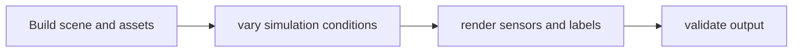

# CDF Simulation (formerly paidf-simulation)

[Catalog](../../README.md) · [한국어](../ko/cdf-simulation.md)

Simulation workflows for rendering labeled synthetic imagery with Isaac Sim and Replicator.

**Official sources:** [Repository](https://github.com/NVIDIA/cdf-simulation)

**License and access:** Apache-2.0; simulator and assets have separate terms. Models, data, dependencies and hosted services may have separate terms; check each source before use.

Image source: [CDF Simulation (formerly paidf-simulation)](https://github.com/NVIDIA/cdf-simulation)

## Workflow

The following conceptual diagram is an explanatory overview, not an official architecture diagram.

## Use case

Generate inspection examples from simulated objects when real labeled data is scarce.

## Related technologies

Isaac Sim, Replicator, SimReady, Cosmos Data Factory. Confirm compatibility and runtime requirements in the documentation for each version.
