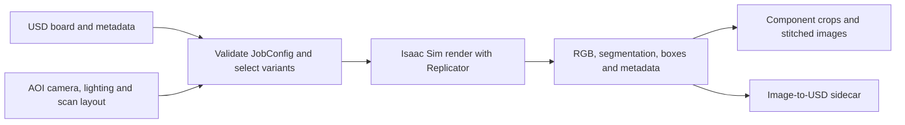

# CDF Simulation (formerly paidf-simulation)

[Catalog](../../README.md) · [한국어](../ko/cdf-simulation.md)

CDF Simulation renders labeled PCB inspection scenes with Isaac Sim and Replicator. A prepared USD scene and board metadata define component placement, and the job configuration selects lighting, camera, scanner coverage and defect variants.

## Inspect the rendered result

The official montage shows excess solder, a tombstoned component, simulated solder joints and interrupted wetting under different lights and camera angles. These variations change which defects are visible, so compare render settings to the intended inspection rig. [Official PCB simulation README](https://github.com/NVIDIA/cdf-simulation)

The guide diagram follows the published YAML and Python entry points. Compile YAML first to check configuration, then render. Depending on the job, post-processing can preserve links from stitched pixels back to USD coordinates. [Configuration guide](https://github.com/NVIDIA/cdf-simulation/blob/main/pcb_aoi/config/README.md) · [Image-to-USD sidecar](https://github.com/NVIDIA/cdf-simulation/blob/main/docs/image-to-usd-sidecar.md)

This example shows the full board in the inspection camera view. Use it to see where component crops and close-ups come from. [Official simulation recipes](https://github.com/NVIDIA/cdf-simulation/blob/main/COOKBOOK.md)

## Worked example — build an AOI defect slice

Render a clean board and selected shifts and tombstones at a fixed camera and lighting setting. Inspect RGB and segmentation together, and check that crop boxes still contain the defect after stitching. Compare against a small set of real inspection images before mixing simulated data into training. Track board and component IDs to avoid leaking variants across splits. [Defect variant guide](https://github.com/NVIDIA/cdf-simulation/blob/main/docs/defect-variants.md)

Code is Apache-2.0. Isaac Sim, the optional solder solver, containers and source scenes have their own requirements and terms. [Official requirements and license](https://github.com/NVIDIA/cdf-simulation#license)
