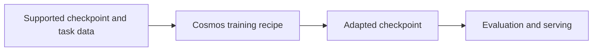

# Cosmos Framework

[← Catalog](../../README.md) · [한국어](../ko/cosmos-framework.md)

Training, post-training, evaluation and serving recipes for Cosmos 3.

## Architecture and data flow

The framework couples supported Cosmos 3 checkpoints with recipes for data preprocessing, model execution and training. Different inputs and targets apply to the reasoner and generator. The documented training options include SFT and model-specific RL or preference workflows. Serving and evaluation consume compatible exported or prepared checkpoints.

Guide illustration based on the official sources below.

## Physical AI example

Adapt a supported Cosmos 3 reasoner to timestamped industrial video Q&A. Validate the input manifest and processor on a few samples, compare baseline and post-trained accuracy on held-out scenes, and verify serving outputs use the same preprocessing.

## What to verify

Use the checkpoint-specific recipe and confirm artifact terms. The repository declares OpenMDW-1.1. Check model, dataset and serving terms separately.

## License and availability

OpenMDW-1.1 repository code. Check the terms of each model and artifact.

## Official sources

- [Repository](https://github.com/NVIDIA/cosmos-framework)
- [Framework documentation](https://nvidia.github.io/cosmos-framework/)
- [Checkpoint and serving matrix](https://nvidia.github.io/cosmos-framework/models/)
- [Repository license](https://github.com/NVIDIA/cosmos-framework/blob/HEAD/LICENSE)

## Related guides

[Cosmos](cosmos.md) · [Cosmos RL](cosmos-rl.md)
