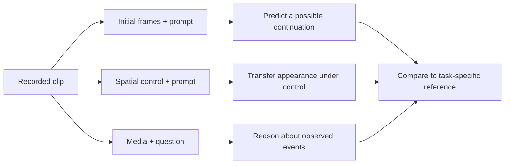

# Cosmos Predict / Transfer / Reason

[← All projects](../../README.md) · [한국어](../ko/cosmos-models.md)

Predict, Transfer and Reason name three jobs in the Cosmos portfolio. Choose the task by its input and output before selecting a legacy or Cosmos 3 checkpoint.

| Job | Conditioning | Result | Check before reuse |
|---|---|---|---|
| Predict | Text, initial frames or action data for a checkpoint supporting that modality | A possible visual continuation | Object persistence and consistency with input motion |
| Transfer | Source media or spatial control such as edges, depth or segmentation | A restyled sequence following the controls | Geometry, actor timing and annotation alignment |
| Reason | Media and a question or instruction | Text, time references or grounding where supported | Agreement with manually labeled frames |

## Compare tasks on one recording

A short drive can support three experiments. Predict extends the opening observation, Transfer changes the lighting while conditioning on road structure, and Reason answers which actor entered the crosswalk. Store each output with the model, input revision, frame timing and prompt. [Official technical overview](https://developer.nvidia.com/blog/scale-synthetic-data-and-physical-ai-reasoning-with-nvidia-cosmos-world-foundation-models/)

The official example shows generated first-person video beside motion conditioning. Inspect how hand motion follows the supplied condition and whether hand-tool contact remains coherent across frames. [NVIDIA Cosmos demos](https://github.com/NVIDIA/cosmos)

This guide diagram separates the input contracts. [Cosmos 3](cosmos.md) covers multiple jobs through Reasoner and Generator. Legacy examples have separate [Predict2](cosmos-predict2.md) and [Reason2](cosmos-reason2.md) interfaces. Check the chosen weights and runtime for supported modalities and terms. [Official model reference](https://docs.nvidia.com/cosmos/latest/cosmos3/model_reference.html)
