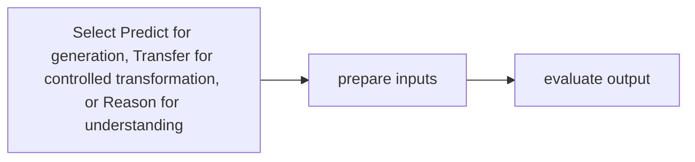

# Cosmos Predict / Transfer / Reason

[← All projects](../../README.md) · [한국어](../ko/cosmos-models.md)

## Overview

Model families for world/video generation, visual transformation, and scene reasoning.

## Conceptual workflow

## Workflow and use

Select Predict for generation, Transfer for controlled transformation, or Reason for understanding → prepare inputs → evaluate output. This is a conceptual workflow; check the official source for version-specific prerequisites and supported configurations.

**Example use case:** generating varied driving videos. Check applicability, supported inputs and model versions in the official source.

**Related technologies:** Cosmos Data Factory, Cosmos Evaluator.

## Architecture and example

Predict generates world/video continuations, Transfer changes visual appearance under controls, and Reason analyzes visual scenes. Supported controls and modality vary by release.

Use a driving clip to generate weather variants with Transfer, then inspect the resulting clips for consistency.

[Official technical source](https://github.com/NVIDIA/cosmos)

## Availability and terms

Check the terms for each model version and its weights. Verify the exact version and the terms of any models, datasets, binaries and dependencies before use.

## Official sources

[Cosmos](https://github.com/NVIDIA/cosmos)
