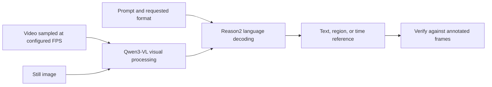

# Cosmos Reason2 code

[Catalog](../../README.md) · [한국어](../ko/cosmos-reason2.md)

Cosmos Reason2 is a vision-language model family for physical common sense and embodied reasoning. Its repository provides prompts, inference examples and utilities. Fetch the weights and choose a compatible inference runtime separately.

## Follow the information through the model

The diagram summarizes the interfaces of the Qwen3-VL based model. Text defines what to answer, and an image or sampled frames provide scene evidence. Sampling too slowly can remove the frames distinguishing an impact from a near miss. Higher sampling rates and longer clips consume more context. [Official inference examples](https://github.com/nvidia-cosmos/cosmos-reason2#inference) · [Model card](https://huggingface.co/nvidia/Cosmos-Reason2-8B)

The image is used in NVIDIA’s still-image reasoning example. Read it alongside the prompt and sample output to compare the generated answer with visible scene evidence. [Embodied reasoning prompt](https://github.com/nvidia-cosmos/cosmos-reason2/blob/main/prompts/embodied_reasoning.yaml) · [Sample output](https://github.com/nvidia-cosmos/cosmos-reason2/blob/main/assets/outputs/embodied_reasoning.log)

## Worked example — timestamp a warehouse event

Ask for the start and end of a pallet movement on a short clip. Run temporal localization with a recorded FPS and save the sampled frames. Compare the predicted interval with human annotations. Inspect false positives where a person occludes the pallet, and repeat with a higher sampling rate to separate frame-selection errors from reasoning errors. [Temporal localization example](https://github.com/nvidia-cosmos/cosmos-reason2#deployment)

Model cards are available for 2B, 8B and 32B. Source is Apache-2.0, and documented weights use NVIDIA Open Model License. See [Cosmos 3](cosmos.md) for the unified family. [Official license section](https://github.com/nvidia-cosmos/cosmos-reason2#license-and-contact)
