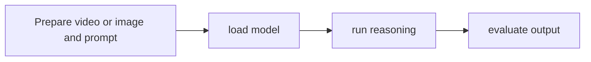

# Cosmos Reason2 code

[Catalog](../../README.md) · [한국어](../ko/cosmos-reason2.md)

Code for training and running a world-reasoning model on visual inputs.

**Official source:** [Repository](https://github.com/nvidia-cosmos/cosmos-reason2)

**License:** Apache-2.0 code; model weights separately licensed.

## Workflow

This diagram is a conceptual overview.

## Use case

Study physical events and visual reasoning in video.

## Related technologies

Cosmos, Cosmos datasets.
