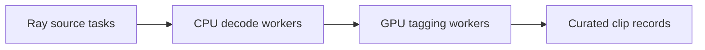

# Cosmos Xenna

[← Catalog](../../README.md) · [한국어](../ko/cosmos-xenna.md)

Ray-based distributed stage execution used by curation pipelines.

> **Limited maintenance**

## Architecture and data flow

The library creates Ray actors for stage workers and uses an orchestrator to move data between them. The streaming autoscaler allocates resources across stages based on throughput. NeMo Curator documents an executor based on Xenna. Cosmos Curator also has Ray Data paths.

Guide illustration based on the official sources below.

## Physical AI example

For a clip pipeline, measure decode throughput separately from GPU tagging throughput. Size worker pools to reduce the bottleneck and record queue depths and processing failures. Verify output records against a single-worker reference.

## What to verify

The upstream repository announces limited maintenance. Confirm the execution backend and versions for the curation release before adding a Xenna dependency.

## License and availability

Apache-2.0 repository code. Model weights, external services and dependencies can have separate terms.

## Official sources

- [Repository](https://github.com/nvidia-cosmos/cosmos-xenna)
- [Documented Curator executor integration](https://docs.nvidia.com/nemo/curator/about/concepts/video/architecture)
- [Repository license](https://github.com/nvidia-cosmos/cosmos-xenna/blob/HEAD/LICENSE)

## Related guides

[NeMo Curator](nemo-curator.md) · [Cosmos Curator](cosmos-curator.md)
