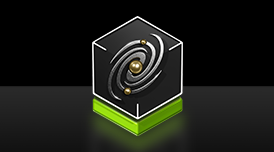

# Cosmos and Cosmos 3

[← All projects](../../README.md) · [한국어](../ko/cosmos.md)

   
  <a href="https://github.com/NVIDIA/cosmos/blob/71317702510f7c456ba3d702b84fb103546caea2/assets/brand/cosmos-logo.png">Official NVIDIA Cosmos logo</a>

Cosmos is NVIDIA’s world-model platform for physical AI. Cosmos 3 is the model family that combines multimodal reasoning and generation. The platform also provides separate training, curation and evaluation tools.

NVIDIA published four [interactive simulation checkpoints](https://huggingface.co/blog/nvidia/cosmos-interactive-world-simulation) under OpenMDW-1.1 in November 2026. Sim-Bimanual predicts video given robot or camera actions, Sim-Transfer renders video from simulator controls, and Sim-Auto and Transfer-Auto serve driving workflows. For models that output robot actions, see the [Cosmos Policy entries](robot-foundation-models.md#cosmos-policy).

## Read the official architecture

The Reasoner and Generator are jointly trained transformer towers with a shared representation. Reasoner grounds language in visual context. Generator uses grounded context and generation conditions to produce outputs supported by the checkpoint. The NIM image exposes separate Reasoner and Generator runtimes, so a unified model architecture does not imply a shared request contract. [NVIDIA technical report](https://research.nvidia.com/labs/cosmos-lab/cosmos3/technical-report.pdf) · [NIM architecture](https://docs.nvidia.com/nim/cosmos/latest/overview.html)

In the attention mask on the right, the purple region is causal. The Reasoner reads its earlier vision and language tokens while predicting text. The orange region shows the Generator's diffusion tokens attending to both token groups. Image and video enter that branch through a visual VAE, with separate encoders for audio and action. This explains how the Generator can use context from the Reasoner while the Reasoner can run by itself. [Cosmos 3 technical report, model architecture](https://research.nvidia.com/labs/cosmos-lab/cosmos3/technical-report.pdf)

| Job | Send | Receive |
|---|---|---|
| Reasoning | Video and a question about an object's movement | Text or a structured observation, depending on serving configuration |
| Forward dynamics | Initial observation and an action sequence in the checkpoint's format | Generated rollout conditioned on those actions |
| Transfer | Prompt and supported spatial controls | Video conditioned on the supplied scene layout |
| Policy | Views, task and state expected by the embodiment | Action prediction in the checkpoint's representation |

Check frame limits, media modes and action dimensions for the chosen checkpoint. Super, Nano and Edge share the model family architecture while their supported tasks and inference integrations vary. [Official model reference](https://docs.nvidia.com/cosmos/latest/cosmos3/model_reference.html)

## Worked example — generate driving scene variants

NVIDIA’s demo shows a driving control layout alongside generated footage. For an experiment, fix camera paths and layout controls, change the weather prompt, and compare actor position, lane layout and movement timing against the controls. Keep model revision, seed and source sequence ID with every result. Measure any downstream improvement on real drives held out by source session. Generated footage can suggest plausible outcomes. Use a suitable simulator or recorded measurements to validate collision or contact outcomes. [Official demos and recipes](https://github.com/NVIDIA/cosmos) · [Cosmos Evaluator](cosmos-evaluator.md)

## Availability

The Cosmos 3 repository identifies OpenMDW-1.1 for code and models. The earlier [Predict2](cosmos-predict2.md) and [Reason2](cosmos-reason2.md) repositories document separate terms. [Official license section](https://github.com/NVIDIA/cosmos#citation--license)

## Related tools

See [Cosmos Framework](cosmos-framework.md) for checkpoint-specific training, post-training and serving recipes. [NVIDIA NIM](nvidia-nim.md) covers packaged inference endpoints.
