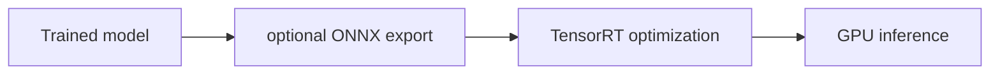

# CUDA / TensorRT / ONNX

[← All projects](../../README.md) · [한국어](../ko/cuda-tensorrt-onnx.md) · [Official source](https://github.com/onnx/onnx) · [Documentation / related project](https://developer.nvidia.com/tensorrt)

A GPU computing platform (CUDA), an inference optimization SDK (TensorRT), and an open model interchange format and ecosystem (ONNX).

**Availability and terms:** ONNX code and specification have their own terms. CUDA and TensorRT product distributions, drivers and third-party components have separate NVIDIA or third-party conditions.

## Architecture and workflow

*Conceptual illustration for this guide; refer to official sources for supported implementations.*

Export a supported model to ONNX where appropriate, build an inference engine for the target environment, then compare output and performance against the original.

## Use cases

Optimize supported vision or robot-policy inference for an NVIDIA GPU.

## Connections

PyTorch can export supported models to ONNX; TensorRT uses NVIDIA GPU software. The exact export and runtime path depends on operator support and versions.

## Official references

- [Project source](https://github.com/onnx/onnx)
- [Documentation / related project](https://developer.nvidia.com/tensorrt)
- [CUDA](https://developer.nvidia.com/cuda-toolkit)
- [TensorRT](https://developer.nvidia.com/tensorrt)
- [ONNX](https://onnx.ai/)
