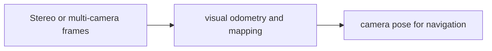

# cuVSLAM

[← All projects](../../README.md) · [한국어](../ko/cuvslam.md)

Image: official project source linked below.

## Overview

CUDA-accelerated visual odometry and SLAM library.

## Conceptual workflow

## Workflow and use

Stereo or multi-camera frames → visual odometry and mapping → camera pose for navigation. This is a conceptual workflow; check the official source for version-specific prerequisites and supported configurations.

**Example use case:** robot localization in a warehouse. Check applicability, supported inputs and model versions in the official source.

**Related technologies:** Isaac ROS Visual SLAM.

## Architecture and practical details

Camera calibration and synchronized visual observations feed visual odometry and mapping; estimated poses can be consumed by a navigation application. For a warehouse mobile robot, compare tracking quality under motion, texture and lighting changes before deploying. Isaac ROS Visual SLAM is a separate ROS integration, and cuVSLAM has its own terms.

[Official documentation](https://github.com/nvidia-isaac/cuVSLAM)

## Availability and terms

NVIDIA Community License restricts use to NVIDIA platforms; distinct from its ROS wrapper. Verify the exact version and the terms of any models, datasets, binaries and dependencies before use.

## Official sources

[Repository](https://github.com/nvidia-isaac/cuVSLAM)
