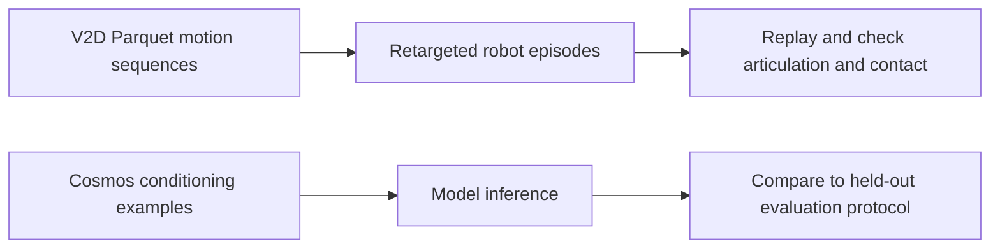

# V2D and Cosmos datasets

[Catalog](../../README.md) · [한국어](../ko/datasets-v2d-cosmos.md)

The entries serve different roles in V2D and Cosmos workflows. Some provide motion and actions, some are conditioning examples, and some are held out for evaluation.

## Match the artifact to the recipe

| Goal | Representative data | What to verify |
|---|---|---|
| Inspect human-to-robot motion conversion | [V2D dexterity task library](#video-to-data-robot-dexterity-task-library-and-dataset) | Parquet motion sequence, robot episode, embodiment and action definition |
| Post-train or benchmark video reasoning | Reason1 [SFT](#cosmos-reason1-sft-dataset), [RL](#cosmos-reason1-rl-dataset), [benchmark](#cosmos-reason1-benchmark) | Which split provides prompts, supervision or evaluation |
| Reproduce Transfer conditioning | [LiDAR example](#cosmos-transfer-lidargen-example) or [AV sample](#cosmos-transfer1-7b-sample-av-data-example) | Camera, control modality, frame rates and matching checkpoint |
| Train or replay robot episodes | [Cosmos3-DROID](#cosmos3-droid), or Cosmos Policy datasets below | Video view keys, state and action arrays, timestamps and episode boundaries |

The guide diagram separates motion replay from conditioned generation. The V2D card documents Parquet and LeRobot v3 outputs with video, motion trajectories and actions. Cosmos3-DROID documents a different LeRobot v3 conversion with sharded MP4 views, Parquet state/action records, task metadata and episode boundaries. [V2D data card](https://huggingface.co/datasets/nvidia/video-to-data-robot-dexterity-task-library-and-dataset) · [DROID data card](https://huggingface.co/datasets/nvidia/Cosmos3-DROID)

The official pipeline traces human demonstration video through ingestion, reconstruction and robot grounding in Isaac Lab. The dataset below provides examples of motion and action outputs from that path. A user can inspect replayable artifacts independently of later policy training or robot deployment. [Official Video to Data pipeline](https://github.com/nvidia-isaac/video_to_data)

## Worked example — verify one DROID episode before training

Read meta/info.json for feature names and decode the exterior and wrist views for one episode. Plot or replay the associated joint and gripper values over the same frame indices. Check action convention and coordinate frame before adapting the sequence to a different robot. For V2D, inspect the human motion and retargeted robot rollout separately to catch joint limits or missed contacts. [DROID schema](https://huggingface.co/datasets/nvidia/Cosmos3-DROID#features) · [Video-to-Data](video-to-data.md)

## Dataset details

### video-to-data-robot-dexterity-task-library-and-dataset

V2D human hand demonstrations retargeted to robot hands.

**License and access:** CC BY 4.0; public.  
**Official dataset card:** [video-to-data-robot-dexterity-task-library-and-dataset](https://huggingface.co/datasets/nvidia/video-to-data-robot-dexterity-task-library-and-dataset)

### Cosmos-Reason1-RL-Dataset

Video and text annotations for reasoning reinforcement learning.

**License and access:** License unverified; public.  
**Official dataset card:** [Cosmos-Reason1-RL-Dataset](https://huggingface.co/datasets/nvidia/Cosmos-Reason1-RL-Dataset)

### Cosmos-Reason1-Benchmark

Video reasoning evaluation annotations.

**License and access:** License unverified; public.  
**Official dataset card:** [Cosmos-Reason1-Benchmark](https://huggingface.co/datasets/nvidia/Cosmos-Reason1-Benchmark)

### Cosmos-Reason1-SFT-Dataset

Video and text annotations for supervised reasoning.

**License and access:** CC BY 4.0; public.  
**Official dataset card:** [Cosmos-Reason1-SFT-Dataset](https://huggingface.co/datasets/nvidia/Cosmos-Reason1-SFT-Dataset)

### Cosmos-Transfer-LidarGen-Example

LiDAR generation example data.

**License and access:** Other terms; access gated.  
**Official dataset card:** [Cosmos-Transfer-LidarGen-Example](https://huggingface.co/datasets/nvidia/Cosmos-Transfer-LidarGen-Example)

### Cosmos-Transfer1-7B-Sample-AV-Data-Example

Sample autonomous-driving input for Cosmos Transfer.

**License and access:** CC BY 4.0; access gated.  
**Official dataset card:** [Cosmos-Transfer1-7B-Sample-AV-Data-Example](https://huggingface.co/datasets/nvidia/Cosmos-Transfer1-7B-Sample-AV-Data-Example)

### ALOHA-Cosmos-Policy

Real bimanual manipulation dataset for Cosmos Policy.

**License and access:** CC tag; exact terms require review.  
**Official dataset card:** [ALOHA-Cosmos-Policy](https://huggingface.co/datasets/nvidia/ALOHA-Cosmos-Policy)

### LIBERO-Cosmos-Policy

LIBERO simulation benchmark data adapted for Cosmos Policy.

**License and access:** CC tag; exact terms require review.  
**Official dataset card:** [LIBERO-Cosmos-Policy](https://huggingface.co/datasets/nvidia/LIBERO-Cosmos-Policy)

### RoboCasa-Cosmos-Policy

RoboCasa simulation benchmark data adapted for Cosmos Policy.

**License and access:** CC tag; exact terms require review.  
**Official dataset card:** [RoboCasa-Cosmos-Policy](https://huggingface.co/datasets/nvidia/RoboCasa-Cosmos-Policy)

### Cosmos-HumanEval-v1

Human evaluation data for Cosmos outputs.

**License and access:** Other terms; check card.  
**Official dataset card:** [Cosmos-HumanEval-v1](https://huggingface.co/datasets/nvidia/Cosmos-HumanEval-v1)

### Cosmos-AnomalyGen-PCB-Dataset

PCB defect generation data.

**License and access:** Other terms; check card.  
**Official dataset card:** [Cosmos-AnomalyGen-PCB-Dataset](https://huggingface.co/datasets/nvidia/Cosmos-AnomalyGen-PCB-Dataset)

### Cosmos-AnomalyGen-Glass-Masks

Masks for glass defect generation.

**License and access:** License unverified; public.  
**Official dataset card:** [Cosmos-AnomalyGen-Glass-Masks](https://huggingface.co/datasets/nvidia/Cosmos-AnomalyGen-Glass-Masks)

### Cosmos3-DROID

Robot manipulation demonstrations for Cosmos 3.

**License and access:** OpenMDW-1.1; public.  
**Official dataset card:** [Cosmos3-DROID](https://huggingface.co/datasets/nvidia/Cosmos3-DROID)

### Cosmos3-Driving-Simulation-Evaluation

Driving simulation evaluation controls and captions.

**License and access:** OpenMDW-1.1; public.  
**Official dataset card:** [Cosmos3-Driving-Simulation-Evaluation](https://huggingface.co/datasets/nvidia/Cosmos3-Driving-Simulation-Evaluation)
