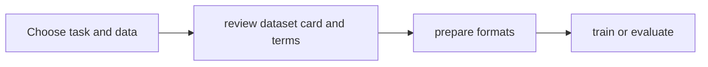

# V2D and Cosmos datasets

[Catalog](../../README.md) · [한국어](../ko/datasets-v2d-cosmos.md)

Review each official dataset card for formats, access requirements and license. Public access does not mean unrestricted use.

## Selection and use

This is a conceptual workflow.

## Dataset details

### video-to-data-robot-dexterity-task-library-and-dataset

V2D human hand demonstrations retargeted to robot hands.

**License and access:** CC BY 4.0; public.  
**Official dataset card:** [video-to-data-robot-dexterity-task-library-and-dataset](https://huggingface.co/datasets/nvidia/video-to-data-robot-dexterity-task-library-and-dataset)

### Cosmos-Reason1-RL-Dataset

Video and text annotations for reasoning reinforcement learning.

**License and access:** License unverified; public.  
**Official dataset card:** [Cosmos-Reason1-RL-Dataset](https://huggingface.co/datasets/nvidia/Cosmos-Reason1-RL-Dataset)

### Cosmos-Reason1-Benchmark

Video reasoning evaluation annotations.

**License and access:** License unverified; public.  
**Official dataset card:** [Cosmos-Reason1-Benchmark](https://huggingface.co/datasets/nvidia/Cosmos-Reason1-Benchmark)

### Cosmos-Reason1-SFT-Dataset

Video and text annotations for supervised reasoning.

**License and access:** CC BY 4.0; public.  
**Official dataset card:** [Cosmos-Reason1-SFT-Dataset](https://huggingface.co/datasets/nvidia/Cosmos-Reason1-SFT-Dataset)

### Cosmos-Transfer-LidarGen-Example

LiDAR generation example data.

**License and access:** Other terms; access gated.  
**Official dataset card:** [Cosmos-Transfer-LidarGen-Example](https://huggingface.co/datasets/nvidia/Cosmos-Transfer-LidarGen-Example)

### Cosmos-Transfer1-7B-Sample-AV-Data-Example

Sample autonomous-driving input for Cosmos Transfer.

**License and access:** CC BY 4.0; access gated.  
**Official dataset card:** [Cosmos-Transfer1-7B-Sample-AV-Data-Example](https://huggingface.co/datasets/nvidia/Cosmos-Transfer1-7B-Sample-AV-Data-Example)

### ALOHA-Cosmos-Policy

Real bimanual manipulation dataset for Cosmos Policy.

**License and access:** CC tag; exact terms require review.  
**Official dataset card:** [ALOHA-Cosmos-Policy](https://huggingface.co/datasets/nvidia/ALOHA-Cosmos-Policy)

### LIBERO-Cosmos-Policy

LIBERO simulation benchmark data adapted for Cosmos Policy.

**License and access:** CC tag; exact terms require review.  
**Official dataset card:** [LIBERO-Cosmos-Policy](https://huggingface.co/datasets/nvidia/LIBERO-Cosmos-Policy)

### RoboCasa-Cosmos-Policy

RoboCasa simulation benchmark data adapted for Cosmos Policy.

**License and access:** CC tag; exact terms require review.  
**Official dataset card:** [RoboCasa-Cosmos-Policy](https://huggingface.co/datasets/nvidia/RoboCasa-Cosmos-Policy)

### Cosmos-HumanEval-v1

Human evaluation data for Cosmos outputs.

**License and access:** Other terms; check card.  
**Official dataset card:** [Cosmos-HumanEval-v1](https://huggingface.co/datasets/nvidia/Cosmos-HumanEval-v1)

### Cosmos-AnomalyGen-PCB-Dataset

PCB defect generation data.

**License and access:** Other terms; check card.  
**Official dataset card:** [Cosmos-AnomalyGen-PCB-Dataset](https://huggingface.co/datasets/nvidia/Cosmos-AnomalyGen-PCB-Dataset)

### Cosmos-AnomalyGen-Glass-Masks

Masks for glass defect generation.

**License and access:** License unverified; public.  
**Official dataset card:** [Cosmos-AnomalyGen-Glass-Masks](https://huggingface.co/datasets/nvidia/Cosmos-AnomalyGen-Glass-Masks)

### Cosmos3-DROID

Robot manipulation demonstrations for Cosmos 3.

**License and access:** OpenMDW-1.1; public.  
**Official dataset card:** [Cosmos3-DROID](https://huggingface.co/datasets/nvidia/Cosmos3-DROID)

### Cosmos3-Driving-Simulation-Evaluation

Driving simulation evaluation controls and captions.

**License and access:** OpenMDW-1.1; public.  
**Official dataset card:** [Cosmos3-Driving-Simulation-Evaluation](https://huggingface.co/datasets/nvidia/Cosmos3-Driving-Simulation-Evaluation)

