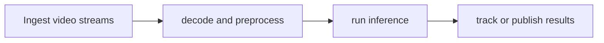

# DeepStream

[← All projects](../../README.md) · [한국어](../ko/deepstream.md)

## Overview

Real-time video analytics SDK.

## Conceptual workflow

## Workflow and use

Ingest video streams → decode and preprocess → run inference → track or publish results. This is a conceptual workflow; check the official source for version-specific prerequisites and supported configurations.

**Example use case:** analyzing multiple camera streams. Check applicability, supported inputs and model versions in the official source.

**Related technologies:** TensorRT, Metropolis, Jetson.

## Architecture and example

DeepStream constructs video analytics graphs using GStreamer plugins. Streams are decoded and batched; inference plugins can use TensorRT or Triton, and downstream plugins process results.

Batch multiple camera feeds and run a detector and tracker to analyze movement through a facility.

[Official technical source](https://docs.nvidia.com/metropolis/deepstream/dev-guide/text/DS_Overview.html)

## Availability and terms

Product SDK; samples and binaries have separate terms. Verify the exact version and the terms of any models, datasets, binaries and dependencies before use.

## Official sources

[Official page](https://developer.nvidia.com/deepstream-sdk)
