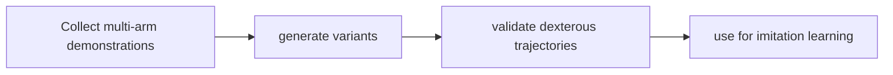

# DexMimicGen

[← All projects](../../README.md) · [한국어](../ko/dexmimicgen.md)

## Overview

Research on generating bimanual and multi-manipulator demonstrations.

## Conceptual workflow

## Workflow and use

Collect multi-arm demonstrations → generate variants → validate dexterous trajectories → use for imitation learning. This is a conceptual workflow; check the official source for version-specific prerequisites and supported configurations.

**Example use case:** generating two-arm manipulation demonstrations. Check applicability, supported inputs and model versions in the official source.

**Related technologies:** MimicGen, Isaac Lab.

## Architecture and practical details

The official release provides simulation environments and datasets for the DexMimicGen research on bimanual dexterous manipulation. Its documented workflow uses robosuite environments and generates training configurations for robomimic; code and datasets use different terms.

[Official documentation](https://github.com/NVlabs/dexmimicgen)

## Availability and terms

Code uses NVIDIA Source Code License; data uses CC-BY-4.0. Check code restrictions. Verify the exact version and the terms of any models, datasets, binaries and dependencies before use.

## Official sources

[Repository](https://github.com/NVlabs/dexmimicgen)
