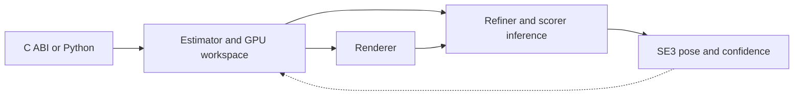

# FoundationPose Inference Library

[← Catalog](../../README.md) · [한국어](../ko/foundationpose-inference-library.md)

This library packages FoundationPose registration and tracking for deployment through a C ABI and Python bindings.

## How it works

Each estimator holds persistent CUDA workspace, an object representation and a stream. The default renderer is a CUDA rasterizer and the default inference backend is TensorRT. Registration accepts RGB uint8, depth float32 in meters, camera intrinsics and a mask. Tracking refines the previous pose without a new mask. The output is a 4×4 object-to-camera transform and a confidence score. CPU and device inputs have different copy costs.

### Component interfaces

| Component | Input | Output |
|---|---|---|
| Registration | RGB-D, camera intrinsics, mask and object representation | Initial object-to-camera pose and confidence |
| Tracking | New RGB-D frame, intrinsics and previous pose | Refined transform and confidence |
| Integration | C ABI or Python calls with host or device buffers | Pose available to a robot application |

## A practical workflow

Start with the supplied synthetic or BOP example. Next pass frames from the deployment RGB-D camera. Compare pose and latency for host buffers versus device buffers. On a memory-constrained target, evaluate smaller refinement micro-batches and observe the registration latency.

## What to verify

Check input layout and units, calibration and transform direction. Record peak VRAM and registration versus tracking latency separately. Read the version-specific platform matrix and separately licensed weights.

## License and availability

Apache-2.0 code; model weights separate.

## Official references

- [Runtime architecture and registration/tracking diagrams](https://github.com/nvidia-isaac/foundation-pose-inference-library/blob/main/doc/ARCHITECTURE.md)
- [Related official resource · github.com](https://github.com/nvidia-isaac/foundation-pose-inference-library)
