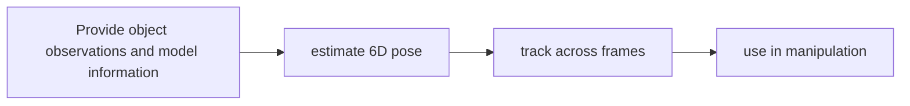

# FoundationPose

[← All projects](../../README.md) · [한국어](../ko/foundationpose.md)

Image: official project source linked below.

## Overview

Research code and models for 6D object pose estimation and tracking.

## Conceptual workflow

## Workflow and use

Provide object observations and model information → estimate 6D pose → track across frames → use in manipulation. This is a conceptual workflow; check the official source for version-specific prerequisites and supported configurations.

**Example use case:** tracking an object for robot grasping. Check applicability, supported inputs and model versions in the official source.

**Related technologies:** Isaac ROS Pose Estimation.

## Architecture and practical details

FoundationPose supports both model-based and model-free 6D pose estimation and tracking. A CAD model or a small set of reference views supplies object information; a robot can then use the inferred pose for a manipulation experiment. The research repository and separately distributed models can have different terms.

[Official documentation](https://github.com/NVlabs/FoundationPose)

## Availability and terms

Research repository code restricts commercial use; separately distributed models have separate terms. Verify the exact version and the terms of any models, datasets, binaries and dependencies before use.

## Official sources

[Code](https://github.com/NVlabs/FoundationPose) · [Model card](https://huggingface.co/nvidia/foundationpose)
