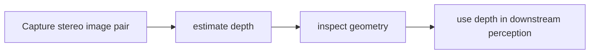

# FoundationStereo

[← All projects](../../README.md) · [한국어](../ko/foundationstereo.md)

Image: official project source linked below.

## Overview

Research code and models for stereo depth estimation.

## Conceptual workflow

## Workflow and use

Capture stereo image pair → estimate depth → inspect geometry → use depth in downstream perception. This is a conceptual workflow; check the official source for version-specific prerequisites and supported configurations.

**Example use case:** estimating scene depth from paired cameras. Check applicability, supported inputs and model versions in the official source.

**Related technologies:** Isaac ROS DNN Stereo Depth.

## Architecture and practical details

FoundationStereo accepts a stereo image pair and produces dense disparity, which can be converted to metric depth or a 3D point cloud using camera calibration. For example, use stereo depth to inspect a scene for robot perception; the research code and commercially distributed model have distinct terms.

[Official documentation](https://github.com/NVlabs/FoundationStereo)

## Availability and terms

Research code has non-commercial restrictions; check separately distributed commercial models. Verify the exact version and the terms of any models, datasets, binaries and dependencies before use.

## Official sources

[Repository](https://github.com/NVlabs/FoundationStereo)
