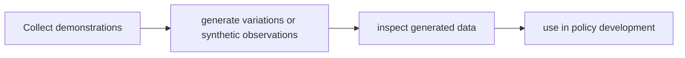

# GR00T-Mimic / GR00T-Dreams

[← All projects](../../README.md) · [한국어](../ko/groot-mimic-dreams.md)

## Overview

Robot demonstration and synthetic-data generation techniques/workflows.

## Conceptual workflow

## Workflow and use

Collect demonstrations → generate variations or synthetic observations → inspect generated data → use in policy development. This is a conceptual workflow; check the official source for version-specific prerequisites and supported configurations.

**Example use case:** expanding robot training data. Check applicability, supported inputs and model versions in the official source.

**Related technologies:** Isaac GR00T, Isaac Sim.

## Architecture and practical details

These names describe data-generation approaches rather than one automatically connected product. GR00T-Mimic concerns expanding demonstrations; GR00T-Dreams concerns synthetic data generation. The GR00T FAQ says a production-ready Cosmos synthetic-training-data pipeline is still in development, so verify availability for the chosen release.

[Official documentation](https://github.com/NVIDIA/Isaac-GR00T/blob/main/FAQ.md)

## Availability and terms

Independent project status and terms for implementations and models require individual verification. Verify the exact version and the terms of any models, datasets, binaries and dependencies before use.

## Official sources

[GR00T](https://github.com/NVIDIA/Isaac-GR00T)
