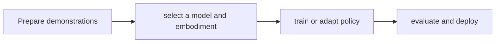

# Isaac GR00T / GR00T N1.7

[← All projects](../../README.md) · [한국어](../ko/groot-model.md)

## Overview

Robot action foundation model and platform.

## Conceptual workflow

## Workflow and use

Prepare demonstrations → select a model and embodiment → train or adapt policy → evaluate and deploy. This is a conceptual workflow; check the official source for version-specific prerequisites and supported configurations.

**Example use case:** adapting a robot policy to a task. Check applicability, supported inputs and model versions in the official source.

**Related technologies:** Isaac Capture, Isaac Lab, Isaac GR00T code.

## Architecture and practical details

GR00T N1.7 is a vision-language-action model: language and image observations, together with robot-specific configuration, support action prediction. The official workflow prepares demonstrations, performs inference or fine-tuning, evaluates in simulation or hardware, then connects a policy to a controller. Check terms for the exact checkpoint.

[Official documentation](https://github.com/NVIDIA/Isaac-GR00T)

*Image source: [Official repository](https://github.com/NVIDIA/Isaac-GR00T)*

## Availability and terms

Code and weights have separate licenses; check the model version. Verify the exact version and the terms of any models, datasets, binaries and dependencies before use.

## Official sources

[Repository](https://github.com/NVIDIA/Isaac-GR00T)
