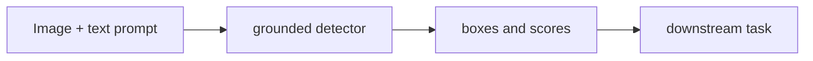

# Grounding DINO

[← All projects](../../README.md) · [한국어](../ko/grounding-dino.md) · [Official source](https://github.com/IDEA-Research/GroundingDINO) · [Documentation / related project](https://github.com/IDEA-Research/GroundingDINO)

A text-conditioned object detector from IDEA Research.

**Availability and terms:** Check the repository code license, checkpoint terms, and any third-party components separately.

## Architecture and workflow

*Conceptual illustration for this guide; refer to official sources for supported implementations.*

Provide an image and a textual object description, run inference, then filter candidate boxes by thresholds before using them.

## Use cases

Find named objects for annotation or as prompts for segmentation.

## Connections

Bounding boxes can seed a segmentation workflow such as SAM; model accuracy depends on the prompt and data.

## Official references

- [Project source](https://github.com/IDEA-Research/GroundingDINO)
- [Documentation / related project](https://github.com/IDEA-Research/GroundingDINO)
