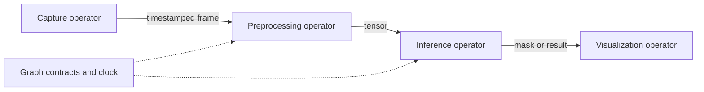

# Holoscan SDK

[← Catalog](../../README.md) · [한국어](../ko/holoscan-sdk.md)

Holoscan SDK builds streaming sensor applications that combine acquisition, accelerated processing and visualization with controlled latency.

*This 4.0 figure shows how fragments group operators and ports. The 5.0 graph API described below has different authoring primitives.* [Official figure source](https://docs.nvidia.com/holoscan/archive/4.0.0/holoscan_core.html)

## How it works

In the documented 5.0 graph API, operators declare typed input and output ports. A graph wires them together, a contract describes timing rules, and compilation resolves an execution plan. A run session activates that plan and moves samples between operators. The earlier 4.x application and fragment APIs are documented separately.

## A practical workflow

Connect a camera, image format conversion, a segmentation model and a display. Trace sample timestamps from capture to display. Add an artificial delay to inference and observe the queue behavior before tuning the graph’s latency settings.

## What to verify

Check device memory ownership, sample timing, queue policy and behavior under input bursts. Verify that examples use the API version installed in the environment.

## License and availability

Apache-2.0; external components have separate terms. Models, data, dependencies and hosted services may have separate terms; check each source before use.

## Official references

- [Architecture and workflow documentation](https://docs.nvidia.com/holoscan/sdk-user-guide/getting-started/core-concepts)
- [Holoscan 4.x core concepts](https://docs.nvidia.com/holoscan/sdk-user-guide/using-the-sdk/holoscan-core)
- [Related official resource · github.com](https://github.com/nvidia-holoscan/holoscan-sdk)
