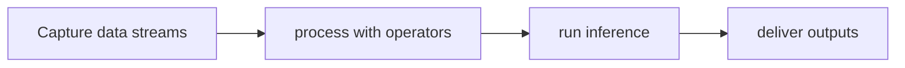

# Holoscan SDK

[Catalog](../../README.md) · [한국어](../ko/holoscan-sdk.md)

A framework for low-latency streaming and sensor AI applications.

**Official sources:** [Repository](https://github.com/nvidia-holoscan/holoscan-sdk)

**License and access:** Apache-2.0; external components have separate terms. Models, data, dependencies and hosted services may have separate terms; check each source before use.

## Workflow

The following conceptual diagram is an explanatory overview, not an official architecture diagram.

## Use case

Develop real-time sensor processing pipelines, including medical and industrial applications.

## Related technologies

CUDA, TensorRT, sensor devices. Confirm compatibility and runtime requirements in the documentation for each version.
