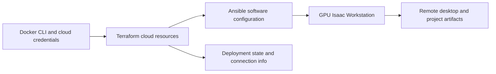

# Isaac Automator

[← Catalog](../../README.md) · [한국어](../ko/isaac-automator.md)

Isaac Automator provisions a GPU workstation for Isaac Sim, Isaac Lab or Isaac Lab-Arena in a supported public cloud. It combines infrastructure creation and software setup, then exposes a remote desktop for development and simulation.

## Architecture

| Component | Responsibility and data boundary |
|---|---|
| Local container and CLI | Provider-specific commands run from a Docker container. Deployment inputs include cloud region, GPU instance type, ingress and Isaac application refs. |
| Terraform and Ansible | Infrastructure and software configuration have separate stages. Terraform manages cloud resources and Ansible configures the workstation. Repair can target either stage. |
| `state/` and workstation | Local deployment state and connection instructions allow the CLI to find the VM. noVNC or NoMachine provides a desktop. Upload and download commands move project data between host and workstation. |

Guide diagram based on the official references below.

### Official figures and examples

Project artwork from the Isaac Automator repository. The architecture above separates the CLI, infrastructure and workstation roles. [Original figure and context](https://github.com/isaac-sim/IsaacAutomator)

## Walkthrough

1. For a reproducible policy-evaluation workstation, select a provider and GPU quota, pin the Isaac versions, and set an explicit ingress range. Record the deployment name and the provider configuration.
2. Deploy, open the connection instructions and run a known Isaac Sim scene before installing project assets or model weights. Upload a scene, run Arena, then download evaluation logs.
3. If the cloud resources are healthy but package setup failed, use the software repair path. When a session ends, choose pause or teardown based on whether you need the workstation again.

## Validation

- Keep the deployment state and any connection material in private storage. A local container restart should retain the state required for management.
- Check regional capacity and exact app version support. Stopping a workstation can leave persistent cloud resources and charges.

## License and scope

Apache-2.0 for Isaac Automator code. Cloud resources and installed software are governed by their own terms.

## Related guides

[Isaac Sim](isaac-sim.md) · [Isaac Lab](isaac-lab.md) · [Isaac Lab-Arena](isaac-lab-arena.md)

## Official references

- [Isaac Automator deployment and operations guide](https://github.com/isaac-sim/IsaacAutomator)
- [Remote desktop connection](https://github.com/isaac-sim/IsaacAutomator#connecting-to-deployed-isaac-workstation)
- [Infrastructure and software repair](https://github.com/isaac-sim/IsaacAutomator#repairing)
