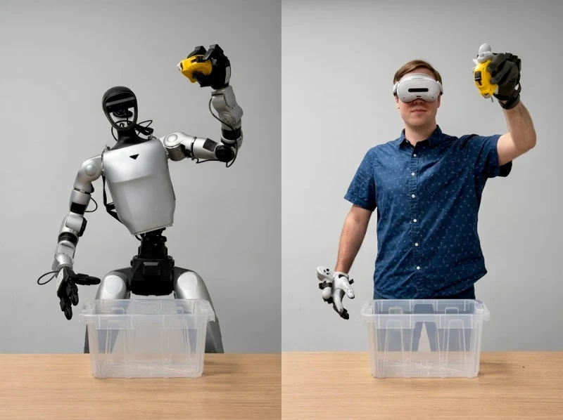

# Isaac Capture (formerly Isaac Teleop)

[← Back to catalog](../../README.md) · [한국어](../ko/isaac-capture.md)

   
  <a href="https://nvidia.github.io/IsaacCapture/main/overview/isaac_teleop.html">Representative teleoperation photo from the official Isaac Capture documentation</a>

Isaac Capture offers two collection routes for robot learning. Isaac Teleop captures what a robot actually observes and executes while an operator drives it. The ego pipeline records what a person sees and reconstructs the person’s motion for downstream processing. The routes share device and data utilities but produce different training inputs.

## Architecture and data flow

| Component | Inputs, processing and outputs |
|---|---|
| **Device plug-ins** | Tracking devices provide streams such as hand, wrist or headset poses. The plug-in exposes device data to the runtime so retargeting can be changed without rewriting device integration. |
| **Teleop and retargeting** | Robot-specific retargeters transform tracking samples into target commands for simulation or hardware. The robot environment supplies its own observations, robot state and control interface. |
| **Recording and playback** | Capture can record device streams to MCAP for replay. Dataset integrations record environment observations and actions as required by their respective learning workflow, such as LeRobot episodes for the SO-101 example. |
| **Ego pipeline** | Calibrated head-mounted footage feeds hand reconstruction and optional camera localization. The output is estimated human hand motion in camera or world coordinates for inspection and subsequent retargeting. |

NVIDIA’s overview places shared device, retargeting and data utilities underneath the teleoperation and ego pipelines. The integration boxes show how the two routes can connect to robot development stacks. [Official figure source](https://developer.nvidia.com/isaac/capture)

The Teleop diagram zooms in on the live control path. Follow device tracking through retargeting to the robot integration and distinguish live input from replayed input. [Official figure source](https://github.com/NVIDIA/IsaacCapture)

## Worked example

1. Use the official SO-101 integration to calibrate the robot and configure the supported operator device. Define a short, repeatable tabletop task.
2. Collect a few episodes with the same camera layout. Record the operator stream separately if you need to reproduce the retargeting path.
3. Replay one episode, then inspect synchronized observations, commands and the end of the trial before collecting a larger dataset.

## What to verify

- Check pose coordinate frames, orientation conventions, missing device samples and whether gripper commands map in the expected direction.
- Inspect recorded device data and the training dataset independently. Successful MCAP replay alone does not establish camera/action alignment in the dataset.

## Official references and terms

The repository defaults to Apache-2.0. EgoPost uses OpenMDW-1.1. CloudXR and optional dependencies have separate terms.

- [NVIDIA product overview](https://developer.nvidia.com/isaac/capture)
- [Isaac Capture documentation](https://nvidia.github.io/IsaacCapture/main/)
- [Source and license details](https://github.com/NVIDIA/IsaacCapture)

## Related guides

[EgoHand and EgoPost](egohand-egopost.md) · [LeRobot](lerobot.md) · [AutoData](autodata.md)
