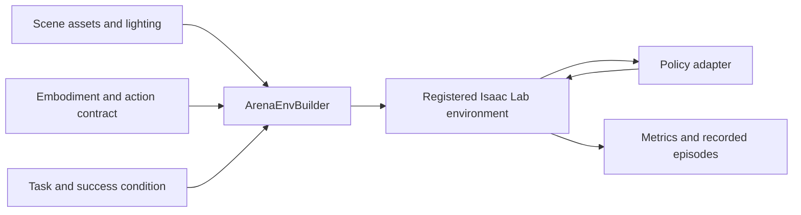

# Isaac Lab-Arena

[← Catalog](../../README.md) · [한국어](../ko/isaac-lab-arena.md)

Isaac Lab-Arena assembles robot-policy evaluation environments from reusable pieces. A benchmark can hold a task constant and vary the scene, embodiment or policy, so failures can be attributed to the changed condition.

## Architecture

| Component | Responsibility and data boundary |
|---|---|
| Scene | Provides asset instances, backgrounds and lights. A benchmark can include multiple layouts or object variants. |
| Embodiment | Specifies robot description, actions, observations and sensors. A different robot changes the policy-facing data contract. |
| Task | Defines the outcome to accomplish, such as moving an object to a target area. Keep the success condition stable when comparing policies. |
| `ArenaEnvBuilder` / policy evaluation | Compiles the three inputs into an Isaac Lab `ManagerBasedRLEnv` and registers it. Policy adapters and the evaluation runner feed actions and record results on that environment. |

Guide diagram based on the official references below.

### Official figures and examples

NVIDIA’s architecture diagram connects partner assets and task definitions to the policy evaluation framework. [Original figure and context](https://developer.nvidia.com/blog/simplify-generalist-robot-policy-evaluation-in-simulation-with-nvidia-isaac-lab-arena)

Lightwheel’s kitchen task suites show how evaluation scenes can vary while retaining a shared task interface. [Original figure and context](https://developer.nvidia.com/blog/simplify-generalist-robot-policy-evaluation-in-simulation-with-nvidia-isaac-lab-arena)

## Walkthrough

1. Define an object-placement or microwave-door task and test the success predicate with scripted actions. Pick an embodiment and validate its observations and action space against the policy interface.
2. Register an environment using `ArenaEnvBuilder`. Run the same policy over fixed initial states and a held-out kitchen layout. Retain task metadata and videos so each failure can be replayed.
3. Add a second policy or embodiment after the baseline. Report success per scene and embodiment, rather than averaging over unmatched task sets.

## Validation

- Record the policy adapter version, action convention, reset seeds and benchmark definition. Use the same episode horizon and success criteria for comparisons.
- Reusable task definitions still need compatible assets, observations and action semantics. Check support for the selected physics backend and robot.

## License and scope

Apache-2.0 for the Arena repository. Simulator, evaluation content, assets and policies have their own terms.

## Related guides

[Isaac Lab](isaac-lab.md) · [Isaac GR00T](isaac-gr00t.md) · [Isaac Sim](isaac-sim.md)

## Official references

- [Isaac Lab-Arena source](https://github.com/isaac-sim/IsaacLab-Arena)
- [Scene, embodiment and task composition](https://isaac-sim.github.io/IsaacLab-Arena/main/pages/concepts/environment/index.html)
- [Official evaluation and benchmark examples](https://developer.nvidia.com/blog/simplify-generalist-robot-policy-evaluation-in-simulation-with-nvidia-isaac-lab-arena)
