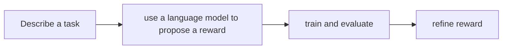

# Isaac Lab Eureka

[← All projects](../../README.md) · [한국어](../ko/isaac-lab-eureka.md)

## Overview

Research code for generating reward functions with language models.

## Conceptual workflow

## Workflow and use

Describe a task → use a language model to propose a reward → train and evaluate → refine reward. This is a conceptual workflow; check the official source for version-specific prerequisites and supported configurations.

**Example use case:** iterating on locomotion rewards. Check applicability, supported inputs and model versions in the official source.

**Related technologies:** Isaac Lab.

## Architecture and practical details

The research workflow uses a language model to propose reward functions for simulated robot tasks and evaluates candidate rewards through robot learning. As a research example, compare generated reward candidates by task performance; generated rewards and code require review and the public repository license remains unverified.

[Official documentation](https://github.com/NVlabs/IsaacLabEureka)

## Availability and terms

Public repository; applicable license unverified. Verify the exact version and the terms of any models, datasets, binaries and dependencies before use.

## Official sources

[Repository](https://github.com/NVlabs/IsaacLabEureka)
