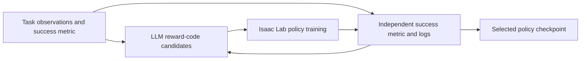

# Isaac Lab Eureka

[← Catalog](../../README.md) · [한국어](../ko/isaac-lab-eureka.md)

Isaac Lab Eureka implements the Eureka research approach for Isaac Lab tasks. An LLM proposes executable reward functions, a reinforcement learning runner trains policies with those candidates, and a separate task metric ranks the resulting policies.

## Architecture

| Component | Responsibility and data boundary |
|---|---|
| Task configuration | The port expects a `DirectRLEnv` task and reads its observation implementation. Each supported task specifies a success metric used to evaluate candidates. |
| Reward proposal and feedback | The LLM produces reward code from task context. A train attempt yields feedback and metrics or an execution failure, which the iteration loop records. |
| Training and replay | RSL RL or RL-Games trains each valid candidate. Eureka stores iteration summaries separately from RL checkpoints, which `scripts/play.py` loads for replay. |

Guide diagram based on the official references below.

### Official figures and examples

Cartpole illustration from the original Eureka research. The Isaac Lab port has its own Cartpole task and checkpoints. [Original figure and context](https://eureka-research.github.io/)

## Walkthrough

1. Begin with the documented `Isaac-Cartpole-Direct-v0` example. Establish a hand-written reward baseline and a separate evaluation criterion such as time balanced.
2. Train candidate rewards under the same budget. Inspect raw proposals and feedback in the Eureka logs and compare candidate policies using their saved checkpoints.
3. Replay the chosen policy across new initial angles and velocities. Examine the generated reward before using it in another task.

## Validation

- Track the training reward separately from the success metric. A policy can optimize a proxy while missing the intended behavior.
- The repository lists direct-workflow tasks and specific RL libraries. Generated code can fail or score deceptively well, so inspect code and rollouts.

## License and scope

The public repository README displays an MIT badge. An authoritative standalone license for this port was not verified. The paper’s original implementation is a separate project.

## Related guides

[Isaac Lab](isaac-lab.md) · [Isaac RLPT](isaac-rlpt.md)

## Official references

- [Isaac Lab port and task examples](https://github.com/NVlabs/IsaacLabEureka)
- [Supported task configuration and success metrics](https://github.com/NVlabs/IsaacLabEureka/blob/main/source/isaaclab_eureka/isaaclab_eureka/config/tasks.py)
- [Original Eureka paper and experiments](https://eureka-research.github.io/)
