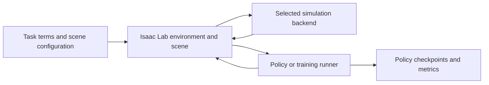

# Isaac Lab

[← Catalog](../../README.md) · [한국어](../ko/isaac-lab.md)

   
  <a href="https://github.com/isaac-sim/IsaacLab">Official Isaac Lab repository banner</a>

Isaac Lab organizes batched simulation into robot learning environments. It provides task interfaces for observations, actions, rewards and resets, and delegates stepping, articulation state and sensors to the selected backend.

## Isaac Lab 3.0

The **3.0.0 general-availability release** targets one task API across interchangeable physics, rendering, and visualization backends. The base installation can run supported tasks with Newton without Omniverse Kit. Add the Isaac Sim 6.2 extra for workflows that need the full PhysX and RTX stack, the ROS bridge, or Kit tooling. OvPhysX and OVRTX are separate backend options for compatible tasks. [Isaac Lab 3.0.0 release](https://github.com/isaac-sim/IsaacLab/releases/tag/v3.0.0) · [Backend presets](https://docs.nvidia.com/isaaclab/concepts/backends-and-presets)

The release targets Python 3.12, PyTorch 2.11 with CUDA 13.0, Newton 1.6.1, and Warp 1.17.0. For reproducible installs, use the tested dependency overrides in the installation guide, especially when enabling the Isaac Sim extra. [Isaac Lab 3.0 installation](https://docs.nvidia.com/isaaclab/isaac-lab/installation)

## Architecture

| Component | Responsibility and data boundary |
|---|---|
| `InteractiveScene` and backend | Scene configuration declares assets and sensors and organizes copies across environments. Backend presets determine the physics, rendering and scene tools available to the task. |
| `ManagerBasedRLEnv` | Managers resolve actions into actuator targets and build observations, rewards, terminations and events from task configuration. They let a task reuse terms or change a sensor without rewriting the entire environment. |
| `DirectRLEnv` | Task code supplies explicit routines for applying actions, forming observations and rewards, and resetting environments. This gives the task tighter control of its execution loop. |
| Policy runner | The learning stack consumes the batched environment interface and writes policy checkpoints. The simulator substep and policy step can run at different rates. |

Guide diagram based on the official references below.

### Official figures and examples

Isaac Lab’s official backend diagram explains where backend-specific implementations connect to the environment-facing interfaces. [Original figure and context](https://isaac-sim.github.io/IsaacLab/develop/source/concepts/backends_and_presets.html)

## Walkthrough

1. Use the manager-based cartpole example to map a state observation and an actuator action. Run a single environment first and inspect reset behavior and joint units.
2. For an arm reach task, replace the scene and define the target-pose observation, joint action and distance reward. Add a termination condition and reset distribution before increasing the number of environments.
3. Replay a checkpoint with fixed seeds, then vary target poses and physical parameters. Evaluate success and action smoothness across held-out conditions before a real robot trial.

## Validation

- Check the backend matrix before swapping PhysX, Newton, or another preset. Availability of sensors, actuators and constraints can differ by backend and release.
- Match observation order, normalization, joint convention and control rate when moving a policy to a new simulation or hardware runner.

## License and scope

Isaac Lab code is BSD-3-Clause. Backends, policy weights and assets have separate terms. [Isaac Lab 3.0 LICENSE](https://github.com/isaac-sim/IsaacLab/blob/v3.0.0/LICENSE)

## Related guides

[Isaac Sim](isaac-sim.md) · [Newton](newton.md) · [Isaac Lab-Arena](isaac-lab-arena.md) · [Isaac RLPT](isaac-rlpt.md) · [Microduck](microduck.md)

## Official references

- [Isaac Lab repository](https://github.com/isaac-sim/IsaacLab)
- [Backend options and presets](https://isaac-sim.github.io/IsaacLab/develop/source/concepts/backends_and_presets.html)
- [Manager-based environment tutorial](https://isaac-sim.github.io/IsaacLab/main/source/tutorials/03_envs/create_manager_rl_env.html)
- [Newton backend interface](https://docs.nvidia.com/isaaclab/concepts/newton)
