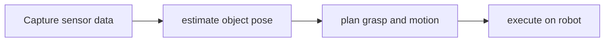

# Isaac Manipulator

[← All projects](../../README.md) · [한국어](../ko/isaac-manipulator.md)

## Overview

Reference workflows for robotic-arm perception, grasping, and planning.

## Conceptual workflow

## Workflow and use

Capture sensor data → estimate object pose → plan grasp and motion → execute on robot. This is a conceptual workflow; check the official source for version-specific prerequisites and supported configurations.

**Example use case:** picking an object using a robot arm. Check applicability, supported inputs and model versions in the official source.

**Related technologies:** Isaac ROS, FoundationPose, cuRobo.

## Architecture and practical details

A typical manipulation graph combines camera perception, object pose estimation, grasp or motion planning and robot control. For example, a robot arm can use the estimated pose of an item to plan a pick; the exact supported robots, sensors and components depend on the selected reference workflow and release.

[Official documentation](https://nvidia-isaac-ros.github.io/)

## Availability and terms

Isaac ROS packages, models, and components have different terms. Verify the exact version and the terms of any models, datasets, binaries and dependencies before use.

## Official sources

[Isaac ROS documentation](https://nvidia-isaac-ros.github.io/)
