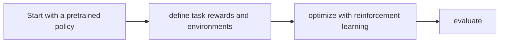

# Isaac RLPT

[← All projects](../../README.md) · [한국어](../ko/isaac-rlpt.md)

## Overview

Workflow for improving pretrained policies with reinforcement learning.

## Conceptual workflow

## Workflow and use

Start with a pretrained policy → define task rewards and environments → optimize with reinforcement learning → evaluate. This is a conceptual workflow; check the official source for version-specific prerequisites and supported configurations.

**Example use case:** improving a pretrained manipulation policy. Check applicability, supported inputs and model versions in the official source.

**Related technologies:** Isaac Lab, Isaac GR00T.

## Architecture and practical details

RL post-training starts from an existing policy and adapts it using interaction and a reward in a selected simulation environment. For a manipulation task, compare task success and robustness before and after post-training; support, implementation and available checkpoints must be checked for the specific release.

[Official documentation](https://github.com/isaac-sim/IsaacLab)

## Availability and terms

Independent repository and license unverified. Verify the exact version and the terms of any models, datasets, binaries and dependencies before use.

## Official sources

[Isaac Lab](https://github.com/isaac-sim/IsaacLab)
