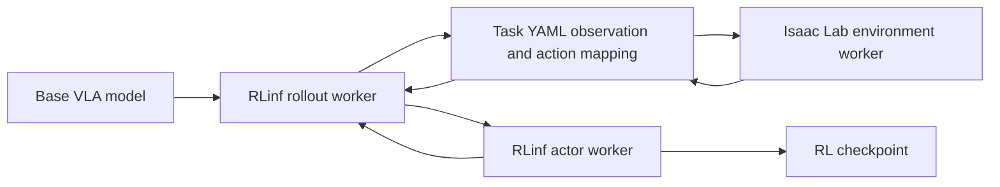

# Isaac RLPT

[← Catalog](../../README.md) · [한국어](../ko/isaac-rlpt.md)

Isaac Lab documents an experimental reinforcement learning post-training integration for pretrained vision-language-action models. RLinf runs the policy, simulation and update workers while Isaac Lab supplies task observations, actions, rewards and resets.

## Architecture

| Component | Responsibility and data boundary |
|---|---|
| Env worker | `IsaacLabGenericEnv` steps the simulator. Task YAML maps camera, language and state keys to the policy representation and converts the model action back to the environment’s joint layout. |
| Rollout worker | Runs the VLA model and collects multi-step experience by exchanging observations and actions with the environment. |
| Actor worker | Updates the policy using an RL objective such as PPO in the documented example. The base model and RL checkpoint remain separate inputs for evaluation. |

Guide diagram based on the official references below.

### Official figures and examples

NVIDIA’s GR00T N1.7 model diagram shows the vision, language and state inputs and the action output. The RLinf worker boundary is explained in the guide diagram above. [Original figure and context](https://developer.nvidia.com/blog/develop-humanoid-robot-policies-end-to-end-with-nvidia-isaac-gr00t/)

## Walkthrough

1. Reproduce the official trocar assembly task using the documented simulator, policy and RLinf versions. Run the base model first and record success and failure videos.
2. Check the task’s YAML observation keys and action conversion on one environment. Run post-training and retain the experiment config and `global_step_<N>` checkpoint.
3. Evaluate the base model and the RL checkpoint over the same reset distribution, including variations held out from training. Report task success, completion time and failure modes.

## Validation

- Validate joint slices, padding, normalization and camera order before training. A shape-compatible mapping can still send actions to the wrong joints.
- Pin the documented dependencies and check VRAM when increasing rollout parallelism. The integration is marked experimental.

## License and scope

This guide describes a documented Isaac Lab integration. Isaac Lab, RLinf, model weights, assets and simulation components each carry their own terms.

## Related guides

[Isaac Lab](isaac-lab.md) · [Isaac GR00T](isaac-gr00t.md) · [Isaac Lab-Arena](isaac-lab-arena.md)

## Official references

- [Isaac Lab RLinf architecture and task YAML](https://docs.nvidia.com/isaaclab/experimental-features/rl-post-training-for-vla-models)
- [Isaac Lab implementation](https://github.com/isaac-sim/IsaacLab)
- [RLinf source](https://github.com/RLinf/RLinf)
