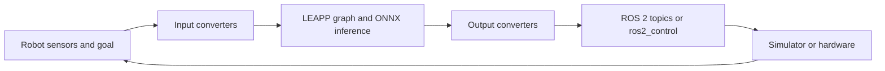

# Isaac ROS Deploy

[← Back to catalog](../../README.md) · [한국어](../ko/isaac-ros-deploy.md)

Isaac ROS Deploy executes learned policies as ROS 2 nodes or inside a ros2_control loop. It consumes a LEAPP bundle and maps the policy interface to the observation and command channels of a simulated or physical robot.

## Architecture and data flow

| Component | Inputs, processing and outputs |
|---|---|
| **Bundle and tensor semantics** | The LEAPP YAML declares graph inputs, outputs and semantics. Converters turn ROS messages or control interface data into named tensors and map outputs back to robot commands. |
| **Inference graph** | The runtime loads ONNX model artifacts and can run inference through NVIDIA Triton. Choose the ROS 2 node runtime for topic-based wiring or the ros2_control runtime for controller-loop integration. |
| **Command execution** | The optional SafetyController can blend policy commands and detect configured joint-velocity thresholds before forwarding commands to hardware. NVIDIA documents its scope and limits. |

The official UR10e reach example shows the behavior produced by the control loop. The diagram above summarizes the runtime interfaces described in the package documentation. [Official example](https://nvidia-isaac-ros.github.io/v/release-4.5/reference_workflows/isaac_for_manipulation/tutorials/sim_to_real/tutorial_sim_to_real.html)

## Worked example

1. Follow the official Isaac Lab reach-policy tutorial. Export the supported policy, configure the correct goal and robot state channels, then test in a supported simulated setup.
2. Compare graph outputs on known observations with Python inference. Verify output units and timeouts before the first hardware test, then measure full loop latency with sensors connected.

## What to verify

- Map tensor order, data type, observation timing and reference frames to the hardware configuration. A compatible tensor shape is insufficient to prove correct robot behavior.
- NVIDIA describes SafetyController as an optional runtime component without functional safety certification. Use the hardware platform’s independent safety procedures.

## Official references and terms

The repository code uses Apache-2.0. Check the terms of the chosen inference runtime and policy weights separately.

- [Isaac ROS Deploy documentation and runtime selection](https://nvidia-isaac-ros.github.io/repositories_and_packages/isaac_ros_deploy/)
- [SafetyController and control-loop wiring](https://nvidia-isaac-ros.github.io/repositories_and_packages/isaac_ros_deploy/concepts/safety.html)
- [Isaac Lab to robot reach-policy tutorial](https://nvidia-isaac-ros.github.io/v/release-4.5/reference_workflows/isaac_for_manipulation/tutorials/sim_to_real/tutorial_sim_to_real.html)
- [Code repository](https://github.com/NVIDIA-ISAAC-ROS/isaac_ros_deploy)

## Related guides

[LEAPP](leapp.md) · [Isaac Lab](isaac-lab.md) · [Isaac GR00T](isaac-gr00t.md)
