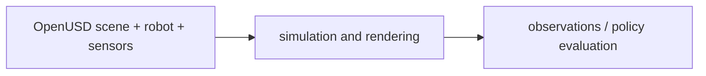

# Isaac Sim

[← All projects](../../README.md) · [한국어](../ko/isaac-sim.md) · [Official source](https://github.com/isaac-sim/IsaacSim) · [Documentation](https://docs.isaacsim.omniverse.nvidia.com/latest/index.html)

A robotics simulation application for building virtual worlds, robots and sensor workflows.

**License:** Repository code: Apache-2.0; distribution, assets and dependencies may have separate terms. Check the exact release, assets, models, and dependencies before use.

*Image: [official project repository](https://github.com/isaac-sim/IsaacSim); see the source for attribution and reuse terms.*

## Architecture

Isaac Sim combines scene authoring, physics, rendering and sensor simulation in an extensible application. Supported sensors, assets and physics features depend on the installed release.

*Conceptual workflow created for this guide; consult the official documentation for implementation details.*

## Workflow

Compose a scene from assets; add robots and sensors; simulate interactions; generate sensor observations or evaluate a robot policy.

## Use cases

Test warehouse robot behavior, generate synthetic camera data, and evaluate a policy before hardware deployment.

## Connections

OpenUSD describes the scene; PhysX supplies physics capabilities; Isaac Lab builds robot-learning workflows on compatible simulation backends. Replicator supports synthetic data generation.

## Official references

- [Project repository](https://github.com/isaac-sim/IsaacSim)
- [Documentation](https://docs.isaacsim.omniverse.nvidia.com/latest/index.html)
