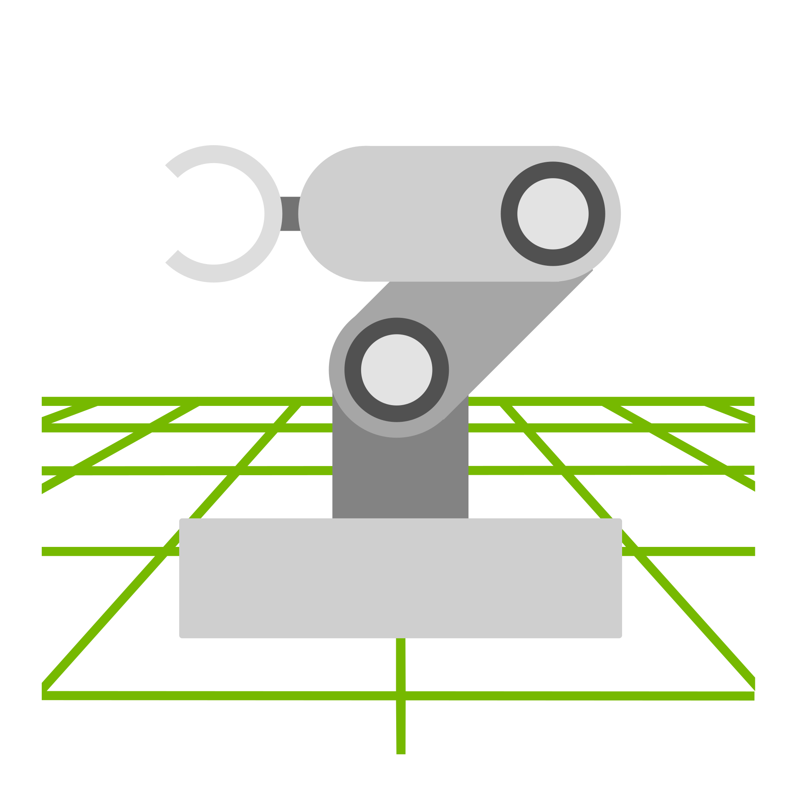
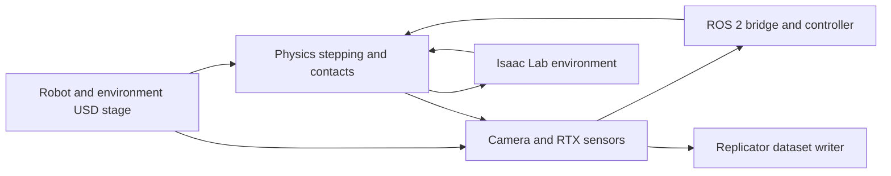

# Isaac Sim

[← Catalog](../../README.md) · [한국어](../ko/isaac-sim.md)

   
  <a href="https://github.com/isaac-sim/IsaacSim/blob/7c206f75bdadd9e05fc457f19863ca4c3f0cb693/source/deprecated/isaacsim.replicator.domain_randomization/python/nodes/icons/isaac-sim.svg">Official Isaac Sim icon</a>

Isaac Sim is a robotics simulation application that composes OpenUSD scenes, advances robot and object dynamics, and exposes simulated sensors. The same scene can be used for a ROS 2 integration test, a Replicator dataset job, or an Isaac Lab task with the appropriate setup.

## Architecture

| Component | Responsibility and data boundary |
|---|---|
| Geometry and scene authoring | Import robot geometry and composition data from formats such as URDF or USD, then define articulation, collider and drive settings. Reference environment assets as separate scene components. |
| Physics and time | The physics engine advances body poses and contacts at the physics timestep. Application logic can use different update or capture rates, so simulation time must be carried across interfaces. |
| Sensors and renderer | Camera and RTX sensor pipelines consume the composed scene and poses. Camera imagery, LiDAR outputs and physics-derived contact measurements represent different sensor paths. |
| External consumers | ROS 2 can exchange commands and publish observations. Replicator combines render products with annotators and writers. Isaac Lab reads simulator state and applies actions inside a learning environment. |

Guide diagram based on the official references below.

### Official figures and examples

NVIDIA’s reference architecture groups robot and scene authoring, interaction, data generation, and evaluation into distinct workstreams. [Original figure and context](https://docs.isaacsim.omniverse.nvidia.com/6.1.0/introduction/reference_architecture.html)

The Replicator panel shows annotations generated alongside rendered views, giving a concrete example of the dataset path. [Original figure and context](https://docs.isaacsim.omniverse.nvidia.com/6.1.0/introduction/reference_architecture.html)

## Walkthrough

1. To test obstacle avoidance, place a wheeled robot and shelves in an OpenUSD warehouse scene. Inspect collision geometry and add a LiDAR at the same pose as the physical mount.
2. Connect the ROS 2 bridge to publish sensor data and accept motion commands. Start with a scripted route and a fixed obstacle. Save point clouds, transforms and simulated time along with the robot path.
3. Introduce shelf position or lighting changes, then replay the same command sequence. For perception training, attach Replicator annotators and a writer to capture a separate labeled dataset.

## Validation

- Check the scan frame, topic timestamp and unit scale against the scene before interpreting a navigation failure.
- Record release, sensor configuration, physics timestep and update rates in experiment metadata. Inspect a sensor sample at rest before moving the robot.

## License and scope

The source repository uses Apache-2.0 for its code. Some distributed components, dependencies and assets have separate terms.

## Related guides

[OpenUSD](openusd.md) · [PhysX](nvidia-physx.md) · [Isaac Lab](isaac-lab.md) · [Replicator](replicator.md) · [ROS 2](ros-2.md)

## Official references

- [Isaac Sim source](https://github.com/isaac-sim/IsaacSim)
- [Reference architecture and task groupings](https://docs.isaacsim.omniverse.nvidia.com/6.1.0/introduction/reference_architecture.html)
- [RTX sensor interfaces](https://docs.isaacsim.omniverse.nvidia.com/6.1.0/sensors/isaacsim_sensors_rtx.html)
- [ROS 2 integration tutorials](https://docs.isaacsim.omniverse.nvidia.com/latest/ros2_tutorials/index.html)
